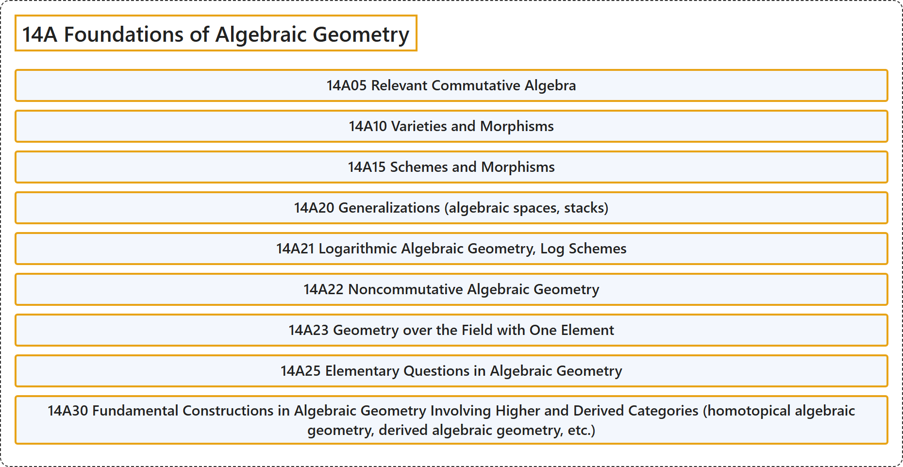

# 14A Foundations of Algebraic Geometry

## Classification

## Glossary

| Term | Definition | 中文翻译 | Source |
|---|---|---|---|
| **14A Foundations of Algebraic Geometry** 代数几何基础 | (No definition) | （无定义） | [Associate Editors of Mathematical Reviews and zbMATH, 2020](https://msc2020.org/) |
| **14A05 Relevant Commutative Algebra** 相关的交换代数 | (No definition) | （无定义） | [Associate Editors of Mathematical Reviews and zbMATH, 2020](https://msc2020.org/) |
| **14A10 Varieties and Morphisms** 簇与态射 | (No definition) | （无定义） | [Associate Editors of Mathematical Reviews and zbMATH, 2020](https://msc2020.org/) |
| **14A15 Schemes and Morphisms** 概形与态射 | (No definition) | （无定义） | [Associate Editors of Mathematical Reviews and zbMATH, 2020](https://msc2020.org/) |
| **14A20 Generalizations (algebraic spaces, stacks)** 推广（代数空间、叠） | (No definition) | （无定义） | [Associate Editors of Mathematical Reviews and zbMATH, 2020](https://msc2020.org/) |
| **14A21 Logarithmic Algebraic Geometry, Log Schemes** 对数代数几何、对数概形 | (No definition) | （无定义） | [Associate Editors of Mathematical Reviews and zbMATH, 2020](https://msc2020.org/) |
| **14A22 Noncommutative Algebraic Geometry** 非交换代数几何 | (No definition) | （无定义） | [Associate Editors of Mathematical Reviews and zbMATH, 2020](https://msc2020.org/) |
| **14A23 Geometry over the Field with One Element** 单元素域上的几何 | (No definition) | （无定义） | [Associate Editors of Mathematical Reviews and zbMATH, 2020](https://msc2020.org/) |
| **14A25 Elementary Questions in Algebraic Geometry** 代数几何中的初等问题 | (No definition) | （无定义） | [Associate Editors of Mathematical Reviews and zbMATH, 2020](https://msc2020.org/) |
| **14A30 Fundamental Constructions in Algebraic Geometry Involving Higher and Derived Categories (homotopical algebraic geometry, derived algebraic geometry, etc.)** 代数几何中涉及高阶范畴与导出范畴的基本构造（同伦代数几何、导出代数几何等） | (No definition) | （无定义） | [Associate Editors of Mathematical Reviews and zbMATH, 2020](https://msc2020.org/) |

## References

Associate Editors of Mathematical Reviews and zbMATH. (2020). *MSC2020: Mathematics Subject Classification system*. Retrieved October 27, 2026, from <https://msc2020.org/>
