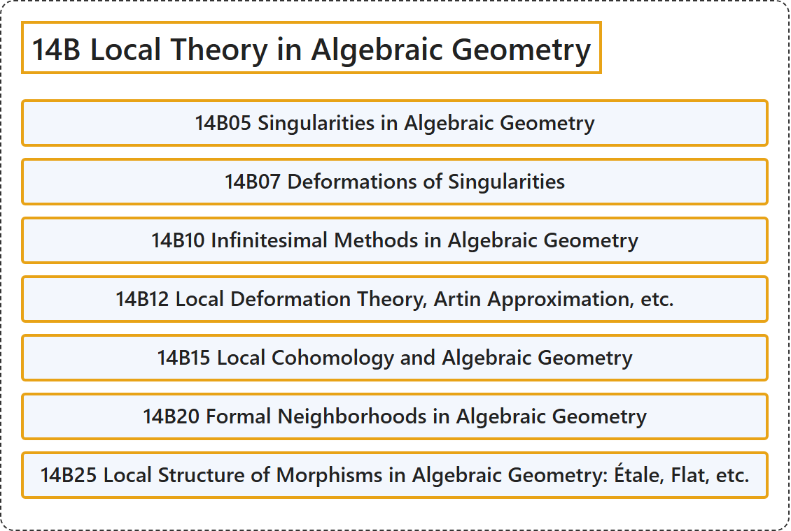

# 14B Local Theory in Algebraic Geometry

## Classification

## Glossary

| Term | Definition | 中文翻译 | Source |
|---|---|---|---|
| **14B Local Theory in Algebraic Geometry** 代数几何中的局部理论 | (No definition) | （无定义） | [Associate Editors of Mathematical Reviews and zbMATH, 2020](https://msc2020.org/) |
| **14B05 Singularities in Algebraic Geometry** 代数几何中的奇点 | (No definition) | （无定义） | [Associate Editors of Mathematical Reviews and zbMATH, 2020](https://msc2020.org/) |
| **14B07 Deformations of Singularities** 奇点的形变 | (No definition) | （无定义） | [Associate Editors of Mathematical Reviews and zbMATH, 2020](https://msc2020.org/) |
| **14B10 Infinitesimal Methods in Algebraic Geometry** 代数几何中的无穷小方法 | (No definition) | （无定义） | [Associate Editors of Mathematical Reviews and zbMATH, 2020](https://msc2020.org/) |
| **14B12 Local Deformation Theory, Artin Approximation, etc.** 局部形变理论、阿廷逼近等 | (No definition) | （无定义） | [Associate Editors of Mathematical Reviews and zbMATH, 2020](https://msc2020.org/) |
| **14B15 Local Cohomology and Algebraic Geometry** 局部上同调与代数几何 | (No definition) | （无定义） | [Associate Editors of Mathematical Reviews and zbMATH, 2020](https://msc2020.org/) |
| **14B20 Formal Neighborhoods in Algebraic Geometry** 代数几何中的形式邻域 | (No definition) | （无定义） | [Associate Editors of Mathematical Reviews and zbMATH, 2020](https://msc2020.org/) |
| **14B25 Local Structure of Morphisms in Algebraic Geometry: Étale, Flat, etc.** 代数几何中态射的局部结构：平展、平坦等 | (No definition) | （无定义） | [Associate Editors of Mathematical Reviews and zbMATH, 2020](https://msc2020.org/) |

## References

Associate Editors of Mathematical Reviews and zbMATH. (2020). *MSC2020: Mathematics Subject Classification system*. Retrieved October 27, 2026, from <https://msc2020.org/>
