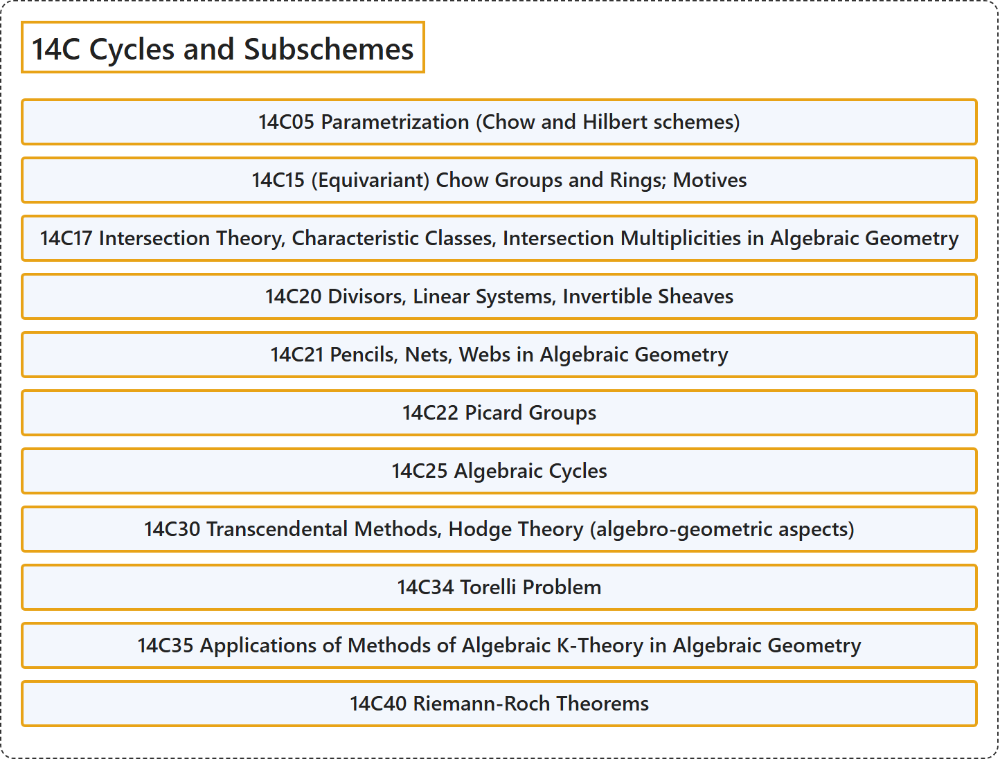

# 14C Cycles and Subschemes

## Classification

## Glossary

| Term | Definition | 中文翻译 | Source |
|---|---|---|---|
| **14C Cycles and Subschemes** 圈与子概形 | (No definition) | （无定义） | [Associate Editors of Mathematical Reviews and zbMATH, 2020](https://msc2020.org/) |
| **14C05 Parametrization (Chow and Hilbert schemes)** 参数化（周概形与希尔伯特概形） | (No definition) | （无定义） | [Associate Editors of Mathematical Reviews and zbMATH, 2020](https://msc2020.org/) |
| **14C15 (Equivariant) Chow Groups and Rings; Motives** （等变）周群与周环；motive | (No definition) | （无定义） | [Associate Editors of Mathematical Reviews and zbMATH, 2020](https://msc2020.org/) |
| **14C17 Intersection Theory, Characteristic Classes, Intersection Multiplicities in Algebraic Geometry** 代数几何中的相交理论、示性类、相交重数 | (No definition) | （无定义） | [Associate Editors of Mathematical Reviews and zbMATH, 2020](https://msc2020.org/) |
| **14C20 Divisors, Linear Systems, Invertible Sheaves** 除子、线性系、可逆层 | (No definition) | （无定义） | [Associate Editors of Mathematical Reviews and zbMATH, 2020](https://msc2020.org/) |
| **14C21 Pencils, Nets, Webs in Algebraic Geometry** 代数几何中的线束、网、网络 | (No definition) | （无定义） | [Associate Editors of Mathematical Reviews and zbMATH, 2020](https://msc2020.org/) |
| **14C22 Picard Groups** 皮卡群 | (No definition) | （无定义） | [Associate Editors of Mathematical Reviews and zbMATH, 2020](https://msc2020.org/) |
| **14C25 Algebraic Cycles** 代数闭链 | (No definition) | （无定义） | [Associate Editors of Mathematical Reviews and zbMATH, 2020](https://msc2020.org/) |
| **14C30 Transcendental Methods, Hodge Theory (algebro-geometric aspects)** 超越方法、霍奇理论（代数几何方面） | (No definition) | （无定义） | [Associate Editors of Mathematical Reviews and zbMATH, 2020](https://msc2020.org/) |
| **14C34 Torelli Problem** 托雷利问题 | (No definition) | （无定义） | [Associate Editors of Mathematical Reviews and zbMATH, 2020](https://msc2020.org/) |
| **14C35 Applications of Methods of Algebraic K-Theory in Algebraic Geometry** 代数K理论方法在代数几何中的应用 | (No definition) | （无定义） | [Associate Editors of Mathematical Reviews and zbMATH, 2020](https://msc2020.org/) |
| **14C40 Riemann-Roch Theorems** 黎曼-罗赫定理 | (No definition) | （无定义） | [Associate Editors of Mathematical Reviews and zbMATH, 2020](https://msc2020.org/) |

## References

Associate Editors of Mathematical Reviews and zbMATH. (2020). *MSC2020: Mathematics Subject Classification system*. Retrieved October 27, 2026, from <https://msc2020.org/>
