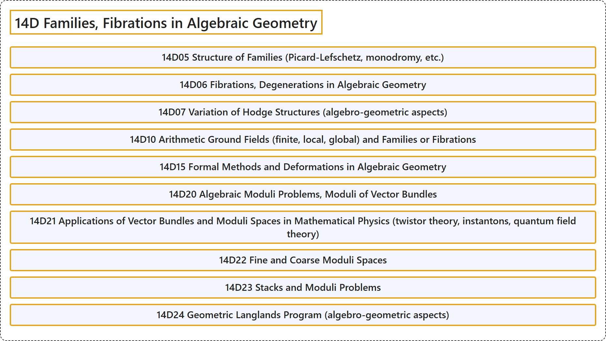

# 14D Families, Fibrations in Algebraic Geometry

## Classification

## Glossary

| Term | Definition | 中文翻译 | Source |
|---|---|---|---|
| **14D Families, Fibrations in Algebraic Geometry** 代数几何中的族、纤维化 | (No definition) | （无定义） | [Associate Editors of Mathematical Reviews and zbMATH, 2020](https://msc2020.org/) |
| **14D05 Structure of Families (Picard-Lefschetz, monodromy, etc.)** 族的结构（皮卡-莱夫谢茨、单值性等） | (No definition) | （无定义） | [Associate Editors of Mathematical Reviews and zbMATH, 2020](https://msc2020.org/) |
| **14D06 Fibrations, Degenerations in Algebraic Geometry** 代数几何中的纤维化、退化 | (No definition) | （无定义） | [Associate Editors of Mathematical Reviews and zbMATH, 2020](https://msc2020.org/) |
| **14D07 Variation of Hodge Structures (algebro-geometric aspects)** 霍奇结构的变分（代数几何方面） | (No definition) | （无定义） | [Associate Editors of Mathematical Reviews and zbMATH, 2020](https://msc2020.org/) |
| **14D10 Arithmetic Ground Fields (finite, local, global) and Families or Fibrations** 算术基域（有限、局部、整体）与族或纤维化 | (No definition) | （无定义） | [Associate Editors of Mathematical Reviews and zbMATH, 2020](https://msc2020.org/) |
| **14D15 Formal Methods and Deformations in Algebraic Geometry** 代数几何中的形式方法与形变 | (No definition) | （无定义） | [Associate Editors of Mathematical Reviews and zbMATH, 2020](https://msc2020.org/) |
| **14D20 Algebraic Moduli Problems, Moduli of Vector Bundles** 代数模问题、向量丛的模 | (No definition) | （无定义） | [Associate Editors of Mathematical Reviews and zbMATH, 2020](https://msc2020.org/) |
| **14D21 Applications of Vector Bundles and Moduli Spaces in Mathematical Physics (twistor theory, instantons, quantum field theory)** 向量丛与模空间在数学物理中的应用（扭量理论、瞬子、量子场论） | (No definition) | （无定义） | [Associate Editors of Mathematical Reviews and zbMATH, 2020](https://msc2020.org/) |
| **14D22 Fine and Coarse Moduli Spaces** 精细与粗模空间 | (No definition) | （无定义） | [Associate Editors of Mathematical Reviews and zbMATH, 2020](https://msc2020.org/) |
| **14D23 Stacks and Moduli Problems** 叠与模问题 | (No definition) | （无定义） | [Associate Editors of Mathematical Reviews and zbMATH, 2020](https://msc2020.org/) |
| **14D24 Geometric Langlands Program (algebro-geometric aspects)** 几何朗兰兹纲领（代数几何方面） | (No definition) | （无定义） | [Associate Editors of Mathematical Reviews and zbMATH, 2020](https://msc2020.org/) |

## References

Associate Editors of Mathematical Reviews and zbMATH. (2020). *MSC2020: Mathematics Subject Classification system*. Retrieved October 27, 2026, from <https://msc2020.org/>
