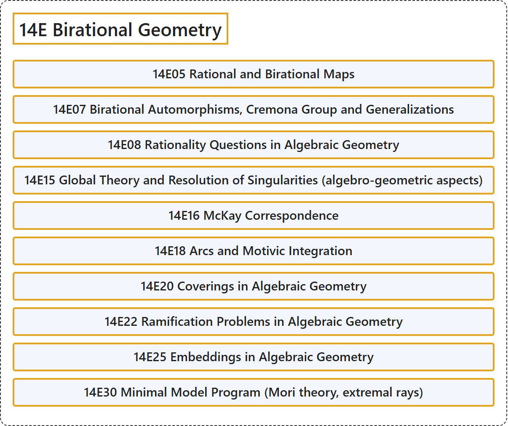

# 14E Birational Geometry

## Classification

## Glossary

| Term | Definition | 中文翻译 | Source |
|---|---|---|---|
| **14E Birational Geometry** 双有理几何 | (No definition) | （无定义） | [Associate Editors of Mathematical Reviews and zbMATH, 2020](https://msc2020.org/) |
| **14E05 Rational and Birational Maps** 有理映射与双有理映射 | (No definition) | （无定义） | [Associate Editors of Mathematical Reviews and zbMATH, 2020](https://msc2020.org/) |
| **14E07 Birational Automorphisms, Cremona Group and Generalizations** 双有理自同构、克雷莫纳群及其推广 | (No definition) | （无定义） | [Associate Editors of Mathematical Reviews and zbMATH, 2020](https://msc2020.org/) |
| **14E08 Rationality Questions in Algebraic Geometry** 代数几何中的有理性问题 | (No definition) | （无定义） | [Associate Editors of Mathematical Reviews and zbMATH, 2020](https://msc2020.org/) |
| **14E15 Global Theory and Resolution of Singularities (algebro-geometric aspects)** 整体理论与奇点解消（代数几何方面） | (No definition) | （无定义） | [Associate Editors of Mathematical Reviews and zbMATH, 2020](https://msc2020.org/) |
| **14E16 McKay Correspondence** 麦凯对应 | (No definition) | （无定义） | [Associate Editors of Mathematical Reviews and zbMATH, 2020](https://msc2020.org/) |
| **14E18 Arcs and Motivic Integration** 弧与motivic积分 | (No definition) | （无定义） | [Associate Editors of Mathematical Reviews and zbMATH, 2020](https://msc2020.org/) |
| **14E20 Coverings in Algebraic Geometry** 代数几何中的覆盖 | (No definition) | （无定义） | [Associate Editors of Mathematical Reviews and zbMATH, 2020](https://msc2020.org/) |
| **14E22 Ramification Problems in Algebraic Geometry** 代数几何中的分歧问题 | (No definition) | （无定义） | [Associate Editors of Mathematical Reviews and zbMATH, 2020](https://msc2020.org/) |
| **14E25 Embeddings in Algebraic Geometry** 代数几何中的嵌入 | (No definition) | （无定义） | [Associate Editors of Mathematical Reviews and zbMATH, 2020](https://msc2020.org/) |
| **14E30 Minimal Model Program (Mori theory, extremal rays)** 极小模型纲领（森理论、极端射线） | (No definition) | （无定义） | [Associate Editors of Mathematical Reviews and zbMATH, 2020](https://msc2020.org/) |

## References

Associate Editors of Mathematical Reviews and zbMATH. (2020). *MSC2020: Mathematics Subject Classification system*. Retrieved October 27, 2026, from <https://msc2020.org/>
