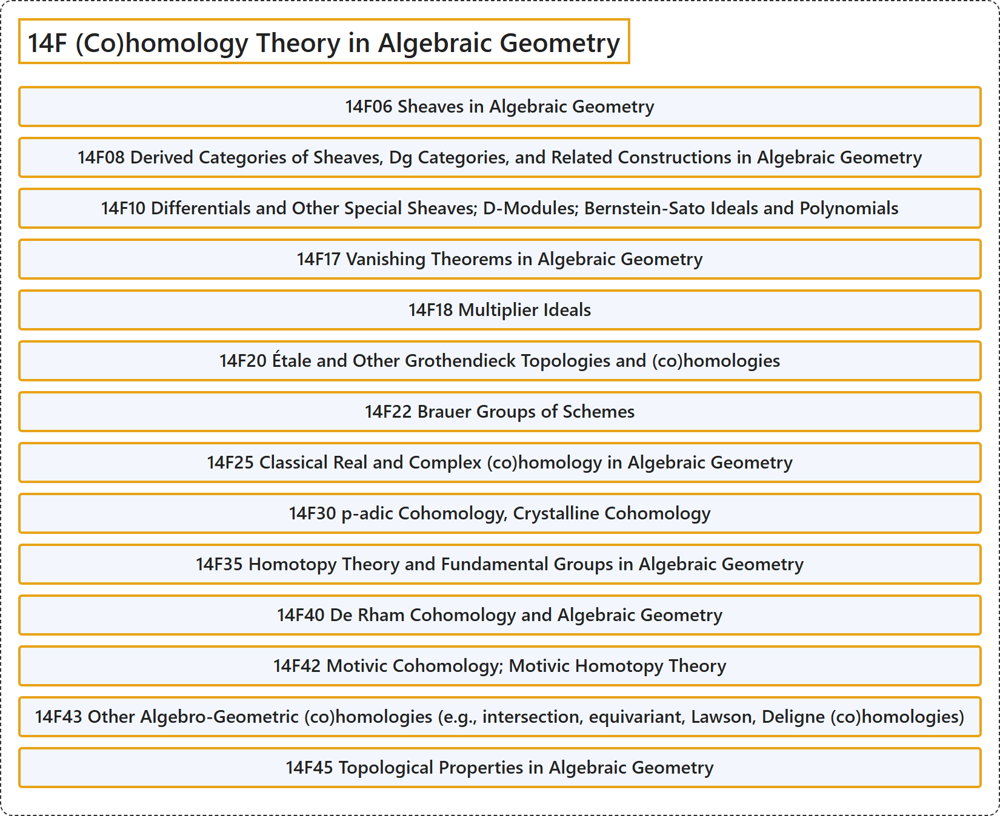

# 14F (Co)homology Theory in Algebraic Geometry

## Classification

## Glossary

| Term | Definition | 中文翻译 | Source |
|---|---|---|---|
| **14F (Co)homology Theory in Algebraic Geometry** 代数几何中的（上）同调理论 | (No definition) | （无定义） | [Associate Editors of Mathematical Reviews and zbMATH, 2020](https://msc2020.org/) |
| **14F06 Sheaves in Algebraic Geometry** 代数几何中的层 | (No definition) | （无定义） | [Associate Editors of Mathematical Reviews and zbMATH, 2020](https://msc2020.org/) |
| **14F08 Derived Categories of Sheaves, Dg Categories, and Related Constructions in Algebraic Geometry** 层的导出范畴、dg范畴及代数几何中的相关构造 | (No definition) | （无定义） | [Associate Editors of Mathematical Reviews and zbMATH, 2020](https://msc2020.org/) |
| **14F10 Differentials and Other Special Sheaves; D-Modules; Bernstein-Sato Ideals and Polynomials** 微分与其他特殊层；D模；伯恩斯坦-佐藤理想与多项式 | (No definition) | （无定义） | [Associate Editors of Mathematical Reviews and zbMATH, 2020](https://msc2020.org/) |
| **14F17 Vanishing Theorems in Algebraic Geometry** 代数几何中的消灭定理 | (No definition) | （无定义） | [Associate Editors of Mathematical Reviews and zbMATH, 2020](https://msc2020.org/) |
| **14F18 Multiplier Ideals** 乘子理想 | (No definition) | （无定义） | [Associate Editors of Mathematical Reviews and zbMATH, 2020](https://msc2020.org/) |
| **14F20 Étale and Other Grothendieck Topologies and (co)homologies** 平展及其他格罗滕迪克拓扑与（上）同调 | (No definition) | （无定义） | [Associate Editors of Mathematical Reviews and zbMATH, 2020](https://msc2020.org/) |
| **14F22 Brauer Groups of Schemes** 概形的布饶尔群 | (No definition) | （无定义） | [Associate Editors of Mathematical Reviews and zbMATH, 2020](https://msc2020.org/) |
| **14F25 Classical Real and Complex (co)homology in Algebraic Geometry** 代数几何中的经典实与复（上）同调 | (No definition) | （无定义） | [Associate Editors of Mathematical Reviews and zbMATH, 2020](https://msc2020.org/) |
| **14F30 p-adic Cohomology, Crystalline Cohomology** p进上同调、晶体上同调 | (No definition) | （无定义） | [Associate Editors of Mathematical Reviews and zbMATH, 2020](https://msc2020.org/) |
| **14F35 Homotopy Theory and Fundamental Groups in Algebraic Geometry** 代数几何中的同伦论与基本群 | (No definition) | （无定义） | [Associate Editors of Mathematical Reviews and zbMATH, 2020](https://msc2020.org/) |
| **14F40 De Rham Cohomology and Algebraic Geometry** 德拉姆上同调与代数几何 | (No definition) | （无定义） | [Associate Editors of Mathematical Reviews and zbMATH, 2020](https://msc2020.org/) |
| **14F42 Motivic Cohomology; Motivic Homotopy Theory** motivic上同调；motivic同伦论 | (No definition) | （无定义） | [Associate Editors of Mathematical Reviews and zbMATH, 2020](https://msc2020.org/) |
| **14F43 Other Algebro-Geometric (co)homologies (e.g., intersection, equivariant, Lawson, Deligne (co)homologies)** 其他代数几何（上）同调（例如相交、等变、劳森、德利涅（上）同调） | (No definition) | （无定义） | [Associate Editors of Mathematical Reviews and zbMATH, 2020](https://msc2020.org/) |
| **14F45 Topological Properties in Algebraic Geometry** 代数几何中的拓扑性质 | (No definition) | （无定义） | [Associate Editors of Mathematical Reviews and zbMATH, 2020](https://msc2020.org/) |

## References

Associate Editors of Mathematical Reviews and zbMATH. (2020). *MSC2020: Mathematics Subject Classification system*. Retrieved October 27, 2026, from <https://msc2020.org/>
