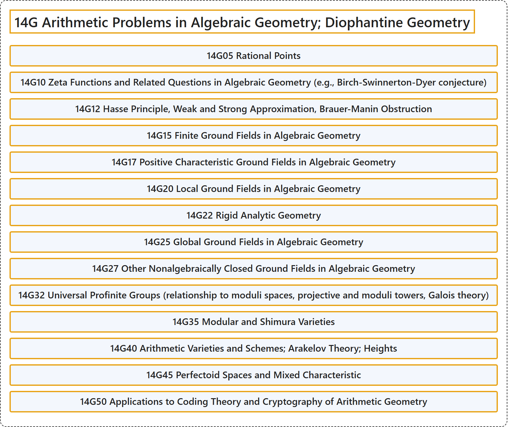

# 14G Arithmetic Problems in Algebraic Geometry; Diophantine Geometry

## Classification

## Glossary

| Term | Definition | 中文翻译 | Source |
|---|---|---|---|
| **14G Arithmetic Problems in Algebraic Geometry; Diophantine Geometry** 代数几何中的算术问题；丢番图几何 | (No definition) | （无定义） | [Associate Editors of Mathematical Reviews and zbMATH, 2020](https://msc2020.org/) |
| **14G05 Rational Points** 有理点 | (No definition) | （无定义） | [Associate Editors of Mathematical Reviews and zbMATH, 2020](https://msc2020.org/) |
| **14G10 Zeta Functions and Related Questions in Algebraic Geometry (e.g., Birch-Swinnerton-Dyer conjecture)** 代数几何中的ζ函数及相关问题（例如伯奇-斯温纳顿-戴尔猜想） | (No definition) | （无定义） | [Associate Editors of Mathematical Reviews and zbMATH, 2020](https://msc2020.org/) |
| **14G12 Hasse Principle, Weak and Strong Approximation, Brauer-Manin Obstruction** 哈塞原理、弱逼近与强逼近、布饶尔-马宁障碍 | (No definition) | （无定义） | [Associate Editors of Mathematical Reviews and zbMATH, 2020](https://msc2020.org/) |
| **14G15 Finite Ground Fields in Algebraic Geometry** 代数几何中的有限基域 | (No definition) | （无定义） | [Associate Editors of Mathematical Reviews and zbMATH, 2020](https://msc2020.org/) |
| **14G17 Positive Characteristic Ground Fields in Algebraic Geometry** 代数几何中的正特征基域 | (No definition) | （无定义） | [Associate Editors of Mathematical Reviews and zbMATH, 2020](https://msc2020.org/) |
| **14G20 Local Ground Fields in Algebraic Geometry** 代数几何中的局部基域 | (No definition) | （无定义） | [Associate Editors of Mathematical Reviews and zbMATH, 2020](https://msc2020.org/) |
| **14G22 Rigid Analytic Geometry** 刚性解析几何 | (No definition) | （无定义） | [Associate Editors of Mathematical Reviews and zbMATH, 2020](https://msc2020.org/) |
| **14G25 Global Ground Fields in Algebraic Geometry** 代数几何中的整体基域 | (No definition) | （无定义） | [Associate Editors of Mathematical Reviews and zbMATH, 2020](https://msc2020.org/) |
| **14G27 Other Nonalgebraically Closed Ground Fields in Algebraic Geometry** 其他非代数闭基域上的代数几何 | (No definition) | （无定义） | [Associate Editors of Mathematical Reviews and zbMATH, 2020](https://msc2020.org/) |
| **14G32 Universal Profinite Groups (relationship to moduli spaces, projective and moduli towers, Galois theory)** 万有射有限群（与模空间的关系、射影塔与模塔、伽罗瓦理论） | (No definition) | （无定义） | [Associate Editors of Mathematical Reviews and zbMATH, 2020](https://msc2020.org/) |
| **14G35 Modular and Shimura Varieties** 模簇与志村簇 | (No definition) | （无定义） | [Associate Editors of Mathematical Reviews and zbMATH, 2020](https://msc2020.org/) |
| **14G40 Arithmetic Varieties and Schemes; Arakelov Theory; Heights** 算术簇与算术概形；阿拉凯洛夫理论；高度 | (No definition) | （无定义） | [Associate Editors of Mathematical Reviews and zbMATH, 2020](https://msc2020.org/) |
| **14G45 Perfectoid Spaces and Mixed Characteristic** 完美胚空间与混合特征 | (No definition) | （无定义） | [Associate Editors of Mathematical Reviews and zbMATH, 2020](https://msc2020.org/) |
| **14G50 Applications to Coding Theory and Cryptography of Arithmetic Geometry** 算术几何在编码理论与密码学中的应用 | (No definition) | （无定义） | [Associate Editors of Mathematical Reviews and zbMATH, 2020](https://msc2020.org/) |

## References

Associate Editors of Mathematical Reviews and zbMATH. (2020). *MSC2020: Mathematics Subject Classification system*. Retrieved October 27, 2026, from <https://msc2020.org/>
