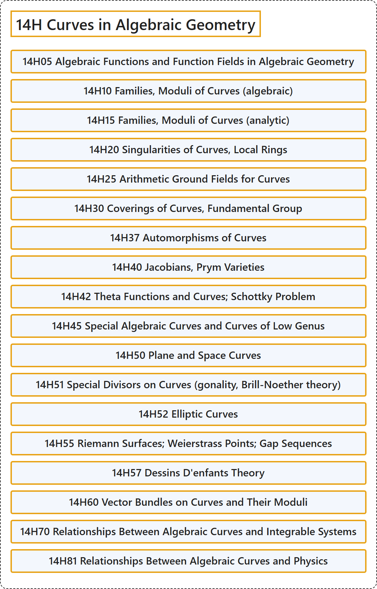

# 14H Curves in Algebraic Geometry

## Classification

## Glossary

| Term | Definition | 中文翻译 | Source |
|---|---|---|---|
| **14H Curves in Algebraic Geometry** 代数几何中的曲线 | (No definition) | （无定义） | [Associate Editors of Mathematical Reviews and zbMATH, 2020](https://msc2020.org/) |
| **14H05 Algebraic Functions and Function Fields in Algebraic Geometry** 代数几何中的代数函数与函数域 | (No definition) | （无定义） | [Associate Editors of Mathematical Reviews and zbMATH, 2020](https://msc2020.org/) |
| **14H10 Families, Moduli of Curves (algebraic)** 曲线族、曲线的模（代数） | (No definition) | （无定义） | [Associate Editors of Mathematical Reviews and zbMATH, 2020](https://msc2020.org/) |
| **14H15 Families, Moduli of Curves (analytic)** 曲线族、曲线的模（解析） | (No definition) | （无定义） | [Associate Editors of Mathematical Reviews and zbMATH, 2020](https://msc2020.org/) |
| **14H20 Singularities of Curves, Local Rings** 曲线的奇点、局部环 | (No definition) | （无定义） | [Associate Editors of Mathematical Reviews and zbMATH, 2020](https://msc2020.org/) |
| **14H25 Arithmetic Ground Fields for Curves** 曲线的算术基域 | (No definition) | （无定义） | [Associate Editors of Mathematical Reviews and zbMATH, 2020](https://msc2020.org/) |
| **14H30 Coverings of Curves, Fundamental Group** 曲线的覆盖、基本群 | (No definition) | （无定义） | [Associate Editors of Mathematical Reviews and zbMATH, 2020](https://msc2020.org/) |
| **14H37 Automorphisms of Curves** 曲线的自同构 | (No definition) | （无定义） | [Associate Editors of Mathematical Reviews and zbMATH, 2020](https://msc2020.org/) |
| **14H40 Jacobians, Prym Varieties** 雅可比簇、普吕姆簇 | (No definition) | （无定义） | [Associate Editors of Mathematical Reviews and zbMATH, 2020](https://msc2020.org/) |
| **14H42 Theta Functions and Curves; Schottky Problem** θ函数与曲线；肖特基问题 | (No definition) | （无定义） | [Associate Editors of Mathematical Reviews and zbMATH, 2020](https://msc2020.org/) |
| **14H45 Special Algebraic Curves and Curves of Low Genus** 特殊代数曲线与低亏格曲线 | (No definition) | （无定义） | [Associate Editors of Mathematical Reviews and zbMATH, 2020](https://msc2020.org/) |
| **14H50 Plane and Space Curves** 平面曲线与空间曲线 | (No definition) | （无定义） | [Associate Editors of Mathematical Reviews and zbMATH, 2020](https://msc2020.org/) |
| **14H51 Special Divisors on Curves (gonality, Brill-Noether theory)** 曲线上的特殊除子（滚动度、布里尔-诺特理论） | (No definition) | （无定义） | [Associate Editors of Mathematical Reviews and zbMATH, 2020](https://msc2020.org/) |
| **14H52 Elliptic Curves** 椭圆曲线 | (No definition) | （无定义） | [Associate Editors of Mathematical Reviews and zbMATH, 2020](https://msc2020.org/) |
| **14H55 Riemann Surfaces; Weierstrass Points; Gap Sequences** 黎曼曲面；魏尔斯特拉斯点；间隙序列 | (No definition) | （无定义） | [Associate Editors of Mathematical Reviews and zbMATH, 2020](https://msc2020.org/) |
| **14H57 Dessins D'enfants Theory** 儿童画理论 | (No definition) | （无定义） | [Associate Editors of Mathematical Reviews and zbMATH, 2020](https://msc2020.org/) |
| **14H60 Vector Bundles on Curves and Their Moduli** 曲线上的向量丛及其模 | (No definition) | （无定义） | [Associate Editors of Mathematical Reviews and zbMATH, 2020](https://msc2020.org/) |
| **14H70 Relationships Between Algebraic Curves and Integrable Systems** 代数曲线与可积系统之间的关系 | (No definition) | （无定义） | [Associate Editors of Mathematical Reviews and zbMATH, 2020](https://msc2020.org/) |
| **14H81 Relationships Between Algebraic Curves and Physics** 代数曲线与物理学之间的关系 | (No definition) | （无定义） | [Associate Editors of Mathematical Reviews and zbMATH, 2020](https://msc2020.org/) |

## References

Associate Editors of Mathematical Reviews and zbMATH. (2020). *MSC2020: Mathematics Subject Classification system*. Retrieved October 27, 2026, from <https://msc2020.org/>
