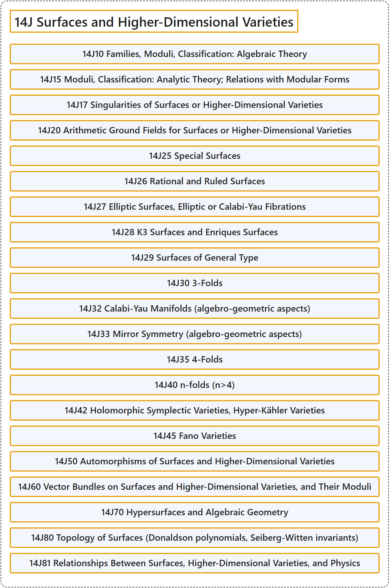

# 14J Surfaces and Higher-Dimensional Varieties

## Classification

## Glossary

| Term | Definition | 中文翻译 | Source |
|---|---|---|---|
| **14J Surfaces and Higher-Dimensional Varieties** 曲面与高维簇 | (No definition) | （无定义） | [Associate Editors of Mathematical Reviews and zbMATH, 2020](https://msc2020.org/) |
| **14J10 Families, Moduli, Classification: Algebraic Theory** 族、模、分类：代数理论 | (No definition) | （无定义） | [Associate Editors of Mathematical Reviews and zbMATH, 2020](https://msc2020.org/) |
| **14J15 Moduli, Classification: Analytic Theory; Relations with Modular Forms** 模、分类：解析理论；与模形式的关系 | (No definition) | （无定义） | [Associate Editors of Mathematical Reviews and zbMATH, 2020](https://msc2020.org/) |
| **14J17 Singularities of Surfaces or Higher-Dimensional Varieties** 曲面或高维簇的奇点 | (No definition) | （无定义） | [Associate Editors of Mathematical Reviews and zbMATH, 2020](https://msc2020.org/) |
| **14J20 Arithmetic Ground Fields for Surfaces or Higher-Dimensional Varieties** 曲面或高维簇的算术基域 | (No definition) | （无定义） | [Associate Editors of Mathematical Reviews and zbMATH, 2020](https://msc2020.org/) |
| **14J25 Special Surfaces** 特殊曲面 | (No definition) | （无定义） | [Associate Editors of Mathematical Reviews and zbMATH, 2020](https://msc2020.org/) |
| **14J26 Rational and Ruled Surfaces** 有理曲面与直纹曲面 | (No definition) | （无定义） | [Associate Editors of Mathematical Reviews and zbMATH, 2020](https://msc2020.org/) |
| **14J27 Elliptic Surfaces, Elliptic or Calabi-Yau Fibrations** 椭圆曲面、椭圆纤维化或卡拉比-丘纤维化 | (No definition) | （无定义） | [Associate Editors of Mathematical Reviews and zbMATH, 2020](https://msc2020.org/) |
| **14J28 K3 Surfaces and Enriques Surfaces** K3曲面与恩里克斯曲面 | (No definition) | （无定义） | [Associate Editors of Mathematical Reviews and zbMATH, 2020](https://msc2020.org/) |
| **14J29 Surfaces of General Type** 一般型曲面 | (No definition) | （无定义） | [Associate Editors of Mathematical Reviews and zbMATH, 2020](https://msc2020.org/) |
| **14J30 3-Folds** 三重形 | (No definition) | （无定义） | [Associate Editors of Mathematical Reviews and zbMATH, 2020](https://msc2020.org/) |
| **14J32 Calabi-Yau Manifolds (algebro-geometric aspects)** 卡拉比-丘流形（代数几何方面） | (No definition) | （无定义） | [Associate Editors of Mathematical Reviews and zbMATH, 2020](https://msc2020.org/) |
| **14J33 Mirror Symmetry (algebro-geometric aspects)** 镜像对称（代数几何方面） | (No definition) | （无定义） | [Associate Editors of Mathematical Reviews and zbMATH, 2020](https://msc2020.org/) |
| **14J35 4-Folds** 四重形 | (No definition) | （无定义） | [Associate Editors of Mathematical Reviews and zbMATH, 2020](https://msc2020.org/) |
| **14J40 n-folds (n>4)** n重形（n>4） | (No definition) | （无定义） | [Associate Editors of Mathematical Reviews and zbMATH, 2020](https://msc2020.org/) |
| **14J42 Holomorphic Symplectic Varieties, Hyper-Kähler Varieties** 全纯辛簇、超凯勒簇 | (No definition) | （无定义） | [Associate Editors of Mathematical Reviews and zbMATH, 2020](https://msc2020.org/) |
| **14J45 Fano Varieties** 法诺簇 | (No definition) | （无定义） | [Associate Editors of Mathematical Reviews and zbMATH, 2020](https://msc2020.org/) |
| **14J50 Automorphisms of Surfaces and Higher-Dimensional Varieties** 曲面与高维簇的自同构 | (No definition) | （无定义） | [Associate Editors of Mathematical Reviews and zbMATH, 2020](https://msc2020.org/) |
| **14J60 Vector Bundles on Surfaces and Higher-Dimensional Varieties, and Their Moduli** 曲面与高维簇上的向量丛及其模 | (No definition) | （无定义） | [Associate Editors of Mathematical Reviews and zbMATH, 2020](https://msc2020.org/) |
| **14J70 Hypersurfaces and Algebraic Geometry** 超曲面与代数几何 | (No definition) | （无定义） | [Associate Editors of Mathematical Reviews and zbMATH, 2020](https://msc2020.org/) |
| **14J80 Topology of Surfaces (Donaldson polynomials, Seiberg-Witten invariants)** 曲面的拓扑（唐纳森多项式、赛伯格-威滕不变量） | (No definition) | （无定义） | [Associate Editors of Mathematical Reviews and zbMATH, 2020](https://msc2020.org/) |
| **14J81 Relationships Between Surfaces, Higher-Dimensional Varieties, and Physics** 曲面、高维簇与物理学之间的关系 | (No definition) | （无定义） | [Associate Editors of Mathematical Reviews and zbMATH, 2020](https://msc2020.org/) |

## References

Associate Editors of Mathematical Reviews and zbMATH. (2020). *MSC2020: Mathematics Subject Classification system*. Retrieved October 27, 2026, from <https://msc2020.org/>
