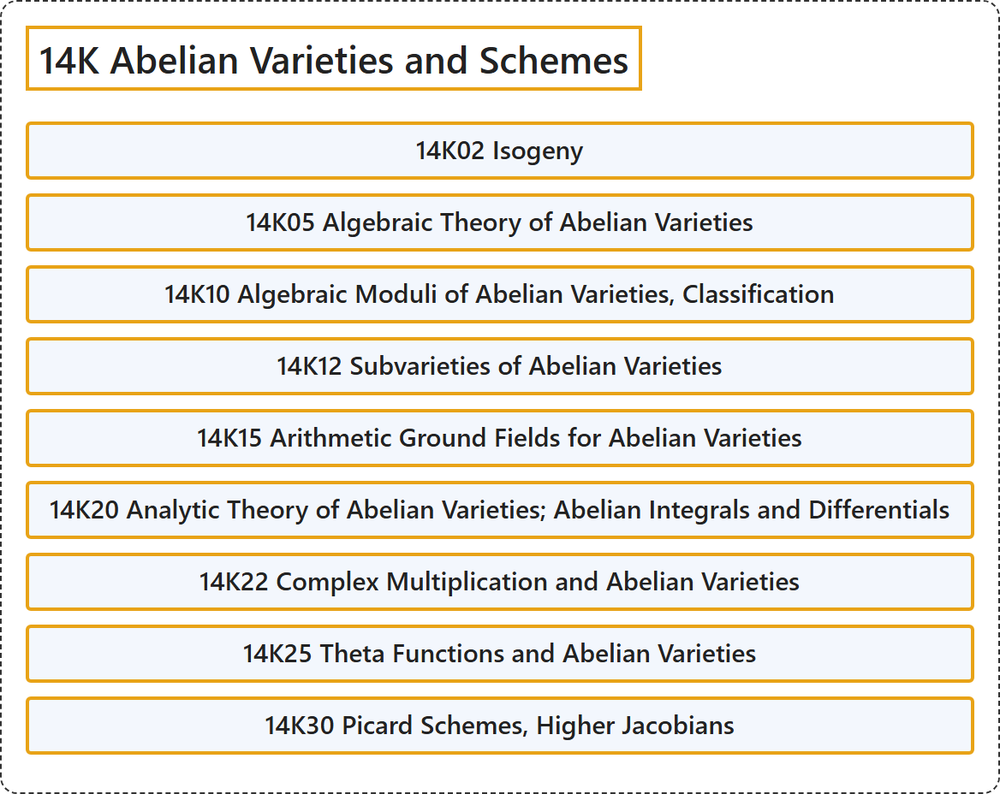

# 14K Abelian Varieties and Schemes

## Classification

## Glossary

| Term | Definition | 中文翻译 | Source |
|---|---|---|---|
| **14K Abelian Varieties and Schemes** 阿贝尔簇与阿贝尔概形 | (No definition) | （无定义） | [Associate Editors of Mathematical Reviews and zbMATH, 2020](https://msc2020.org/) |
| **14K02 Isogeny** 同源 | (No definition) | （无定义） | [Associate Editors of Mathematical Reviews and zbMATH, 2020](https://msc2020.org/) |
| **14K05 Algebraic Theory of Abelian Varieties** 阿贝尔簇的代数理论 | (No definition) | （无定义） | [Associate Editors of Mathematical Reviews and zbMATH, 2020](https://msc2020.org/) |
| **14K10 Algebraic Moduli of Abelian Varieties, Classification** 阿贝尔簇的代数模、分类 | (No definition) | （无定义） | [Associate Editors of Mathematical Reviews and zbMATH, 2020](https://msc2020.org/) |
| **14K12 Subvarieties of Abelian Varieties** 阿贝尔簇的子簇 | (No definition) | （无定义） | [Associate Editors of Mathematical Reviews and zbMATH, 2020](https://msc2020.org/) |
| **14K15 Arithmetic Ground Fields for Abelian Varieties** 阿贝尔簇的算术基域 | (No definition) | （无定义） | [Associate Editors of Mathematical Reviews and zbMATH, 2020](https://msc2020.org/) |
| **14K20 Analytic Theory of Abelian Varieties; Abelian Integrals and Differentials** 阿贝尔簇的解析理论；阿贝尔积分与阿贝尔微分 | (No definition) | （无定义） | [Associate Editors of Mathematical Reviews and zbMATH, 2020](https://msc2020.org/) |
| **14K22 Complex Multiplication and Abelian Varieties** 复乘法与阿贝尔簇 | (No definition) | （无定义） | [Associate Editors of Mathematical Reviews and zbMATH, 2020](https://msc2020.org/) |
| **14K25 Theta Functions and Abelian Varieties** θ函数与阿贝尔簇 | (No definition) | （无定义） | [Associate Editors of Mathematical Reviews and zbMATH, 2020](https://msc2020.org/) |
| **14K30 Picard Schemes, Higher Jacobians** 皮卡概形、高阶雅可比簇 | (No definition) | （无定义） | [Associate Editors of Mathematical Reviews and zbMATH, 2020](https://msc2020.org/) |

## References

Associate Editors of Mathematical Reviews and zbMATH. (2020). *MSC2020: Mathematics Subject Classification system*. Retrieved October 27, 2026, from <https://msc2020.org/>
