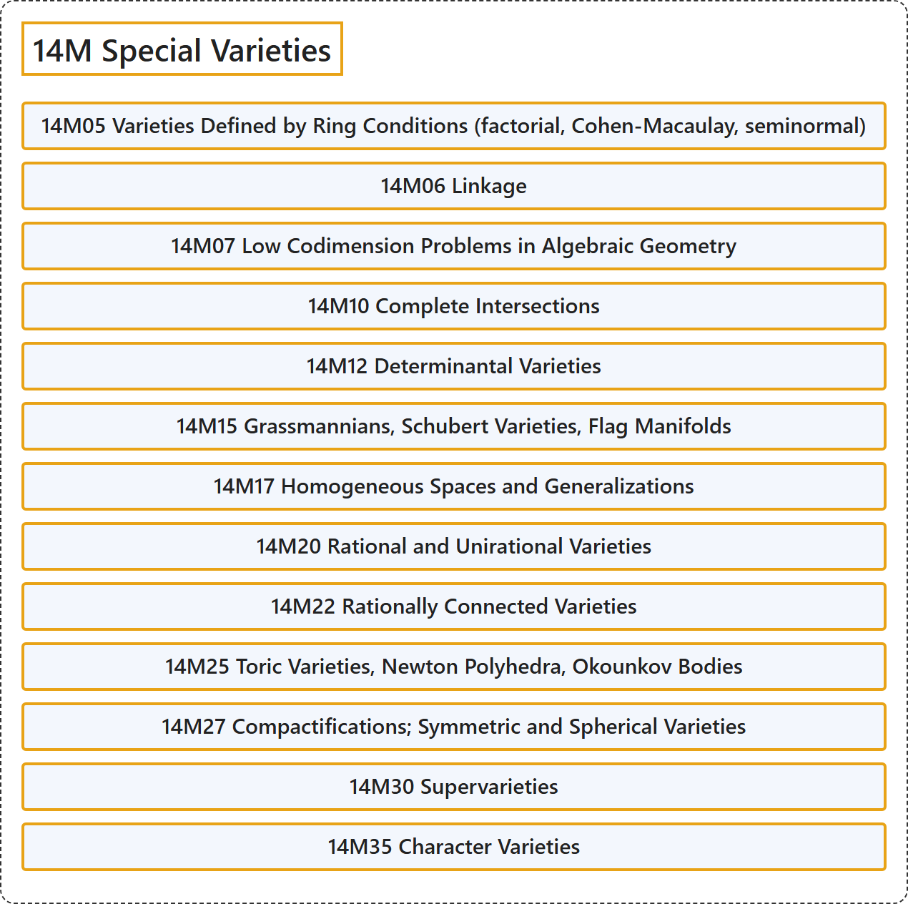

# 14M Special Varieties

## Classification

## Glossary

| Term | Definition | 中文翻译 | Source |
|---|---|---|---|
| **14M Special Varieties** 特殊簇 | (No definition) | （无定义） | [Associate Editors of Mathematical Reviews and zbMATH, 2020](https://msc2020.org/) |
| **14M05 Varieties Defined by Ring Conditions (factorial, Cohen-Macaulay, seminormal)** 由环条件定义的簇（唯一分解、科恩-麦考利、半正规） | (No definition) | （无定义） | [Associate Editors of Mathematical Reviews and zbMATH, 2020](https://msc2020.org/) |
| **14M06 Linkage** 联络 | (No definition) | （无定义） | [Associate Editors of Mathematical Reviews and zbMATH, 2020](https://msc2020.org/) |
| **14M07 Low Codimension Problems in Algebraic Geometry** 代数几何中的低余维数问题 | (No definition) | （无定义） | [Associate Editors of Mathematical Reviews and zbMATH, 2020](https://msc2020.org/) |
| **14M10 Complete Intersections** 完全交 | (No definition) | （无定义） | [Associate Editors of Mathematical Reviews and zbMATH, 2020](https://msc2020.org/) |
| **14M12 Determinantal Varieties** 行列式簇 | (No definition) | （无定义） | [Associate Editors of Mathematical Reviews and zbMATH, 2020](https://msc2020.org/) |
| **14M15 Grassmannians, Schubert Varieties, Flag Manifolds** 格拉斯曼流形、舒伯特簇、旗流形 | (No definition) | （无定义） | [Associate Editors of Mathematical Reviews and zbMATH, 2020](https://msc2020.org/) |
| **14M17 Homogeneous Spaces and Generalizations** 齐性空间及其推广 | (No definition) | （无定义） | [Associate Editors of Mathematical Reviews and zbMATH, 2020](https://msc2020.org/) |
| **14M20 Rational and Unirational Varieties** 有理簇与单有理簇 | (No definition) | （无定义） | [Associate Editors of Mathematical Reviews and zbMATH, 2020](https://msc2020.org/) |
| **14M22 Rationally Connected Varieties** 有理连通簇 | (No definition) | （无定义） | [Associate Editors of Mathematical Reviews and zbMATH, 2020](https://msc2020.org/) |
| **14M25 Toric Varieties, Newton Polyhedra, Okounkov Bodies** 环面簇、牛顿多面体、奥孔科夫体 | (No definition) | （无定义） | [Associate Editors of Mathematical Reviews and zbMATH, 2020](https://msc2020.org/) |
| **14M27 Compactifications; Symmetric and Spherical Varieties** 紧化；对称簇与球簇 | (No definition) | （无定义） | [Associate Editors of Mathematical Reviews and zbMATH, 2020](https://msc2020.org/) |
| **14M30 Supervarieties** 超簇 | (No definition) | （无定义） | [Associate Editors of Mathematical Reviews and zbMATH, 2020](https://msc2020.org/) |
| **14M35 Character Varieties** 特征标簇 | (No definition) | （无定义） | [Associate Editors of Mathematical Reviews and zbMATH, 2020](https://msc2020.org/) |

## References

Associate Editors of Mathematical Reviews and zbMATH. (2020). *MSC2020: Mathematics Subject Classification system*. Retrieved October 27, 2026, from <https://msc2020.org/>
