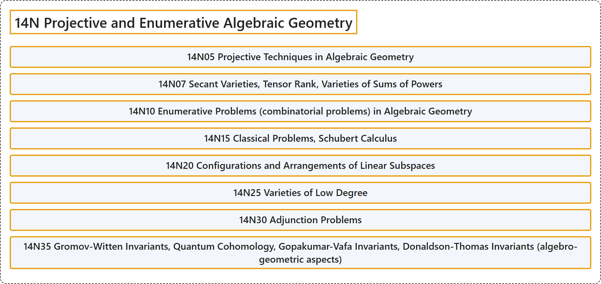

# 14N Projective and Enumerative Algebraic Geometry

## Classification

## Glossary

| Term | Definition | 中文翻译 | Source |
|---|---|---|---|
| **14N Projective and Enumerative Algebraic Geometry** 射影与计数代数几何 | (No definition) | （无定义） | [Associate Editors of Mathematical Reviews and zbMATH, 2020](https://msc2020.org/) |
| **14N05 Projective Techniques in Algebraic Geometry** 代数几何中的射影技术 | (No definition) | （无定义） | [Associate Editors of Mathematical Reviews and zbMATH, 2020](https://msc2020.org/) |
| **14N07 Secant Varieties, Tensor Rank, Varieties of Sums of Powers** 割线簇、张量秩、幂和簇 | (No definition) | （无定义） | [Associate Editors of Mathematical Reviews and zbMATH, 2020](https://msc2020.org/) |
| **14N10 Enumerative Problems (combinatorial problems) in Algebraic Geometry** 代数几何中的计数问题（组合问题） | (No definition) | （无定义） | [Associate Editors of Mathematical Reviews and zbMATH, 2020](https://msc2020.org/) |
| **14N15 Classical Problems, Schubert Calculus** 经典问题、舒伯特演算 | (No definition) | （无定义） | [Associate Editors of Mathematical Reviews and zbMATH, 2020](https://msc2020.org/) |
| **14N20 Configurations and Arrangements of Linear Subspaces** 线性子空间的构形与排列 | (No definition) | （无定义） | [Associate Editors of Mathematical Reviews and zbMATH, 2020](https://msc2020.org/) |
| **14N25 Varieties of Low Degree** 低次数簇 | (No definition) | （无定义） | [Associate Editors of Mathematical Reviews and zbMATH, 2020](https://msc2020.org/) |
| **14N30 Adjunction Problems** 附加问题 | (No definition) | （无定义） | [Associate Editors of Mathematical Reviews and zbMATH, 2020](https://msc2020.org/) |
| **14N35 Gromov-Witten Invariants, Quantum Cohomology, Gopakumar-Vafa Invariants, Donaldson-Thomas Invariants (algebro-geometric aspects)** 格罗莫夫-威滕不变量、量子上同调、Gopakumar-Vafa不变量、唐纳森-托马斯不变量（代数几何方面） | (No definition) | （无定义） | [Associate Editors of Mathematical Reviews and zbMATH, 2020](https://msc2020.org/) |

## References

Associate Editors of Mathematical Reviews and zbMATH. (2020). *MSC2020: Mathematics Subject Classification system*. Retrieved October 27, 2026, from <https://msc2020.org/>
