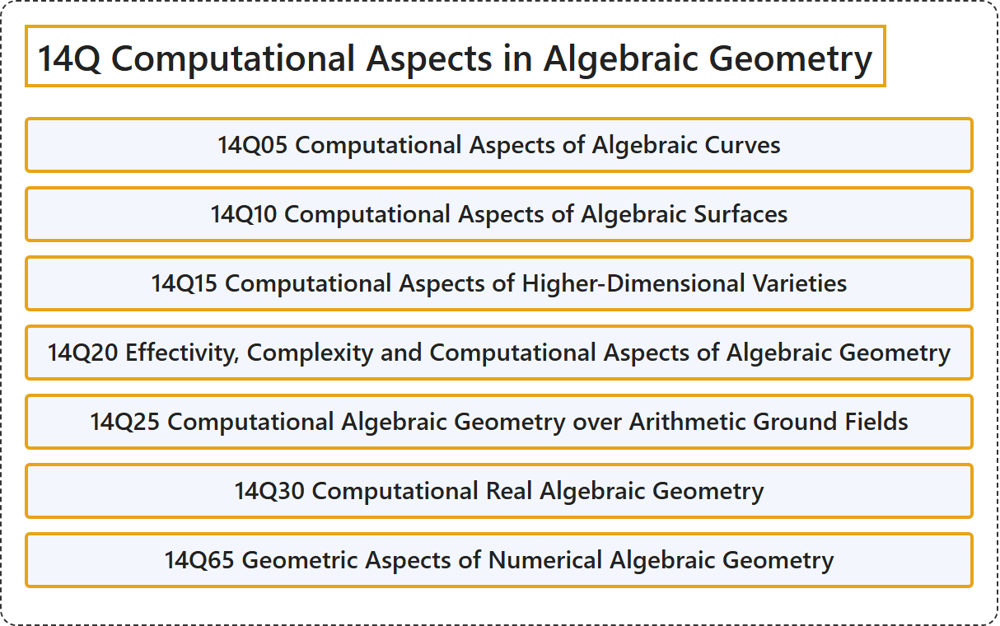

# 14Q Computational Aspects in Algebraic Geometry

## Classification

## Glossary

| Term | Definition | 中文翻译 | Source |
|---|---|---|---|
| **14Q Computational Aspects in Algebraic Geometry** 代数几何中的计算方面 | (No definition) | （无定义） | [Associate Editors of Mathematical Reviews and zbMATH, 2020](https://msc2020.org/) |
| **14Q05 Computational Aspects of Algebraic Curves** 代数曲线的计算方面 | (No definition) | （无定义） | [Associate Editors of Mathematical Reviews and zbMATH, 2020](https://msc2020.org/) |
| **14Q10 Computational Aspects of Algebraic Surfaces** 代数曲面的计算方面 | (No definition) | （无定义） | [Associate Editors of Mathematical Reviews and zbMATH, 2020](https://msc2020.org/) |
| **14Q15 Computational Aspects of Higher-Dimensional Varieties** 高维簇的计算方面 | (No definition) | （无定义） | [Associate Editors of Mathematical Reviews and zbMATH, 2020](https://msc2020.org/) |
| **14Q20 Effectivity, Complexity and Computational Aspects of Algebraic Geometry** 代数几何的有效性、复杂度与计算方面 | (No definition) | （无定义） | [Associate Editors of Mathematical Reviews and zbMATH, 2020](https://msc2020.org/) |
| **14Q25 Computational Algebraic Geometry over Arithmetic Ground Fields** 算术基域上的计算代数几何 | (No definition) | （无定义） | [Associate Editors of Mathematical Reviews and zbMATH, 2020](https://msc2020.org/) |
| **14Q30 Computational Real Algebraic Geometry** 计算实代数几何 | (No definition) | （无定义） | [Associate Editors of Mathematical Reviews and zbMATH, 2020](https://msc2020.org/) |
| **14Q65 Geometric Aspects of Numerical Algebraic Geometry** 数值代数几何的几何方面 | (No definition) | （无定义） | [Associate Editors of Mathematical Reviews and zbMATH, 2020](https://msc2020.org/) |

## References

Associate Editors of Mathematical Reviews and zbMATH. (2020). *MSC2020: Mathematics Subject Classification system*. Retrieved October 27, 2026, from <https://msc2020.org/>
