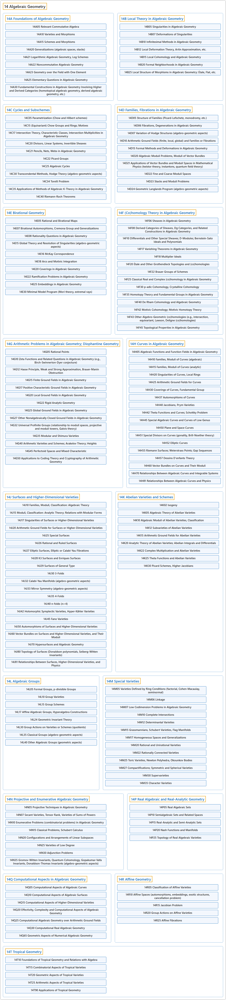

# 14 Algebraic Geometry

## Classification

## Glossary

| Term | Definition | 中文翻译 | Source |
|---|---|---|---|
| **14 Algebraic Geometry** 代数几何 | "Algebraic geometry is the study of **geometries that come from algebra**, in particular, from rings." | 代数几何研究**来自代数的几何**，特别是来自环的几何。 | [Weisstein, n.d., "Algebraic geometry" entry, para. 1](https://mathworld.wolfram.com/AlgebraicGeometry.html#:~:text=Algebraic%20geometry%20is%20the%20study%20of%20geometries%20that%20come%20from%20algebra) |
| **[14A Foundations of Algebraic Geometry](14a-foundations-of-algebraic-geometry.md)** 代数几何基础 | (No definition) | （无定义） | [Associate Editors of Mathematical Reviews and zbMATH, 2020](https://msc2020.org/) |
| **[14B Local Theory in Algebraic Geometry](14b-local-theory-in-algebraic-geometry.md)** 代数几何中的局部理论 | (No definition) | （无定义） | [Associate Editors of Mathematical Reviews and zbMATH, 2020](https://msc2020.org/) |
| **[14C Cycles and Subschemes](14c-cycles-and-subschemes.md)** 圈与子概形 | (No definition) | （无定义） | [Associate Editors of Mathematical Reviews and zbMATH, 2020](https://msc2020.org/) |
| **[14D Families, Fibrations in Algebraic Geometry](14d-families-fibrations-in-algebraic-geometry.md)** 代数几何中的族、纤维化 | (No definition) | （无定义） | [Associate Editors of Mathematical Reviews and zbMATH, 2020](https://msc2020.org/) |
| **[14E Birational Geometry](14e-birational-geometry.md)** 双有理几何 | (No definition) | （无定义） | [Associate Editors of Mathematical Reviews and zbMATH, 2020](https://msc2020.org/) |
| **[14F (Co)homology Theory in Algebraic Geometry](14f-co-homology-theory-in-algebraic-geometry.md)** 代数几何中的（上）同调理论 | (No definition) | （无定义） | [Associate Editors of Mathematical Reviews and zbMATH, 2020](https://msc2020.org/) |
| **[14G Arithmetic Problems in Algebraic Geometry; Diophantine Geometry](14g-arithmetic-problems-in-algebraic-geometry-diophantine-geomet.md)** 代数几何中的算术问题；丢番图几何 | (No definition) | （无定义） | [Associate Editors of Mathematical Reviews and zbMATH, 2020](https://msc2020.org/) |
| **[14H Curves in Algebraic Geometry](14h-curves-in-algebraic-geometry.md)** 代数几何中的曲线 | (No definition) | （无定义） | [Associate Editors of Mathematical Reviews and zbMATH, 2020](https://msc2020.org/) |
| **[14J Surfaces and Higher-Dimensional Varieties](14j-surfaces-and-higher-dimensional-varieties.md)** 曲面与高维簇 | (No definition) | （无定义） | [Associate Editors of Mathematical Reviews and zbMATH, 2020](https://msc2020.org/) |
| **[14K Abelian Varieties and Schemes](14k-abelian-varieties-and-schemes.md)** 阿贝尔簇与阿贝尔概形 | (No definition) | （无定义） | [Associate Editors of Mathematical Reviews and zbMATH, 2020](https://msc2020.org/) |
| **[14L Algebraic Groups](14l-algebraic-groups.md)** 代数群 | (No definition) | （无定义） | [Associate Editors of Mathematical Reviews and zbMATH, 2020](https://msc2020.org/) |
| **[14M Special Varieties](14m-special-varieties.md)** 特殊簇 | (No definition) | （无定义） | [Associate Editors of Mathematical Reviews and zbMATH, 2020](https://msc2020.org/) |
| **[14N Projective and Enumerative Algebraic Geometry](14n-projective-and-enumerative-algebraic-geometry.md)** 射影与计数代数几何 | (No definition) | （无定义） | [Associate Editors of Mathematical Reviews and zbMATH, 2020](https://msc2020.org/) |
| **[14P Real Algebraic and Real-Analytic Geometry](14p-real-algebraic-and-real-analytic-geometry.md)** 实代数几何与实解析几何 | (No definition) | （无定义） | [Associate Editors of Mathematical Reviews and zbMATH, 2020](https://msc2020.org/) |
| **[14Q Computational Aspects in Algebraic Geometry](14q-computational-aspects-in-algebraic-geometry.md)** 代数几何中的计算方面 | (No definition) | （无定义） | [Associate Editors of Mathematical Reviews and zbMATH, 2020](https://msc2020.org/) |
| **[14R Affine Geometry](14r-affine-geometry.md)** 仿射几何 | (No definition) | （无定义） | [Associate Editors of Mathematical Reviews and zbMATH, 2020](https://msc2020.org/) |
| **[14T Tropical Geometry](14t-tropical-geometry.md)** 热带几何 | (No definition) | （无定义） | [Associate Editors of Mathematical Reviews and zbMATH, 2020](https://msc2020.org/) |

## References

Associate Editors of Mathematical Reviews and zbMATH. (2020). *MSC2020: Mathematics Subject Classification system*. Retrieved October 27, 2026, from <https://msc2020.org/>

Weisstein, E. W. (n.d.). *Algebraic geometry*. MathWorld: A Wolfram Resource. Retrieved October 27, 2026, from <https://mathworld.wolfram.com/AlgebraicGeometry.html>
