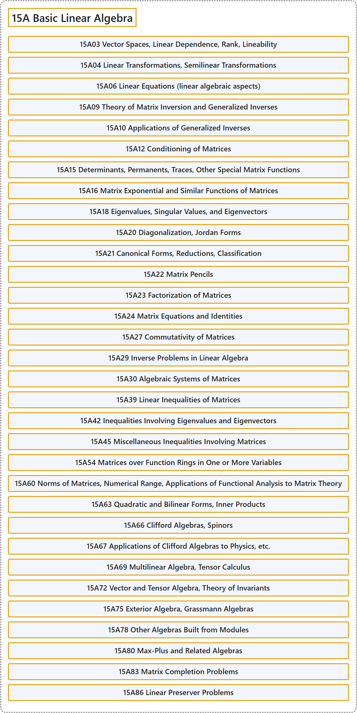

# 15A Basic Linear Algebra

## Classification

## Glossary

| Term | Definition | 中文翻译 | Source |
|---|---|---|---|
| **15A Basic Linear Algebra** 基础线性代数 | (No definition) | （无定义） | [Associate Editors of Mathematical Reviews and zbMATH, 2020](https://msc2020.org/) |
| **15A03 Vector Spaces, Linear Dependence, Rank, Lineability** 向量空间、线性相关、秩、可线性性 | (No definition) | （无定义） | [Associate Editors of Mathematical Reviews and zbMATH, 2020](https://msc2020.org/) |
| **15A04 Linear Transformations, Semilinear Transformations** 线性变换、半线性变换 | (No definition) | （无定义） | [Associate Editors of Mathematical Reviews and zbMATH, 2020](https://msc2020.org/) |
| **15A06 Linear Equations (linear algebraic aspects)** 线性方程（线性代数方面） | (No definition) | （无定义） | [Associate Editors of Mathematical Reviews and zbMATH, 2020](https://msc2020.org/) |
| **15A09 Theory of Matrix Inversion and Generalized Inverses** 矩阵求逆理论与广义逆 | (No definition) | （无定义） | [Associate Editors of Mathematical Reviews and zbMATH, 2020](https://msc2020.org/) |
| **15A10 Applications of Generalized Inverses** 广义逆的应用 | (No definition) | （无定义） | [Associate Editors of Mathematical Reviews and zbMATH, 2020](https://msc2020.org/) |
| **15A12 Conditioning of Matrices** 矩阵的条件数 | (No definition) | （无定义） | [Associate Editors of Mathematical Reviews and zbMATH, 2020](https://msc2020.org/) |
| **15A15 Determinants, Permanents, Traces, Other Special Matrix Functions** 行列式、积和式、迹、其他特殊矩阵函数 | (No definition) | （无定义） | [Associate Editors of Mathematical Reviews and zbMATH, 2020](https://msc2020.org/) |
| **15A16 Matrix Exponential and Similar Functions of Matrices** 矩阵指数及矩阵的类似函数 | (No definition) | （无定义） | [Associate Editors of Mathematical Reviews and zbMATH, 2020](https://msc2020.org/) |
| **15A18 Eigenvalues, Singular Values, and Eigenvectors** 特征值、奇异值与特征向量 | (No definition) | （无定义） | [Associate Editors of Mathematical Reviews and zbMATH, 2020](https://msc2020.org/) |
| **15A20 Diagonalization, Jordan Forms** 对角化、若尔当标准形 | (No definition) | （无定义） | [Associate Editors of Mathematical Reviews and zbMATH, 2020](https://msc2020.org/) |
| **15A21 Canonical Forms, Reductions, Classification** 标准形、约化、分类 | (No definition) | （无定义） | [Associate Editors of Mathematical Reviews and zbMATH, 2020](https://msc2020.org/) |
| **15A22 Matrix Pencils** 矩阵束 | (No definition) | （无定义） | [Associate Editors of Mathematical Reviews and zbMATH, 2020](https://msc2020.org/) |
| **15A23 Factorization of Matrices** 矩阵的分解 | (No definition) | （无定义） | [Associate Editors of Mathematical Reviews and zbMATH, 2020](https://msc2020.org/) |
| **15A24 Matrix Equations and Identities** 矩阵方程与恒等式 | (No definition) | （无定义） | [Associate Editors of Mathematical Reviews and zbMATH, 2020](https://msc2020.org/) |
| **15A27 Commutativity of Matrices** 矩阵的可交换性 | (No definition) | （无定义） | [Associate Editors of Mathematical Reviews and zbMATH, 2020](https://msc2020.org/) |
| **15A29 Inverse Problems in Linear Algebra** 线性代数中的反问题 | (No definition) | （无定义） | [Associate Editors of Mathematical Reviews and zbMATH, 2020](https://msc2020.org/) |
| **15A30 Algebraic Systems of Matrices** 矩阵的代数系统 | (No definition) | （无定义） | [Associate Editors of Mathematical Reviews and zbMATH, 2020](https://msc2020.org/) |
| **15A39 Linear Inequalities of Matrices** 矩阵的线性不等式 | (No definition) | （无定义） | [Associate Editors of Mathematical Reviews and zbMATH, 2020](https://msc2020.org/) |
| **15A42 Inequalities Involving Eigenvalues and Eigenvectors** 涉及特征值与特征向量的不等式 | (No definition) | （无定义） | [Associate Editors of Mathematical Reviews and zbMATH, 2020](https://msc2020.org/) |
| **15A45 Miscellaneous Inequalities Involving Matrices** 涉及矩阵的杂项不等式 | (No definition) | （无定义） | [Associate Editors of Mathematical Reviews and zbMATH, 2020](https://msc2020.org/) |
| **15A54 Matrices over Function Rings in One or More Variables** 一个或多个变量的函数环上的矩阵 | (No definition) | （无定义） | [Associate Editors of Mathematical Reviews and zbMATH, 2020](https://msc2020.org/) |
| **15A60 Norms of Matrices, Numerical Range, Applications of Functional Analysis to Matrix Theory** 矩阵的范数、数值域、泛函分析在矩阵理论中的应用 | (No definition) | （无定义） | [Associate Editors of Mathematical Reviews and zbMATH, 2020](https://msc2020.org/) |
| **15A63 Quadratic and Bilinear Forms, Inner Products** 二次型与双线性型、内积 | (No definition) | （无定义） | [Associate Editors of Mathematical Reviews and zbMATH, 2020](https://msc2020.org/) |
| **15A66 Clifford Algebras, Spinors** 克利福德代数、旋量 | (No definition) | （无定义） | [Associate Editors of Mathematical Reviews and zbMATH, 2020](https://msc2020.org/) |
| **15A67 Applications of Clifford Algebras to Physics, etc.** 克利福德代数在物理学等方面的应用 | (No definition) | （无定义） | [Associate Editors of Mathematical Reviews and zbMATH, 2020](https://msc2020.org/) |
| **15A69 Multilinear Algebra, Tensor Calculus** 多重线性代数、张量演算 | (No definition) | （无定义） | [Associate Editors of Mathematical Reviews and zbMATH, 2020](https://msc2020.org/) |
| **15A72 Vector and Tensor Algebra, Theory of Invariants** 向量与张量代数、不变量理论 | (No definition) | （无定义） | [Associate Editors of Mathematical Reviews and zbMATH, 2020](https://msc2020.org/) |
| **15A75 Exterior Algebra, Grassmann Algebras** 外代数、格拉斯曼代数 | (No definition) | （无定义） | [Associate Editors of Mathematical Reviews and zbMATH, 2020](https://msc2020.org/) |
| **15A78 Other Algebras Built from Modules** 由模构造的其他代数 | (No definition) | （无定义） | [Associate Editors of Mathematical Reviews and zbMATH, 2020](https://msc2020.org/) |
| **15A80 Max-Plus and Related Algebras** 最大加代数及相关代数 | (No definition) | （无定义） | [Associate Editors of Mathematical Reviews and zbMATH, 2020](https://msc2020.org/) |
| **15A83 Matrix Completion Problems** 矩阵补全问题 | (No definition) | （无定义） | [Associate Editors of Mathematical Reviews and zbMATH, 2020](https://msc2020.org/) |
| **15A86 Linear Preserver Problems** 线性保持问题 | (No definition) | （无定义） | [Associate Editors of Mathematical Reviews and zbMATH, 2020](https://msc2020.org/) |

## References

Associate Editors of Mathematical Reviews and zbMATH. (2020). *MSC2020: Mathematics Subject Classification system*. Retrieved October 27, 2026, from <https://msc2020.org/>
