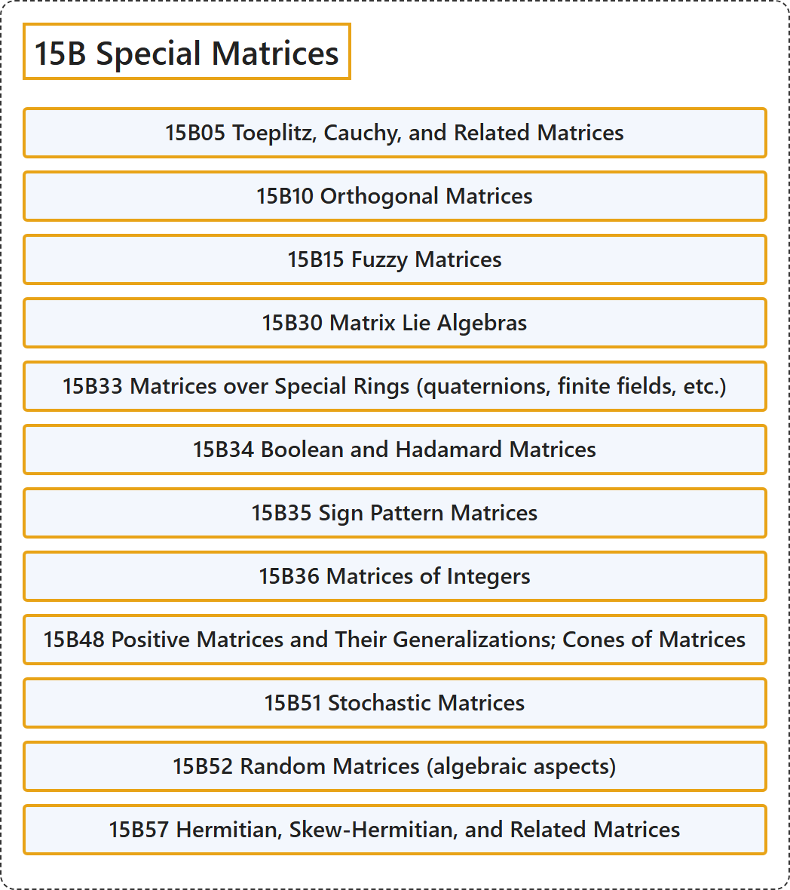

# 15B Special Matrices

## Classification

## Glossary

| Term | Definition | 中文翻译 | Source |
|---|---|---|---|
| **15B Special Matrices** 特殊矩阵 | (No definition) | （无定义） | [Associate Editors of Mathematical Reviews and zbMATH, 2020](https://msc2020.org/) |
| **15B05 Toeplitz, Cauchy, and Related Matrices** 托普利茨矩阵、柯西矩阵及相关矩阵 | (No definition) | （无定义） | [Associate Editors of Mathematical Reviews and zbMATH, 2020](https://msc2020.org/) |
| **15B10 Orthogonal Matrices** 正交矩阵 | (No definition) | （无定义） | [Associate Editors of Mathematical Reviews and zbMATH, 2020](https://msc2020.org/) |
| **15B15 Fuzzy Matrices** 模糊矩阵 | (No definition) | （无定义） | [Associate Editors of Mathematical Reviews and zbMATH, 2020](https://msc2020.org/) |
| **15B30 Matrix Lie Algebras** 矩阵李代数 | (No definition) | （无定义） | [Associate Editors of Mathematical Reviews and zbMATH, 2020](https://msc2020.org/) |
| **15B33 Matrices over Special Rings (quaternions, finite fields, etc.)** 特殊环上的矩阵（四元数、有限域等） | (No definition) | （无定义） | [Associate Editors of Mathematical Reviews and zbMATH, 2020](https://msc2020.org/) |
| **15B34 Boolean and Hadamard Matrices** 布尔矩阵与阿达马矩阵 | (No definition) | （无定义） | [Associate Editors of Mathematical Reviews and zbMATH, 2020](https://msc2020.org/) |
| **15B35 Sign Pattern Matrices** 符号模式矩阵 | (No definition) | （无定义） | [Associate Editors of Mathematical Reviews and zbMATH, 2020](https://msc2020.org/) |
| **15B36 Matrices of Integers** 整数矩阵 | (No definition) | （无定义） | [Associate Editors of Mathematical Reviews and zbMATH, 2020](https://msc2020.org/) |
| **15B48 Positive Matrices and Their Generalizations; Cones of Matrices** 正矩阵及其推广；矩阵锥 | (No definition) | （无定义） | [Associate Editors of Mathematical Reviews and zbMATH, 2020](https://msc2020.org/) |
| **15B51 Stochastic Matrices** 随机矩阵 | (No definition) | （无定义） | [Associate Editors of Mathematical Reviews and zbMATH, 2020](https://msc2020.org/) |
| **15B52 Random Matrices (algebraic aspects)** 随机矩阵（代数方面） | (No definition) | （无定义） | [Associate Editors of Mathematical Reviews and zbMATH, 2020](https://msc2020.org/) |
| **15B57 Hermitian, Skew-Hermitian, and Related Matrices** 埃尔米特矩阵、斜埃尔米特矩阵及相关矩阵 | (No definition) | （无定义） | [Associate Editors of Mathematical Reviews and zbMATH, 2020](https://msc2020.org/) |

## References

Associate Editors of Mathematical Reviews and zbMATH. (2020). *MSC2020: Mathematics Subject Classification system*. Retrieved October 27, 2026, from <https://msc2020.org/>
