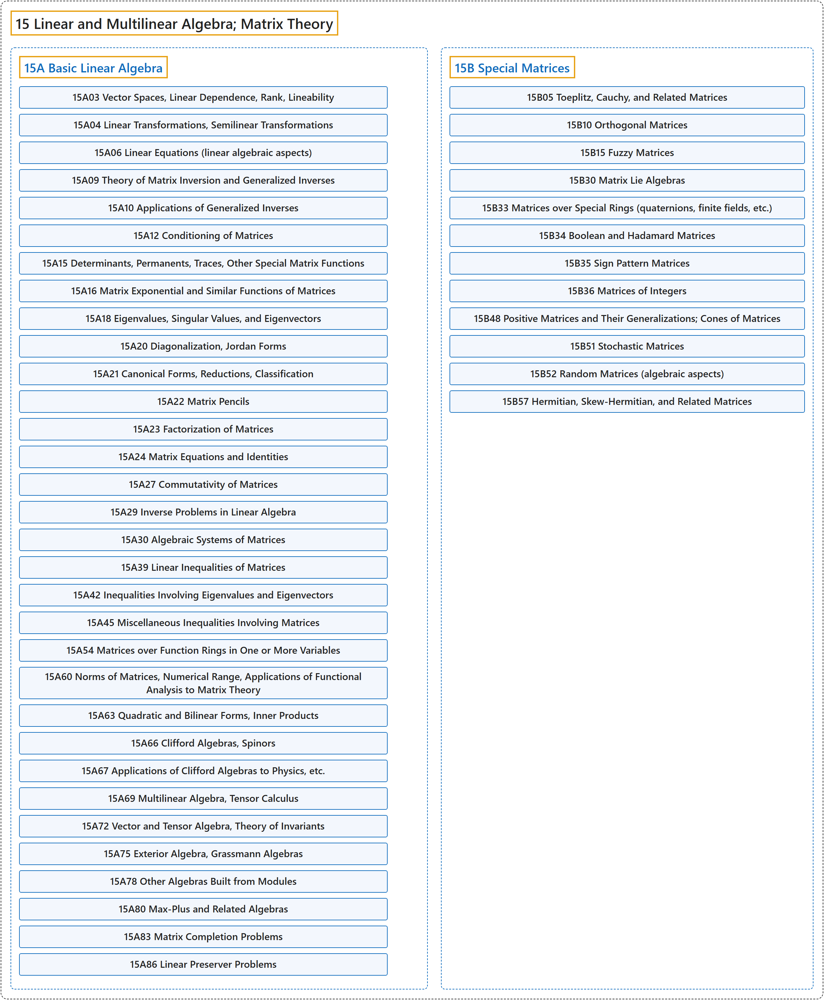

# 15 Linear and Multilinear Algebra; Matrix Theory

## Classification

## Glossary

| Term | Definition | 中文翻译 | Source |
|---|---|---|---|
| **15 Linear and Multilinear Algebra; Matrix Theory** 线性与多重线性代数；矩阵论 | "Linear algebra is the study of **sets of linear equations** and their **transformation properties**." | 线性代数研究**线性方程组**及其**变换性质**。 | [Weisstein, n.d., "Linear algebra" entry, para. 1](https://mathworld.wolfram.com/LinearAlgebra.html#:~:text=Linear%20algebra%20is%20the%20study%20of%20sets%20of%20linear%20equations) |
| **[15A Basic Linear Algebra](15a-basic-linear-algebra.md)** 基础线性代数 | (No definition) | （无定义） | [Associate Editors of Mathematical Reviews and zbMATH, 2020](https://msc2020.org/) |
| **[15B Special Matrices](15b-special-matrices.md)** 特殊矩阵 | (No definition) | （无定义） | [Associate Editors of Mathematical Reviews and zbMATH, 2020](https://msc2020.org/) |

## References

Associate Editors of Mathematical Reviews and zbMATH. (2020). *MSC2020: Mathematics Subject Classification system*. Retrieved October 27, 2026, from <https://msc2020.org/>

Weisstein, E. W. (n.d.). *Linear algebra*. MathWorld: A Wolfram Resource. Retrieved October 27, 2026, from <https://mathworld.wolfram.com/LinearAlgebra.html>
