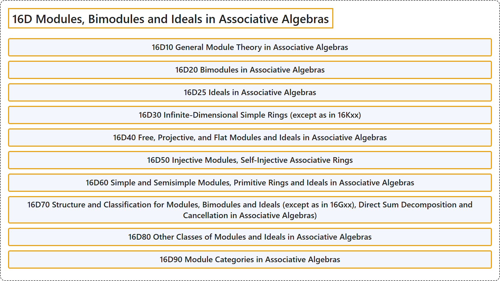

# 16D Modules, Bimodules and Ideals in Associative Algebras

## Classification

## Glossary

| Term | Definition | 中文翻译 | Source |
|---|---|---|---|
| **16D Modules, Bimodules and Ideals in Associative Algebras** 结合代数中的模、双模与理想 | (No definition) | （无定义） | [Associate Editors of Mathematical Reviews and zbMATH, 2020](https://msc2020.org/) |
| **16D10 General Module Theory in Associative Algebras** 结合代数中的一般模论 | (No definition) | （无定义） | [Associate Editors of Mathematical Reviews and zbMATH, 2020](https://msc2020.org/) |
| **16D20 Bimodules in Associative Algebras** 结合代数中的双模 | (No definition) | （无定义） | [Associate Editors of Mathematical Reviews and zbMATH, 2020](https://msc2020.org/) |
| **16D25 Ideals in Associative Algebras** 结合代数中的理想 | (No definition) | （无定义） | [Associate Editors of Mathematical Reviews and zbMATH, 2020](https://msc2020.org/) |
| **16D30 Infinite-Dimensional Simple Rings (except as in 16Kxx)** 无限维单环（16Kxx中的除外） | (No definition) | （无定义） | [Associate Editors of Mathematical Reviews and zbMATH, 2020](https://msc2020.org/) |
| **16D40 Free, Projective, and Flat Modules and Ideals in Associative Algebras** 结合代数中的自由模、射影模与平坦模及理想 | (No definition) | （无定义） | [Associate Editors of Mathematical Reviews and zbMATH, 2020](https://msc2020.org/) |
| **16D50 Injective Modules, Self-Injective Associative Rings** 内射模、自内射结合环 | (No definition) | （无定义） | [Associate Editors of Mathematical Reviews and zbMATH, 2020](https://msc2020.org/) |
| **16D60 Simple and Semisimple Modules, Primitive Rings and Ideals in Associative Algebras** 结合代数中的单模与半单模、本原环与本原理想 | (No definition) | （无定义） | [Associate Editors of Mathematical Reviews and zbMATH, 2020](https://msc2020.org/) |
| **16D70 Structure and Classification for Modules, Bimodules and Ideals (except as in 16Gxx), Direct Sum Decomposition and Cancellation in Associative Algebras)** 模、双模与理想的结构与分类（16Gxx中的除外）、结合代数中的直和分解与消去 | (No definition) | （无定义） | [Associate Editors of Mathematical Reviews and zbMATH, 2020](https://msc2020.org/) |
| **16D80 Other Classes of Modules and Ideals in Associative Algebras** 结合代数中模与理想的其他类 | (No definition) | （无定义） | [Associate Editors of Mathematical Reviews and zbMATH, 2020](https://msc2020.org/) |
| **16D90 Module Categories in Associative Algebras** 结合代数中的模范畴 | (No definition) | （无定义） | [Associate Editors of Mathematical Reviews and zbMATH, 2020](https://msc2020.org/) |

## References

Associate Editors of Mathematical Reviews and zbMATH. (2020). *MSC2020: Mathematics Subject Classification system*. Retrieved October 27, 2026, from <https://msc2020.org/>
