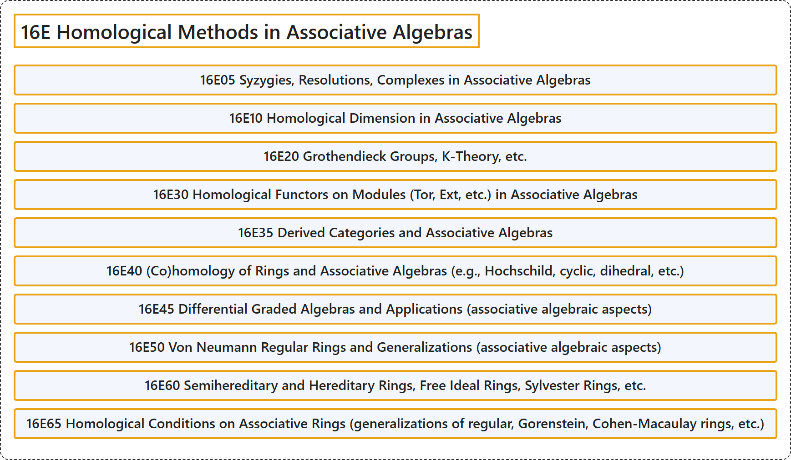

# 16E Homological Methods in Associative Algebras

## Classification

## Glossary

| Term | Definition | 中文翻译 | Source |
|---|---|---|---|
| **16E Homological Methods in Associative Algebras** 结合代数中的同调方法 | (No definition) | （无定义） | [Associate Editors of Mathematical Reviews and zbMATH, 2020](https://msc2020.org/) |
| **16E05 Syzygies, Resolutions, Complexes in Associative Algebras** 结合代数中的合冲、分解、复形 | (No definition) | （无定义） | [Associate Editors of Mathematical Reviews and zbMATH, 2020](https://msc2020.org/) |
| **16E10 Homological Dimension in Associative Algebras** 结合代数中的同调维数 | (No definition) | （无定义） | [Associate Editors of Mathematical Reviews and zbMATH, 2020](https://msc2020.org/) |
| **16E20 Grothendieck Groups, K-Theory, etc.** 格罗滕迪克群、K理论等 | (No definition) | （无定义） | [Associate Editors of Mathematical Reviews and zbMATH, 2020](https://msc2020.org/) |
| **16E30 Homological Functors on Modules (Tor, Ext, etc.) in Associative Algebras** 结合代数中模上的同调函子（Tor、Ext等） | (No definition) | （无定义） | [Associate Editors of Mathematical Reviews and zbMATH, 2020](https://msc2020.org/) |
| **16E35 Derived Categories and Associative Algebras** 导出范畴与结合代数 | (No definition) | （无定义） | [Associate Editors of Mathematical Reviews and zbMATH, 2020](https://msc2020.org/) |
| **16E40 (Co)homology of Rings and Associative Algebras (e.g., Hochschild, cyclic, dihedral, etc.)** 环与结合代数的（上）同调（例如霍赫希尔德、循环、二面体等） | (No definition) | （无定义） | [Associate Editors of Mathematical Reviews and zbMATH, 2020](https://msc2020.org/) |
| **16E45 Differential Graded Algebras and Applications (associative algebraic aspects)** 微分分次代数及其应用（结合代数方面） | (No definition) | （无定义） | [Associate Editors of Mathematical Reviews and zbMATH, 2020](https://msc2020.org/) |
| **16E50 Von Neumann Regular Rings and Generalizations (associative algebraic aspects)** 冯诺伊曼正则环及其推广（结合代数方面） | (No definition) | （无定义） | [Associate Editors of Mathematical Reviews and zbMATH, 2020](https://msc2020.org/) |
| **16E60 Semihereditary and Hereditary Rings, Free Ideal Rings, Sylvester Rings, etc.** 半遗传环与遗传环、自由理想环、西尔维斯特环等 | (No definition) | （无定义） | [Associate Editors of Mathematical Reviews and zbMATH, 2020](https://msc2020.org/) |
| **16E65 Homological Conditions on Associative Rings (generalizations of regular, Gorenstein, Cohen-Macaulay rings, etc.)** 结合环上的同调条件（正则环、戈伦斯坦环、科恩-麦考利环等的推广） | (No definition) | （无定义） | [Associate Editors of Mathematical Reviews and zbMATH, 2020](https://msc2020.org/) |

## References

Associate Editors of Mathematical Reviews and zbMATH. (2020). *MSC2020: Mathematics Subject Classification system*. Retrieved October 27, 2026, from <https://msc2020.org/>
