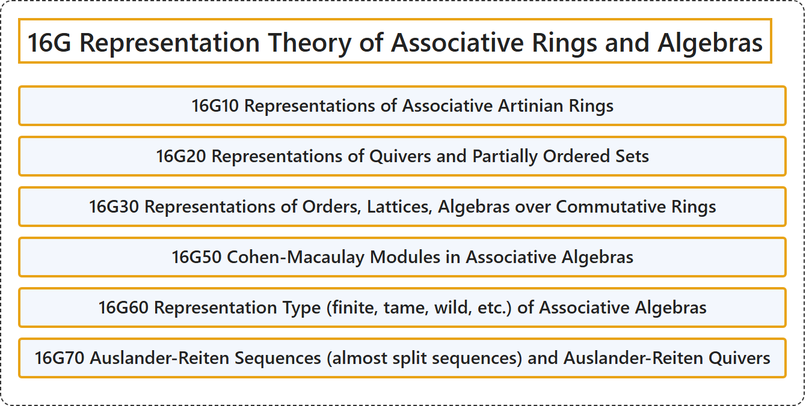

# 16G Representation Theory of Associative Rings and Algebras

## Classification

## Glossary

| Term | Definition | 中文翻译 | Source |
|---|---|---|---|
| **16G Representation Theory of Associative Rings and Algebras** 结合环与结合代数的表示论 | (No definition) | （无定义） | [Associate Editors of Mathematical Reviews and zbMATH, 2020](https://msc2020.org/) |
| **16G10 Representations of Associative Artinian Rings** 结合阿廷环的表示 | (No definition) | （无定义） | [Associate Editors of Mathematical Reviews and zbMATH, 2020](https://msc2020.org/) |
| **16G20 Representations of Quivers and Partially Ordered Sets** 箭图与偏序集的表示 | (No definition) | （无定义） | [Associate Editors of Mathematical Reviews and zbMATH, 2020](https://msc2020.org/) |
| **16G30 Representations of Orders, Lattices, Algebras over Commutative Rings** 序、格、交换环上代数的表示 | (No definition) | （无定义） | [Associate Editors of Mathematical Reviews and zbMATH, 2020](https://msc2020.org/) |
| **16G50 Cohen-Macaulay Modules in Associative Algebras** 结合代数中的科恩-麦考利模 | (No definition) | （无定义） | [Associate Editors of Mathematical Reviews and zbMATH, 2020](https://msc2020.org/) |
| **16G60 Representation Type (finite, tame, wild, etc.) of Associative Algebras** 结合代数的表示型（有限、驯顺、野等） | (No definition) | （无定义） | [Associate Editors of Mathematical Reviews and zbMATH, 2020](https://msc2020.org/) |
| **16G70 Auslander-Reiten Sequences (almost split sequences) and Auslander-Reiten Quivers** 奥斯兰德-赖滕序列（几乎可裂序列）与奥斯兰德-赖滕箭图 | (No definition) | （无定义） | [Associate Editors of Mathematical Reviews and zbMATH, 2020](https://msc2020.org/) |

## References

Associate Editors of Mathematical Reviews and zbMATH. (2020). *MSC2020: Mathematics Subject Classification system*. Retrieved October 27, 2026, from <https://msc2020.org/>
