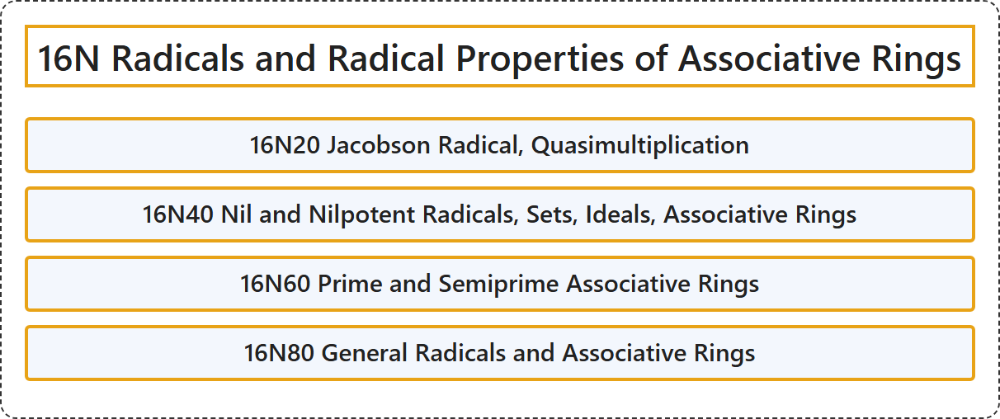

# 16N Radicals and Radical Properties of Associative Rings

## Classification

## Glossary

| Term | Definition | 中文翻译 | Source |
|---|---|---|---|
| **16N Radicals and Radical Properties of Associative Rings** 结合环的根与根性质 | (No definition) | （无定义） | [Associate Editors of Mathematical Reviews and zbMATH, 2020](https://msc2020.org/) |
| **16N20 Jacobson Radical, Quasimultiplication** 雅各布森根、拟乘法 | (No definition) | （无定义） | [Associate Editors of Mathematical Reviews and zbMATH, 2020](https://msc2020.org/) |
| **16N40 Nil and Nilpotent Radicals, Sets, Ideals, Associative Rings** 结合环中的幂零根与诣零根、集合、理想 | (No definition) | （无定义） | [Associate Editors of Mathematical Reviews and zbMATH, 2020](https://msc2020.org/) |
| **16N60 Prime and Semiprime Associative Rings** 素结合环与半素结合环 | (No definition) | （无定义） | [Associate Editors of Mathematical Reviews and zbMATH, 2020](https://msc2020.org/) |
| **16N80 General Radicals and Associative Rings** 一般根与结合环 | (No definition) | （无定义） | [Associate Editors of Mathematical Reviews and zbMATH, 2020](https://msc2020.org/) |

## References

Associate Editors of Mathematical Reviews and zbMATH. (2020). *MSC2020: Mathematics Subject Classification system*. Retrieved October 27, 2026, from <https://msc2020.org/>
