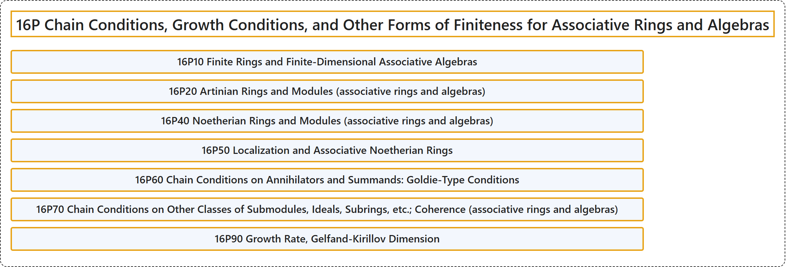

# 16P Chain Conditions, Growth Conditions, and Other Forms of Finiteness for Associative Rings and Algebras

## Classification

## Glossary

| Term | Definition | 中文翻译 | Source |
|---|---|---|---|
| **16P Chain Conditions, Growth Conditions, and Other Forms of Finiteness for Associative Rings and Algebras** 结合环与结合代数的链条件、增长条件及其他有限性形式 | (No definition) | （无定义） | [Associate Editors of Mathematical Reviews and zbMATH, 2020](https://msc2020.org/) |
| **16P10 Finite Rings and Finite-Dimensional Associative Algebras** 有限环与有限维结合代数 | (No definition) | （无定义） | [Associate Editors of Mathematical Reviews and zbMATH, 2020](https://msc2020.org/) |
| **16P20 Artinian Rings and Modules (associative rings and algebras)** 阿廷环与模（结合环与代数） | (No definition) | （无定义） | [Associate Editors of Mathematical Reviews and zbMATH, 2020](https://msc2020.org/) |
| **16P40 Noetherian Rings and Modules (associative rings and algebras)** 诺特环与模（结合环与代数） | (No definition) | （无定义） | [Associate Editors of Mathematical Reviews and zbMATH, 2020](https://msc2020.org/) |
| **16P50 Localization and Associative Noetherian Rings** 局部化与结合诺特环 | (No definition) | （无定义） | [Associate Editors of Mathematical Reviews and zbMATH, 2020](https://msc2020.org/) |
| **16P60 Chain Conditions on Annihilators and Summands: Goldie-Type Conditions** 零化子与直和项上的链条件：戈尔迪型条件 | (No definition) | （无定义） | [Associate Editors of Mathematical Reviews and zbMATH, 2020](https://msc2020.org/) |
| **16P70 Chain Conditions on Other Classes of Submodules, Ideals, Subrings, etc.; Coherence (associative rings and algebras)** 其他子模类、理想、子环等上的链条件；相干性（结合环与代数） | (No definition) | （无定义） | [Associate Editors of Mathematical Reviews and zbMATH, 2020](https://msc2020.org/) |
| **16P90 Growth Rate, Gelfand-Kirillov Dimension** 增长率、盖尔范德-基里洛夫维数 | (No definition) | （无定义） | [Associate Editors of Mathematical Reviews and zbMATH, 2020](https://msc2020.org/) |

## References

Associate Editors of Mathematical Reviews and zbMATH. (2020). *MSC2020: Mathematics Subject Classification system*. Retrieved October 27, 2026, from <https://msc2020.org/>
