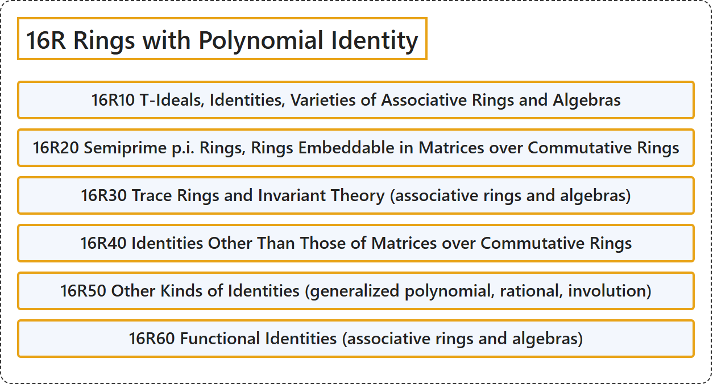

# 16R Rings with Polynomial Identity

## Classification

## Glossary

| Term | Definition | 中文翻译 | Source |
|---|---|---|---|
| **16R Rings with Polynomial Identity** 多项式恒等式环 | (No definition) | （无定义） | [Associate Editors of Mathematical Reviews and zbMATH, 2020](https://msc2020.org/) |
| **16R10 T-Ideals, Identities, Varieties of Associative Rings and Algebras** T理想、恒等式、结合环与代数的簇 | (No definition) | （无定义） | [Associate Editors of Mathematical Reviews and zbMATH, 2020](https://msc2020.org/) |
| **16R20 Semiprime p.i. Rings, Rings Embeddable in Matrices over Commutative Rings** 半素PI环、可嵌入交换环上矩阵环的环 | (No definition) | （无定义） | [Associate Editors of Mathematical Reviews and zbMATH, 2020](https://msc2020.org/) |
| **16R30 Trace Rings and Invariant Theory (associative rings and algebras)** 迹环与不变量理论（结合环与代数） | (No definition) | （无定义） | [Associate Editors of Mathematical Reviews and zbMATH, 2020](https://msc2020.org/) |
| **16R40 Identities Other Than Those of Matrices over Commutative Rings** 交换环上矩阵恒等式以外的恒等式 | (No definition) | （无定义） | [Associate Editors of Mathematical Reviews and zbMATH, 2020](https://msc2020.org/) |
| **16R50 Other Kinds of Identities (generalized polynomial, rational, involution)** 其他种类的恒等式（广义多项式、有理、对合） | (No definition) | （无定义） | [Associate Editors of Mathematical Reviews and zbMATH, 2020](https://msc2020.org/) |
| **16R60 Functional Identities (associative rings and algebras)** 函数恒等式（结合环与代数） | (No definition) | （无定义） | [Associate Editors of Mathematical Reviews and zbMATH, 2020](https://msc2020.org/) |

## References

Associate Editors of Mathematical Reviews and zbMATH. (2020). *MSC2020: Mathematics Subject Classification system*. Retrieved October 27, 2026, from <https://msc2020.org/>
