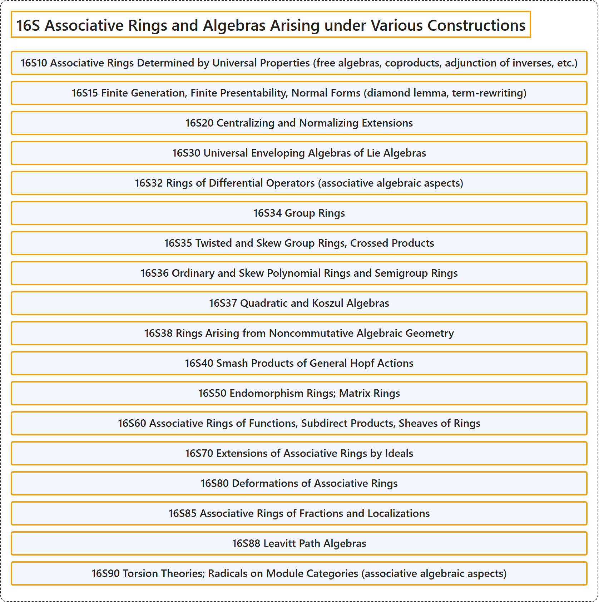

# 16S Associative Rings and Algebras Arising under Various Constructions

## Classification

## Glossary

| Term | Definition | 中文翻译 | Source |
|---|---|---|---|
| **16S Associative Rings and Algebras Arising under Various Constructions** 由各种构造产生的结合环与结合代数 | (No definition) | （无定义） | [Associate Editors of Mathematical Reviews and zbMATH, 2020](https://msc2020.org/) |
| **16S10 Associative Rings Determined by Universal Properties (free algebras, coproducts, adjunction of inverses, etc.)** 由泛性质确定的结合环（自由代数、余积、添加逆元等） | (No definition) | （无定义） | [Associate Editors of Mathematical Reviews and zbMATH, 2020](https://msc2020.org/) |
| **16S15 Finite Generation, Finite Presentability, Normal Forms (diamond lemma, term-rewriting)** 有限生成、有限表现、范式（钻石引理、项重写） | (No definition) | （无定义） | [Associate Editors of Mathematical Reviews and zbMATH, 2020](https://msc2020.org/) |
| **16S20 Centralizing and Normalizing Extensions** 中心化扩张与正规化扩张 | (No definition) | （无定义） | [Associate Editors of Mathematical Reviews and zbMATH, 2020](https://msc2020.org/) |
| **16S30 Universal Enveloping Algebras of Lie Algebras** 李代数的泛包络代数 | (No definition) | （无定义） | [Associate Editors of Mathematical Reviews and zbMATH, 2020](https://msc2020.org/) |
| **16S32 Rings of Differential Operators (associative algebraic aspects)** 微分算子环（结合代数方面） | (No definition) | （无定义） | [Associate Editors of Mathematical Reviews and zbMATH, 2020](https://msc2020.org/) |
| **16S34 Group Rings** 群环 | (No definition) | （无定义） | [Associate Editors of Mathematical Reviews and zbMATH, 2020](https://msc2020.org/) |
| **16S35 Twisted and Skew Group Rings, Crossed Products** 扭群环与斜群环、交叉积 | (No definition) | （无定义） | [Associate Editors of Mathematical Reviews and zbMATH, 2020](https://msc2020.org/) |
| **16S36 Ordinary and Skew Polynomial Rings and Semigroup Rings** 普通多项式环与斜多项式环、半群环 | (No definition) | （无定义） | [Associate Editors of Mathematical Reviews and zbMATH, 2020](https://msc2020.org/) |
| **16S37 Quadratic and Koszul Algebras** 二次代数与科斯居尔代数 | (No definition) | （无定义） | [Associate Editors of Mathematical Reviews and zbMATH, 2020](https://msc2020.org/) |
| **16S38 Rings Arising from Noncommutative Algebraic Geometry** 源自非交换代数几何的环 | (No definition) | （无定义） | [Associate Editors of Mathematical Reviews and zbMATH, 2020](https://msc2020.org/) |
| **16S40 Smash Products of General Hopf Actions** 一般霍普夫作用的斯马什积 | (No definition) | （无定义） | [Associate Editors of Mathematical Reviews and zbMATH, 2020](https://msc2020.org/) |
| **16S50 Endomorphism Rings; Matrix Rings** 自同态环；矩阵环 | (No definition) | （无定义） | [Associate Editors of Mathematical Reviews and zbMATH, 2020](https://msc2020.org/) |
| **16S60 Associative Rings of Functions, Subdirect Products, Sheaves of Rings** 函数的结合环、子直积、环层 | (No definition) | （无定义） | [Associate Editors of Mathematical Reviews and zbMATH, 2020](https://msc2020.org/) |
| **16S70 Extensions of Associative Rings by Ideals** 结合环被理想的扩张 | (No definition) | （无定义） | [Associate Editors of Mathematical Reviews and zbMATH, 2020](https://msc2020.org/) |
| **16S80 Deformations of Associative Rings** 结合环的形变 | (No definition) | （无定义） | [Associate Editors of Mathematical Reviews and zbMATH, 2020](https://msc2020.org/) |
| **16S85 Associative Rings of Fractions and Localizations** 结合分式环与局部化 | (No definition) | （无定义） | [Associate Editors of Mathematical Reviews and zbMATH, 2020](https://msc2020.org/) |
| **16S88 Leavitt Path Algebras** 莱维特路径代数 | (No definition) | （无定义） | [Associate Editors of Mathematical Reviews and zbMATH, 2020](https://msc2020.org/) |
| **16S90 Torsion Theories; Radicals on Module Categories (associative algebraic aspects)** 挠理论；模范畴上的根（结合代数方面） | (No definition) | （无定义） | [Associate Editors of Mathematical Reviews and zbMATH, 2020](https://msc2020.org/) |

## References

Associate Editors of Mathematical Reviews and zbMATH. (2020). *MSC2020: Mathematics Subject Classification system*. Retrieved October 27, 2026, from <https://msc2020.org/>
