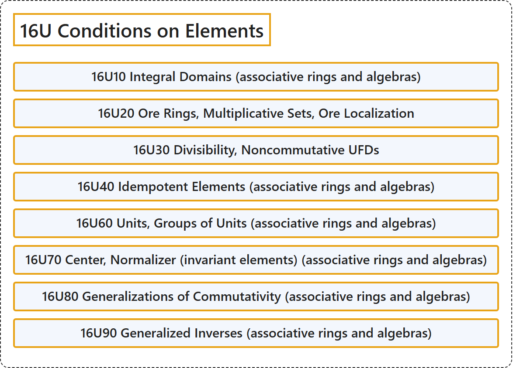

# 16U Conditions on Elements

## Classification

## Glossary

| Term | Definition | 中文翻译 | Source |
|---|---|---|---|
| **16U Conditions on Elements** 元素上的条件 | (No definition) | （无定义） | [Associate Editors of Mathematical Reviews and zbMATH, 2020](https://msc2020.org/) |
| **16U10 Integral Domains (associative rings and algebras)** 整环（结合环与代数） | (No definition) | （无定义） | [Associate Editors of Mathematical Reviews and zbMATH, 2020](https://msc2020.org/) |
| **16U20 Ore Rings, Multiplicative Sets, Ore Localization** 奥尔环、乘法集、奥尔局部化 | (No definition) | （无定义） | [Associate Editors of Mathematical Reviews and zbMATH, 2020](https://msc2020.org/) |
| **16U30 Divisibility, Noncommutative UFDs** 整除性、非交换唯一分解整环 | (No definition) | （无定义） | [Associate Editors of Mathematical Reviews and zbMATH, 2020](https://msc2020.org/) |
| **16U40 Idempotent Elements (associative rings and algebras)** 幂等元（结合环与代数） | (No definition) | （无定义） | [Associate Editors of Mathematical Reviews and zbMATH, 2020](https://msc2020.org/) |
| **16U60 Units, Groups of Units (associative rings and algebras)** 单位、单位群（结合环与代数） | (No definition) | （无定义） | [Associate Editors of Mathematical Reviews and zbMATH, 2020](https://msc2020.org/) |
| **16U70 Center, Normalizer (invariant elements) (associative rings and algebras)** 中心、正规化子（不变元）（结合环与代数） | (No definition) | （无定义） | [Associate Editors of Mathematical Reviews and zbMATH, 2020](https://msc2020.org/) |
| **16U80 Generalizations of Commutativity (associative rings and algebras)** 交换性的推广（结合环与代数） | (No definition) | （无定义） | [Associate Editors of Mathematical Reviews and zbMATH, 2020](https://msc2020.org/) |
| **16U90 Generalized Inverses (associative rings and algebras)** 广义逆（结合环与代数） | (No definition) | （无定义） | [Associate Editors of Mathematical Reviews and zbMATH, 2020](https://msc2020.org/) |

## References

Associate Editors of Mathematical Reviews and zbMATH. (2020). *MSC2020: Mathematics Subject Classification system*. Retrieved October 27, 2026, from <https://msc2020.org/>
