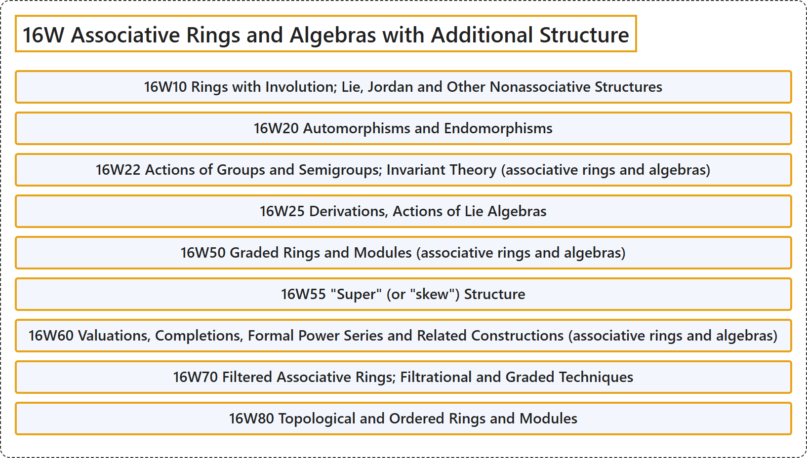

# 16W Associative Rings and Algebras with Additional Structure

## Classification

## Glossary

| Term | Definition | 中文翻译 | Source |
|---|---|---|---|
| **16W Associative Rings and Algebras with Additional Structure** 带附加结构的结合环与结合代数 | (No definition) | （无定义） | [Associate Editors of Mathematical Reviews and zbMATH, 2020](https://msc2020.org/) |
| **16W10 Rings with Involution; Lie, Jordan and Other Nonassociative Structures** 带对合的环；李、若尔当及其他非结合结构 | (No definition) | （无定义） | [Associate Editors of Mathematical Reviews and zbMATH, 2020](https://msc2020.org/) |
| **16W20 Automorphisms and Endomorphisms** 自同构与自同态 | (No definition) | （无定义） | [Associate Editors of Mathematical Reviews and zbMATH, 2020](https://msc2020.org/) |
| **16W22 Actions of Groups and Semigroups; Invariant Theory (associative rings and algebras)** 群与半群的作用；不变量理论（结合环与代数） | (No definition) | （无定义） | [Associate Editors of Mathematical Reviews and zbMATH, 2020](https://msc2020.org/) |
| **16W25 Derivations, Actions of Lie Algebras** 导子、李代数的作用 | (No definition) | （无定义） | [Associate Editors of Mathematical Reviews and zbMATH, 2020](https://msc2020.org/) |
| **16W50 Graded Rings and Modules (associative rings and algebras)** 分次环与分次模（结合环与代数） | (No definition) | （无定义） | [Associate Editors of Mathematical Reviews and zbMATH, 2020](https://msc2020.org/) |
| **16W55 "Super" (or "skew") Structure** “超”（或“斜”）结构 | (No definition) | （无定义） | [Associate Editors of Mathematical Reviews and zbMATH, 2020](https://msc2020.org/) |
| **16W60 Valuations, Completions, Formal Power Series and Related Constructions (associative rings and algebras)** 赋值、完备化、形式幂级数及相关构造（结合环与代数） | (No definition) | （无定义） | [Associate Editors of Mathematical Reviews and zbMATH, 2020](https://msc2020.org/) |
| **16W70 Filtered Associative Rings; Filtrational and Graded Techniques** 滤过结合环；滤过技术与分次技术 | (No definition) | （无定义） | [Associate Editors of Mathematical Reviews and zbMATH, 2020](https://msc2020.org/) |
| **16W80 Topological and Ordered Rings and Modules** 拓扑环与有序环及模 | (No definition) | （无定义） | [Associate Editors of Mathematical Reviews and zbMATH, 2020](https://msc2020.org/) |

## References

Associate Editors of Mathematical Reviews and zbMATH. (2020). *MSC2020: Mathematics Subject Classification system*. Retrieved October 27, 2026, from <https://msc2020.org/>
