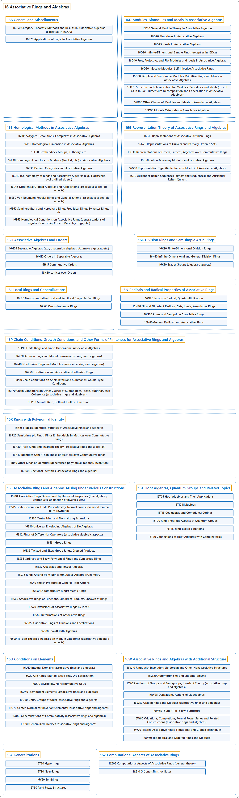

# 16 Associative Rings and Algebras

## Classification

## Glossary

| Term | Definition | 中文翻译 | Source |
|---|---|---|---|
| **16 Associative Rings and Algebras** 结合环与结合代数 | "A ring in the mathematical sense is **a set S together with two binary operators** + and * (commonly interpreted as **addition and multiplication**, respectively) satisfying the following conditions ..." | 数学意义上的环是**一个集合 S 连同两个二元运算** + 和 *（通常分别解释为**加法和乘法**），并满足以下条件…… | [Weisstein, n.d., "Ring" entry, para. 1](https://mathworld.wolfram.com/Ring.html#:~:text=A%20ring%20in%20the%20mathematical%20sense%20is%20a%20set) |
| **[16B General and Miscellaneous](16b-general-and-miscellaneous.md)** 一般及杂项 | (No definition) | （无定义） | [Associate Editors of Mathematical Reviews and zbMATH, 2020](https://msc2020.org/) |
| **[16D Modules, Bimodules and Ideals in Associative Algebras](16d-modules-bimodules-and-ideals-in-associative-algebras.md)** 结合代数中的模、双模与理想 | (No definition) | （无定义） | [Associate Editors of Mathematical Reviews and zbMATH, 2020](https://msc2020.org/) |
| **[16E Homological Methods in Associative Algebras](16e-homological-methods-in-associative-algebras.md)** 结合代数中的同调方法 | (No definition) | （无定义） | [Associate Editors of Mathematical Reviews and zbMATH, 2020](https://msc2020.org/) |
| **[16G Representation Theory of Associative Rings and Algebras](16g-representation-theory-of-associative-rings-and-algebras.md)** 结合环与结合代数的表示论 | (No definition) | （无定义） | [Associate Editors of Mathematical Reviews and zbMATH, 2020](https://msc2020.org/) |
| **[16H Associative Algebras and Orders](16h-associative-algebras-and-orders.md)** 结合代数与序 | (No definition) | （无定义） | [Associate Editors of Mathematical Reviews and zbMATH, 2020](https://msc2020.org/) |
| **[16K Division Rings and Semisimple Artin Rings](16k-division-rings-and-semisimple-artin-rings.md)** 除环与半单阿廷环 | (No definition) | （无定义） | [Associate Editors of Mathematical Reviews and zbMATH, 2020](https://msc2020.org/) |
| **[16L Local Rings and Generalizations](16l-local-rings-and-generalizations.md)** 局部环及其推广 | (No definition) | （无定义） | [Associate Editors of Mathematical Reviews and zbMATH, 2020](https://msc2020.org/) |
| **[16N Radicals and Radical Properties of Associative Rings](16n-radicals-and-radical-properties-of-associative-rings.md)** 结合环的根与根性质 | (No definition) | （无定义） | [Associate Editors of Mathematical Reviews and zbMATH, 2020](https://msc2020.org/) |
| **[16P Chain Conditions, Growth Conditions, and Other Forms of Finiteness for Associative Rings and Algebras](16p-chain-conditions-growth-conditions-and-other-forms-of-finite.md)** 结合环与结合代数的链条件、增长条件及其他有限性形式 | (No definition) | （无定义） | [Associate Editors of Mathematical Reviews and zbMATH, 2020](https://msc2020.org/) |
| **[16R Rings with Polynomial Identity](16r-rings-with-polynomial-identity.md)** 多项式恒等式环 | (No definition) | （无定义） | [Associate Editors of Mathematical Reviews and zbMATH, 2020](https://msc2020.org/) |
| **[16S Associative Rings and Algebras Arising under Various Constructions](16s-associative-rings-and-algebras-arising-under-various-constru.md)** 由各种构造产生的结合环与结合代数 | (No definition) | （无定义） | [Associate Editors of Mathematical Reviews and zbMATH, 2020](https://msc2020.org/) |
| **[16T Hopf Algebras, Quantum Groups and Related Topics](16t-hopf-algebras-quantum-groups-and-related-topics.md)** 霍普夫代数、量子群及相关专题 | (No definition) | （无定义） | [Associate Editors of Mathematical Reviews and zbMATH, 2020](https://msc2020.org/) |
| **[16U Conditions on Elements](16u-conditions-on-elements.md)** 元素上的条件 | (No definition) | （无定义） | [Associate Editors of Mathematical Reviews and zbMATH, 2020](https://msc2020.org/) |
| **[16W Associative Rings and Algebras with Additional Structure](16w-associative-rings-and-algebras-with-additional-structure.md)** 带附加结构的结合环与结合代数 | (No definition) | （无定义） | [Associate Editors of Mathematical Reviews and zbMATH, 2020](https://msc2020.org/) |
| **[16Y Generalizations](16y-generalizations.md)** 推广 | (No definition) | （无定义） | [Associate Editors of Mathematical Reviews and zbMATH, 2020](https://msc2020.org/) |
| **[16Z Computational Aspects of Associative Rings](16z-computational-aspects-of-associative-rings.md)** 结合环的计算方面 | (No definition) | （无定义） | [Associate Editors of Mathematical Reviews and zbMATH, 2020](https://msc2020.org/) |

## References

Associate Editors of Mathematical Reviews and zbMATH. (2020). *MSC2020: Mathematics Subject Classification system*. Retrieved October 27, 2026, from <https://msc2020.org/>

Weisstein, E. W. (n.d.). *Ring*. MathWorld: A Wolfram Resource. Retrieved October 27, 2026, from <https://mathworld.wolfram.com/Ring.html>
