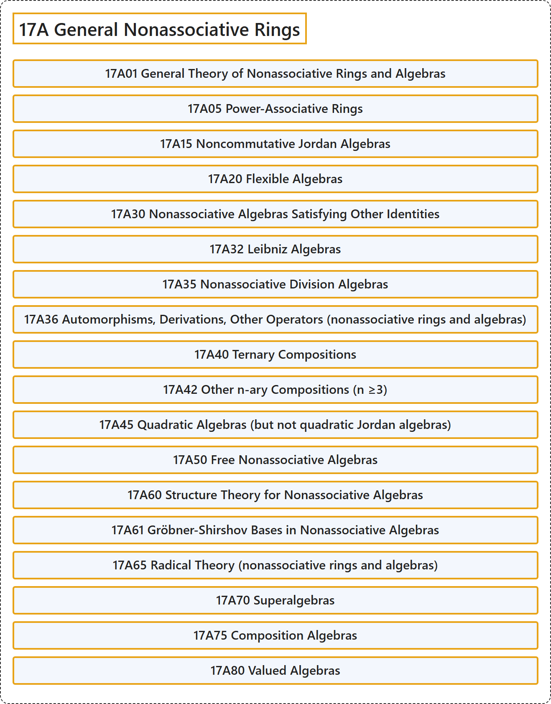

# 17A General Nonassociative Rings

## Classification

## Glossary

| Term | Definition | 中文翻译 | Source |
|---|---|---|---|
| **17A General Nonassociative Rings** 一般非结合环 | (No definition) | （无定义） | [Associate Editors of Mathematical Reviews and zbMATH, 2020](https://msc2020.org/) |
| **17A01 General Theory of Nonassociative Rings and Algebras** 非结合环与代数的一般理论 | (No definition) | （无定义） | [Associate Editors of Mathematical Reviews and zbMATH, 2020](https://msc2020.org/) |
| **17A05 Power-Associative Rings** 幂结合环 | (No definition) | （无定义） | [Associate Editors of Mathematical Reviews and zbMATH, 2020](https://msc2020.org/) |
| **17A15 Noncommutative Jordan Algebras** 非交换若尔当代数 | (No definition) | （无定义） | [Associate Editors of Mathematical Reviews and zbMATH, 2020](https://msc2020.org/) |
| **17A20 Flexible Algebras** 柔代数 | (No definition) | （无定义） | [Associate Editors of Mathematical Reviews and zbMATH, 2020](https://msc2020.org/) |
| **17A30 Nonassociative Algebras Satisfying Other Identities** 满足其他恒等式的非结合代数 | (No definition) | （无定义） | [Associate Editors of Mathematical Reviews and zbMATH, 2020](https://msc2020.org/) |
| **17A32 Leibniz Algebras** 莱布尼茨代数 | (No definition) | （无定义） | [Associate Editors of Mathematical Reviews and zbMATH, 2020](https://msc2020.org/) |
| **17A35 Nonassociative Division Algebras** 非结合除代数 | (No definition) | （无定义） | [Associate Editors of Mathematical Reviews and zbMATH, 2020](https://msc2020.org/) |
| **17A36 Automorphisms, Derivations, Other Operators (nonassociative rings and algebras)** 自同构、导子、其他算子（非结合环与代数） | (No definition) | （无定义） | [Associate Editors of Mathematical Reviews and zbMATH, 2020](https://msc2020.org/) |
| **17A40 Ternary Compositions** 三元合成 | (No definition) | （无定义） | [Associate Editors of Mathematical Reviews and zbMATH, 2020](https://msc2020.org/) |
| **17A42 Other n-ary Compositions (n ≥3)** 其他n元合成（n ≥3） | (No definition) | （无定义） | [Associate Editors of Mathematical Reviews and zbMATH, 2020](https://msc2020.org/) |
| **17A45 Quadratic Algebras (but not quadratic Jordan algebras)** 二次代数（二次若尔当代数除外） | (No definition) | （无定义） | [Associate Editors of Mathematical Reviews and zbMATH, 2020](https://msc2020.org/) |
| **17A50 Free Nonassociative Algebras** 自由非结合代数 | (No definition) | （无定义） | [Associate Editors of Mathematical Reviews and zbMATH, 2020](https://msc2020.org/) |
| **17A60 Structure Theory for Nonassociative Algebras** 非结合代数的结构理论 | (No definition) | （无定义） | [Associate Editors of Mathematical Reviews and zbMATH, 2020](https://msc2020.org/) |
| **17A61 Gröbner-Shirshov Bases in Nonassociative Algebras** 非结合代数中的格罗布纳-希尔绍夫基 | (No definition) | （无定义） | [Associate Editors of Mathematical Reviews and zbMATH, 2020](https://msc2020.org/) |
| **17A65 Radical Theory (nonassociative rings and algebras)** 根理论（非结合环与代数） | (No definition) | （无定义） | [Associate Editors of Mathematical Reviews and zbMATH, 2020](https://msc2020.org/) |
| **17A70 Superalgebras** 超代数 | (No definition) | （无定义） | [Associate Editors of Mathematical Reviews and zbMATH, 2020](https://msc2020.org/) |
| **17A75 Composition Algebras** 合成代数 | (No definition) | （无定义） | [Associate Editors of Mathematical Reviews and zbMATH, 2020](https://msc2020.org/) |
| **17A80 Valued Algebras** 赋值代数 | (No definition) | （无定义） | [Associate Editors of Mathematical Reviews and zbMATH, 2020](https://msc2020.org/) |

## References

Associate Editors of Mathematical Reviews and zbMATH. (2020). *MSC2020: Mathematics Subject Classification system*. Retrieved October 27, 2026, from <https://msc2020.org/>
