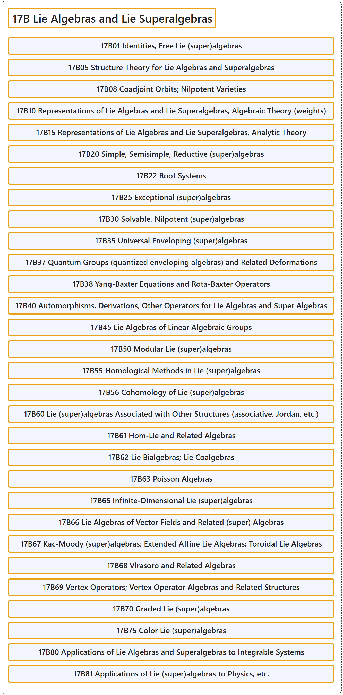

# 17B Lie Algebras and Lie Superalgebras

## Classification

## Glossary

| Term | Definition | 中文翻译 | Source |
|---|---|---|---|
| **17B Lie Algebras and Lie Superalgebras** 李代数与李超代数 | (No definition) | （无定义） | [Associate Editors of Mathematical Reviews and zbMATH, 2020](https://msc2020.org/) |
| **17B01 Identities, Free Lie (super)algebras** 恒等式、自由李（超）代数 | (No definition) | （无定义） | [Associate Editors of Mathematical Reviews and zbMATH, 2020](https://msc2020.org/) |
| **17B05 Structure Theory for Lie Algebras and Superalgebras** 李代数与李超代数的结构理论 | (No definition) | （无定义） | [Associate Editors of Mathematical Reviews and zbMATH, 2020](https://msc2020.org/) |
| **17B08 Coadjoint Orbits; Nilpotent Varieties** 余伴随轨道；幂零簇 | (No definition) | （无定义） | [Associate Editors of Mathematical Reviews and zbMATH, 2020](https://msc2020.org/) |
| **17B10 Representations of Lie Algebras and Lie Superalgebras, Algebraic Theory (weights)** 李代数与李超代数的表示，代数理论（权） | (No definition) | （无定义） | [Associate Editors of Mathematical Reviews and zbMATH, 2020](https://msc2020.org/) |
| **17B15 Representations of Lie Algebras and Lie Superalgebras, Analytic Theory** 李代数与李超代数的表示，解析理论 | (No definition) | （无定义） | [Associate Editors of Mathematical Reviews and zbMATH, 2020](https://msc2020.org/) |
| **17B20 Simple, Semisimple, Reductive (super)algebras** 单、半单、可约（超）代数 | (No definition) | （无定义） | [Associate Editors of Mathematical Reviews and zbMATH, 2020](https://msc2020.org/) |
| **17B22 Root Systems** 根系 | (No definition) | （无定义） | [Associate Editors of Mathematical Reviews and zbMATH, 2020](https://msc2020.org/) |
| **17B25 Exceptional (super)algebras** 例外（超）代数 | (No definition) | （无定义） | [Associate Editors of Mathematical Reviews and zbMATH, 2020](https://msc2020.org/) |
| **17B30 Solvable, Nilpotent (super)algebras** 可解、幂零（超）代数 | (No definition) | （无定义） | [Associate Editors of Mathematical Reviews and zbMATH, 2020](https://msc2020.org/) |
| **17B35 Universal Enveloping (super)algebras** 泛包络（超）代数 | (No definition) | （无定义） | [Associate Editors of Mathematical Reviews and zbMATH, 2020](https://msc2020.org/) |
| **17B37 Quantum Groups (quantized enveloping algebras) and Related Deformations** 量子群（量子化包络代数）及相关形变 | (No definition) | （无定义） | [Associate Editors of Mathematical Reviews and zbMATH, 2020](https://msc2020.org/) |
| **17B38 Yang-Baxter Equations and Rota-Baxter Operators** 杨-巴克斯特方程与罗塔-巴克斯特算子 | (No definition) | （无定义） | [Associate Editors of Mathematical Reviews and zbMATH, 2020](https://msc2020.org/) |
| **17B40 Automorphisms, Derivations, Other Operators for Lie Algebras and Super Algebras** 李代数与李超代数的自同构、导子、其他算子 | (No definition) | （无定义） | [Associate Editors of Mathematical Reviews and zbMATH, 2020](https://msc2020.org/) |
| **17B45 Lie Algebras of Linear Algebraic Groups** 线性代数群的李代数 | (No definition) | （无定义） | [Associate Editors of Mathematical Reviews and zbMATH, 2020](https://msc2020.org/) |
| **17B50 Modular Lie (super)algebras** 模李（超）代数 | (No definition) | （无定义） | [Associate Editors of Mathematical Reviews and zbMATH, 2020](https://msc2020.org/) |
| **17B55 Homological Methods in Lie (super)algebras** 李（超）代数中的同调方法 | (No definition) | （无定义） | [Associate Editors of Mathematical Reviews and zbMATH, 2020](https://msc2020.org/) |
| **17B56 Cohomology of Lie (super)algebras** 李（超）代数的上同调 | (No definition) | （无定义） | [Associate Editors of Mathematical Reviews and zbMATH, 2020](https://msc2020.org/) |
| **17B60 Lie (super)algebras Associated with Other Structures (associative, Jordan, etc.)** 与其他结构（结合、若尔当等）相伴的李（超）代数 | (No definition) | （无定义） | [Associate Editors of Mathematical Reviews and zbMATH, 2020](https://msc2020.org/) |
| **17B61 Hom-Lie and Related Algebras** Hom-李代数及相关代数 | (No definition) | （无定义） | [Associate Editors of Mathematical Reviews and zbMATH, 2020](https://msc2020.org/) |
| **17B62 Lie Bialgebras; Lie Coalgebras** 李双代数；李余代数 | (No definition) | （无定义） | [Associate Editors of Mathematical Reviews and zbMATH, 2020](https://msc2020.org/) |
| **17B63 Poisson Algebras** 泊松代数 | (No definition) | （无定义） | [Associate Editors of Mathematical Reviews and zbMATH, 2020](https://msc2020.org/) |
| **17B65 Infinite-Dimensional Lie (super)algebras** 无限维李（超）代数 | (No definition) | （无定义） | [Associate Editors of Mathematical Reviews and zbMATH, 2020](https://msc2020.org/) |
| **17B66 Lie Algebras of Vector Fields and Related (super) Algebras** 向量场李代数及相关（超）代数 | (No definition) | （无定义） | [Associate Editors of Mathematical Reviews and zbMATH, 2020](https://msc2020.org/) |
| **17B67 Kac-Moody (super)algebras; Extended Affine Lie Algebras; Toroidal Lie Algebras** 卡茨-穆迪（超）代数；扩张仿射李代数；环面李代数 | (No definition) | （无定义） | [Associate Editors of Mathematical Reviews and zbMATH, 2020](https://msc2020.org/) |
| **17B68 Virasoro and Related Algebras** 维拉索罗代数及相关代数 | (No definition) | （无定义） | [Associate Editors of Mathematical Reviews and zbMATH, 2020](https://msc2020.org/) |
| **17B69 Vertex Operators; Vertex Operator Algebras and Related Structures** 顶点算子；顶点算子代数及相关结构 | (No definition) | （无定义） | [Associate Editors of Mathematical Reviews and zbMATH, 2020](https://msc2020.org/) |
| **17B70 Graded Lie (super)algebras** 分次李（超）代数 | (No definition) | （无定义） | [Associate Editors of Mathematical Reviews and zbMATH, 2020](https://msc2020.org/) |
| **17B75 Color Lie (super)algebras** 色李（超）代数 | (No definition) | （无定义） | [Associate Editors of Mathematical Reviews and zbMATH, 2020](https://msc2020.org/) |
| **17B80 Applications of Lie Algebras and Superalgebras to Integrable Systems** 李代数与李超代数在可积系统中的应用 | (No definition) | （无定义） | [Associate Editors of Mathematical Reviews and zbMATH, 2020](https://msc2020.org/) |
| **17B81 Applications of Lie (super)algebras to Physics, etc.** 李（超）代数在物理学等方面的应用 | (No definition) | （无定义） | [Associate Editors of Mathematical Reviews and zbMATH, 2020](https://msc2020.org/) |

## References

Associate Editors of Mathematical Reviews and zbMATH. (2020). *MSC2020: Mathematics Subject Classification system*. Retrieved October 27, 2026, from <https://msc2020.org/>
