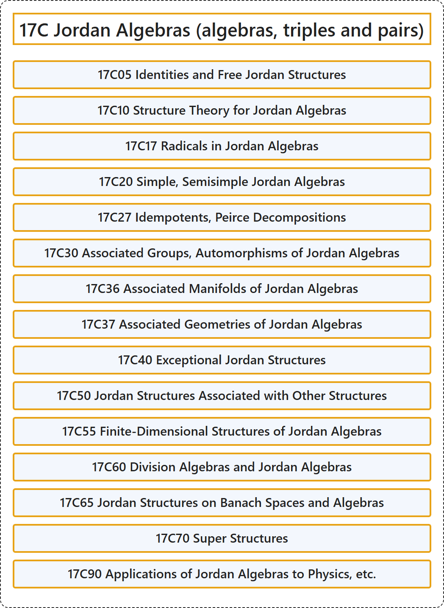

# 17C Jordan Algebras (algebras, triples and pairs)

## Classification

## Glossary

| Term | Definition | 中文翻译 | Source |
|---|---|---|---|
| **17C Jordan Algebras (algebras, triples and pairs)** 若尔当代数（代数、三系与对） | (No definition) | （无定义） | [Associate Editors of Mathematical Reviews and zbMATH, 2020](https://msc2020.org/) |
| **17C05 Identities and Free Jordan Structures** 恒等式与自由若尔当结构 | (No definition) | （无定义） | [Associate Editors of Mathematical Reviews and zbMATH, 2020](https://msc2020.org/) |
| **17C10 Structure Theory for Jordan Algebras** 若尔当代数的结构理论 | (No definition) | （无定义） | [Associate Editors of Mathematical Reviews and zbMATH, 2020](https://msc2020.org/) |
| **17C17 Radicals in Jordan Algebras** 若尔当代数中的根 | (No definition) | （无定义） | [Associate Editors of Mathematical Reviews and zbMATH, 2020](https://msc2020.org/) |
| **17C20 Simple, Semisimple Jordan Algebras** 单若尔当代数、半单若尔当代数 | (No definition) | （无定义） | [Associate Editors of Mathematical Reviews and zbMATH, 2020](https://msc2020.org/) |
| **17C27 Idempotents, Peirce Decompositions** 幂等元、皮尔斯分解 | (No definition) | （无定义） | [Associate Editors of Mathematical Reviews and zbMATH, 2020](https://msc2020.org/) |
| **17C30 Associated Groups, Automorphisms of Jordan Algebras** 若尔当代数的相伴群、自同构 | (No definition) | （无定义） | [Associate Editors of Mathematical Reviews and zbMATH, 2020](https://msc2020.org/) |
| **17C36 Associated Manifolds of Jordan Algebras** 若尔当代数的相伴流形 | (No definition) | （无定义） | [Associate Editors of Mathematical Reviews and zbMATH, 2020](https://msc2020.org/) |
| **17C37 Associated Geometries of Jordan Algebras** 若尔当代数的相伴几何 | (No definition) | （无定义） | [Associate Editors of Mathematical Reviews and zbMATH, 2020](https://msc2020.org/) |
| **17C40 Exceptional Jordan Structures** 例外若尔当结构 | (No definition) | （无定义） | [Associate Editors of Mathematical Reviews and zbMATH, 2020](https://msc2020.org/) |
| **17C50 Jordan Structures Associated with Other Structures** 与其他结构相伴的若尔当结构 | (No definition) | （无定义） | [Associate Editors of Mathematical Reviews and zbMATH, 2020](https://msc2020.org/) |
| **17C55 Finite-Dimensional Structures of Jordan Algebras** 若尔当代数的有限维结构 | (No definition) | （无定义） | [Associate Editors of Mathematical Reviews and zbMATH, 2020](https://msc2020.org/) |
| **17C60 Division Algebras and Jordan Algebras** 除代数与若尔当代数 | (No definition) | （无定义） | [Associate Editors of Mathematical Reviews and zbMATH, 2020](https://msc2020.org/) |
| **17C65 Jordan Structures on Banach Spaces and Algebras** 巴拿赫空间与巴拿赫代数上的若尔当结构 | (No definition) | （无定义） | [Associate Editors of Mathematical Reviews and zbMATH, 2020](https://msc2020.org/) |
| **17C70 Super Structures** 超结构 | (No definition) | （无定义） | [Associate Editors of Mathematical Reviews and zbMATH, 2020](https://msc2020.org/) |
| **17C90 Applications of Jordan Algebras to Physics, etc.** 若尔当代数在物理学等方面的应用 | (No definition) | （无定义） | [Associate Editors of Mathematical Reviews and zbMATH, 2020](https://msc2020.org/) |

## References

Associate Editors of Mathematical Reviews and zbMATH. (2020). *MSC2020: Mathematics Subject Classification system*. Retrieved October 27, 2026, from <https://msc2020.org/>
