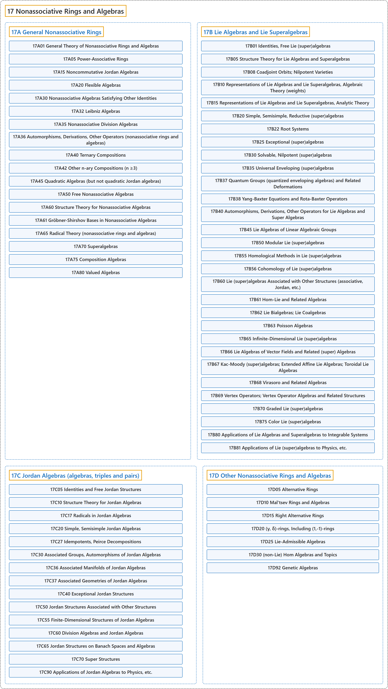

# 17 Nonassociative Rings and Algebras

## Classification

## Glossary

| Term | Definition | 中文翻译 | Source |
|---|---|---|---|
| **17 Nonassociative Rings and Algebras** 非结合环与非结合代数 | "A nonassociative algebra is an algebra which **does not satisfy** a(bc)=(ab)c." | 非结合代数是**不满足** a(bc)=(ab)c 的代数。 | [Weisstein, n.d., "Nonassociative algebra" entry, para. 1](https://mathworld.wolfram.com/NonassociativeAlgebra.html#:~:text=A%20nonassociative%20algebra%20is%20an%20algebra%20which%20does%20not%20satisfy) |
| **[17A General Nonassociative Rings](17a-general-nonassociative-rings.md)** 一般非结合环 | (No definition) | （无定义） | [Associate Editors of Mathematical Reviews and zbMATH, 2020](https://msc2020.org/) |
| **[17B Lie Algebras and Lie Superalgebras](17b-lie-algebras-and-lie-superalgebras.md)** 李代数与李超代数 | (No definition) | （无定义） | [Associate Editors of Mathematical Reviews and zbMATH, 2020](https://msc2020.org/) |
| **[17C Jordan Algebras (algebras, triples and pairs)](17c-jordan-algebras-algebras-triples-and-pairs.md)** 若尔当代数（代数、三系与对） | (No definition) | （无定义） | [Associate Editors of Mathematical Reviews and zbMATH, 2020](https://msc2020.org/) |
| **[17D Other Nonassociative Rings and Algebras](17d-other-nonassociative-rings-and-algebras.md)** 其他非结合环与非结合代数 | (No definition) | （无定义） | [Associate Editors of Mathematical Reviews and zbMATH, 2020](https://msc2020.org/) |

## References

Associate Editors of Mathematical Reviews and zbMATH. (2020). *MSC2020: Mathematics Subject Classification system*. Retrieved October 27, 2026, from <https://msc2020.org/>

Weisstein, E. W. (n.d.). *Nonassociative algebra*. MathWorld: A Wolfram Resource. Retrieved October 27, 2026, from <https://mathworld.wolfram.com/NonassociativeAlgebra.html>
