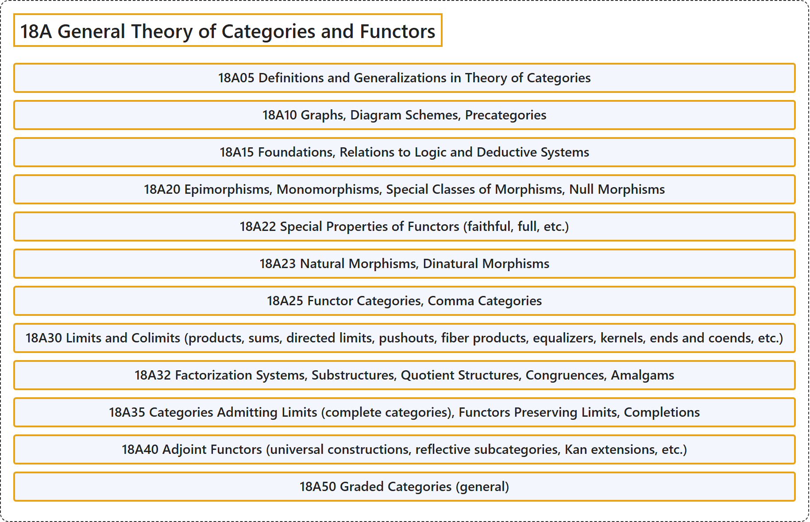

# 18A General Theory of Categories and Functors

## Classification

## Glossary

| Term | Definition | 中文翻译 | Source |
|---|---|---|---|
| **18A General Theory of Categories and Functors** 范畴与函子的一般理论 | (No definition) | （无定义） | [Associate Editors of Mathematical Reviews and zbMATH, 2020](https://msc2020.org/) |
| **18A05 Definitions and Generalizations in Theory of Categories** 范畴论中的定义与推广 | (No definition) | （无定义） | [Associate Editors of Mathematical Reviews and zbMATH, 2020](https://msc2020.org/) |
| **18A10 Graphs, Diagram Schemes, Precategories** 图、图式、预范畴 | (No definition) | （无定义） | [Associate Editors of Mathematical Reviews and zbMATH, 2020](https://msc2020.org/) |
| **18A15 Foundations, Relations to Logic and Deductive Systems** 基础、与逻辑和演绎系统的关系 | (No definition) | （无定义） | [Associate Editors of Mathematical Reviews and zbMATH, 2020](https://msc2020.org/) |
| **18A20 Epimorphisms, Monomorphisms, Special Classes of Morphisms, Null Morphisms** 满态射、单态射、特殊类的态射、零态射 | (No definition) | （无定义） | [Associate Editors of Mathematical Reviews and zbMATH, 2020](https://msc2020.org/) |
| **18A22 Special Properties of Functors (faithful, full, etc.)** 函子的特殊性质（忠实、满等） | (No definition) | （无定义） | [Associate Editors of Mathematical Reviews and zbMATH, 2020](https://msc2020.org/) |
| **18A23 Natural Morphisms, Dinatural Morphisms** 自然态射、双自然态射 | (No definition) | （无定义） | [Associate Editors of Mathematical Reviews and zbMATH, 2020](https://msc2020.org/) |
| **18A25 Functor Categories, Comma Categories** 函子范畴、逗号范畴 | (No definition) | （无定义） | [Associate Editors of Mathematical Reviews and zbMATH, 2020](https://msc2020.org/) |
| **18A30 Limits and Colimits (products, sums, directed limits, pushouts, fiber products, equalizers, kernels, ends and coends, etc.)** 极限与余极限（积、和、有向极限、推出、纤维积、均衡子、核、端与余端等） | (No definition) | （无定义） | [Associate Editors of Mathematical Reviews and zbMATH, 2020](https://msc2020.org/) |
| **18A32 Factorization Systems, Substructures, Quotient Structures, Congruences, Amalgams** 分解系统、子结构、商结构、同余、并合 | (No definition) | （无定义） | [Associate Editors of Mathematical Reviews and zbMATH, 2020](https://msc2020.org/) |
| **18A35 Categories Admitting Limits (complete categories), Functors Preserving Limits, Completions** 容许极限的范畴（完备范畴）、保持极限的函子、完备化 | (No definition) | （无定义） | [Associate Editors of Mathematical Reviews and zbMATH, 2020](https://msc2020.org/) |
| **18A40 Adjoint Functors (universal constructions, reflective subcategories, Kan extensions, etc.)** 伴随函子（泛构造、反射子范畴、坎扩张等） | (No definition) | （无定义） | [Associate Editors of Mathematical Reviews and zbMATH, 2020](https://msc2020.org/) |
| **18A50 Graded Categories (general)** 分次范畴（一般） | (No definition) | （无定义） | [Associate Editors of Mathematical Reviews and zbMATH, 2020](https://msc2020.org/) |

## References

Associate Editors of Mathematical Reviews and zbMATH. (2020). *MSC2020: Mathematics Subject Classification system*. Retrieved October 27, 2026, from <https://msc2020.org/>
