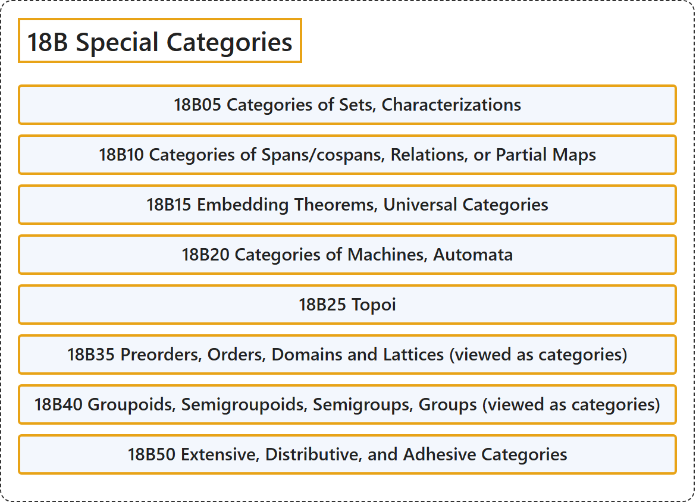

# 18B Special Categories

## Classification

## Glossary

| Term | Definition | 中文翻译 | Source |
|---|---|---|---|
| **18B Special Categories** 特殊范畴 | (No definition) | （无定义） | [Associate Editors of Mathematical Reviews and zbMATH, 2020](https://msc2020.org/) |
| **18B05 Categories of Sets, Characterizations** 集合范畴、刻画 | (No definition) | （无定义） | [Associate Editors of Mathematical Reviews and zbMATH, 2020](https://msc2020.org/) |
| **18B10 Categories of Spans/cospans, Relations, or Partial Maps** 跨度/余跨度范畴、关系范畴或偏映射范畴 | (No definition) | （无定义） | [Associate Editors of Mathematical Reviews and zbMATH, 2020](https://msc2020.org/) |
| **18B15 Embedding Theorems, Universal Categories** 嵌入定理、泛范畴 | (No definition) | （无定义） | [Associate Editors of Mathematical Reviews and zbMATH, 2020](https://msc2020.org/) |
| **18B20 Categories of Machines, Automata** 机器范畴、自动机范畴 | (No definition) | （无定义） | [Associate Editors of Mathematical Reviews and zbMATH, 2020](https://msc2020.org/) |
| **18B25 Topoi** topos | (No definition) | （无定义） | [Associate Editors of Mathematical Reviews and zbMATH, 2020](https://msc2020.org/) |
| **18B35 Preorders, Orders, Domains and Lattices (viewed as categories)** 预序、序、域与格（视为范畴） | (No definition) | （无定义） | [Associate Editors of Mathematical Reviews and zbMATH, 2020](https://msc2020.org/) |
| **18B40 Groupoids, Semigroupoids, Semigroups, Groups (viewed as categories)** 广群、半广群、半群、群（视为范畴） | (No definition) | （无定义） | [Associate Editors of Mathematical Reviews and zbMATH, 2020](https://msc2020.org/) |
| **18B50 Extensive, Distributive, and Adhesive Categories** 外延范畴、分配范畴与黏合范畴 | (No definition) | （无定义） | [Associate Editors of Mathematical Reviews and zbMATH, 2020](https://msc2020.org/) |

## References

Associate Editors of Mathematical Reviews and zbMATH. (2020). *MSC2020: Mathematics Subject Classification system*. Retrieved October 27, 2026, from <https://msc2020.org/>
