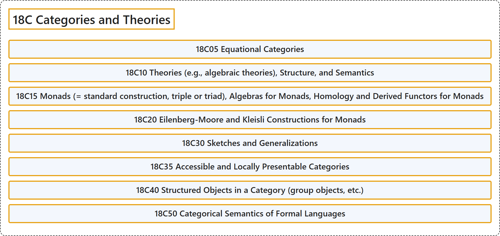

# 18C Categories and Theories

## Classification

## Glossary

| Term | Definition | 中文翻译 | Source |
|---|---|---|---|
| **18C Categories and Theories** 范畴与理论 | (No definition) | （无定义） | [Associate Editors of Mathematical Reviews and zbMATH, 2020](https://msc2020.org/) |
| **18C05 Equational Categories** 方程范畴 | (No definition) | （无定义） | [Associate Editors of Mathematical Reviews and zbMATH, 2020](https://msc2020.org/) |
| **18C10 Theories (e.g., algebraic theories), Structure, and Semantics** 理论（例如代数理论）、结构与语义 | (No definition) | （无定义） | [Associate Editors of Mathematical Reviews and zbMATH, 2020](https://msc2020.org/) |
| **18C15 Monads (= standard construction, triple or triad), Algebras for Monads, Homology and Derived Functors for Monads** 单子（= 标准构造、三元组或三元体）、单子的代数、单子的同调与导出函子 | (No definition) | （无定义） | [Associate Editors of Mathematical Reviews and zbMATH, 2020](https://msc2020.org/) |
| **18C20 Eilenberg-Moore and Kleisli Constructions for Monads** 单子的艾伦伯格-摩尔构造与克莱斯利构造 | (No definition) | （无定义） | [Associate Editors of Mathematical Reviews and zbMATH, 2020](https://msc2020.org/) |
| **18C30 Sketches and Generalizations** 草图及其推广 | (No definition) | （无定义） | [Associate Editors of Mathematical Reviews and zbMATH, 2020](https://msc2020.org/) |
| **18C35 Accessible and Locally Presentable Categories** 可达范畴与局部可表现范畴 | (No definition) | （无定义） | [Associate Editors of Mathematical Reviews and zbMATH, 2020](https://msc2020.org/) |
| **18C40 Structured Objects in a Category (group objects, etc.)** 范畴中的结构对象（群对象等） | (No definition) | （无定义） | [Associate Editors of Mathematical Reviews and zbMATH, 2020](https://msc2020.org/) |
| **18C50 Categorical Semantics of Formal Languages** 形式语言的范畴语义 | (No definition) | （无定义） | [Associate Editors of Mathematical Reviews and zbMATH, 2020](https://msc2020.org/) |

## References

Associate Editors of Mathematical Reviews and zbMATH. (2020). *MSC2020: Mathematics Subject Classification system*. Retrieved October 27, 2026, from <https://msc2020.org/>
