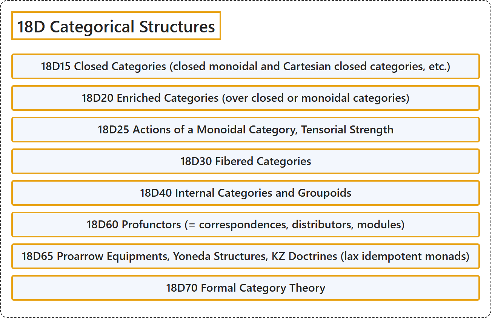

# 18D Categorical Structures

## Classification

## Glossary

| Term | Definition | 中文翻译 | Source |
|---|---|---|---|
| **18D Categorical Structures** 范畴结构 | (No definition) | （无定义） | [Associate Editors of Mathematical Reviews and zbMATH, 2020](https://msc2020.org/) |
| **18D15 Closed Categories (closed monoidal and Cartesian closed categories, etc.)** 闭范畴（闭幺半范畴与笛卡尔闭范畴等） | (No definition) | （无定义） | [Associate Editors of Mathematical Reviews and zbMATH, 2020](https://msc2020.org/) |
| **18D20 Enriched Categories (over closed or monoidal categories)** 富足范畴（闭范畴或幺半范畴上的） | (No definition) | （无定义） | [Associate Editors of Mathematical Reviews and zbMATH, 2020](https://msc2020.org/) |
| **18D25 Actions of a Monoidal Category, Tensorial Strength** 幺半范畴的作用、张量强度 | (No definition) | （无定义） | [Associate Editors of Mathematical Reviews and zbMATH, 2020](https://msc2020.org/) |
| **18D30 Fibered Categories** 纤维范畴 | (No definition) | （无定义） | [Associate Editors of Mathematical Reviews and zbMATH, 2020](https://msc2020.org/) |
| **18D40 Internal Categories and Groupoids** 内部范畴与广群 | (No definition) | （无定义） | [Associate Editors of Mathematical Reviews and zbMATH, 2020](https://msc2020.org/) |
| **18D60 Profunctors (= correspondences, distributors, modules)** 前函子（= 对应、分配子、模） | (No definition) | （无定义） | [Associate Editors of Mathematical Reviews and zbMATH, 2020](https://msc2020.org/) |
| **18D65 Proarrow Equipments, Yoneda Structures, KZ Doctrines (lax idempotent monads)** 前箭头装备、米田结构、KZ学说（松幂等单子） | (No definition) | （无定义） | [Associate Editors of Mathematical Reviews and zbMATH, 2020](https://msc2020.org/) |
| **18D70 Formal Category Theory** 形式范畴论 | (No definition) | （无定义） | [Associate Editors of Mathematical Reviews and zbMATH, 2020](https://msc2020.org/) |

## References

Associate Editors of Mathematical Reviews and zbMATH. (2020). *MSC2020: Mathematics Subject Classification system*. Retrieved October 27, 2026, from <https://msc2020.org/>
