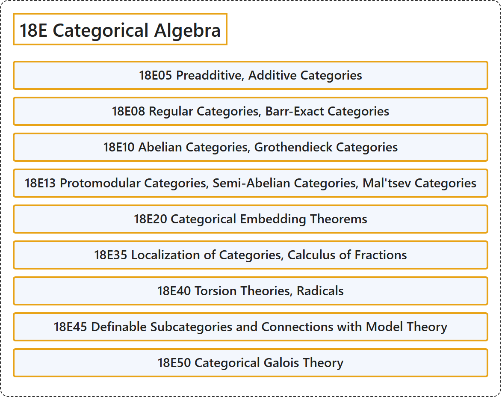

# 18E Categorical Algebra

## Classification

## Glossary

| Term | Definition | 中文翻译 | Source |
|---|---|---|---|
| **18E Categorical Algebra** 范畴代数 | (No definition) | （无定义） | [Associate Editors of Mathematical Reviews and zbMATH, 2020](https://msc2020.org/) |
| **18E05 Preadditive, Additive Categories** 预加法范畴、加法范畴 | (No definition) | （无定义） | [Associate Editors of Mathematical Reviews and zbMATH, 2020](https://msc2020.org/) |
| **18E08 Regular Categories, Barr-Exact Categories** 正则范畴、巴尔正合范畴 | (No definition) | （无定义） | [Associate Editors of Mathematical Reviews and zbMATH, 2020](https://msc2020.org/) |
| **18E10 Abelian Categories, Grothendieck Categories** 阿贝尔范畴、格罗滕迪克范畴 | (No definition) | （无定义） | [Associate Editors of Mathematical Reviews and zbMATH, 2020](https://msc2020.org/) |
| **18E13 Protomodular Categories, Semi-Abelian Categories, Mal'tsev Categories** 原模范畴、半阿贝尔范畴、马尔采夫范畴 | (No definition) | （无定义） | [Associate Editors of Mathematical Reviews and zbMATH, 2020](https://msc2020.org/) |
| **18E20 Categorical Embedding Theorems** 范畴嵌入定理 | (No definition) | （无定义） | [Associate Editors of Mathematical Reviews and zbMATH, 2020](https://msc2020.org/) |
| **18E35 Localization of Categories, Calculus of Fractions** 范畴的局部化、分式演算 | (No definition) | （无定义） | [Associate Editors of Mathematical Reviews and zbMATH, 2020](https://msc2020.org/) |
| **18E40 Torsion Theories, Radicals** 挠理论、根 | (No definition) | （无定义） | [Associate Editors of Mathematical Reviews and zbMATH, 2020](https://msc2020.org/) |
| **18E45 Definable Subcategories and Connections with Model Theory** 可定义子范畴及其与模型论的联系 | (No definition) | （无定义） | [Associate Editors of Mathematical Reviews and zbMATH, 2020](https://msc2020.org/) |
| **18E50 Categorical Galois Theory** 范畴伽罗瓦理论 | (No definition) | （无定义） | [Associate Editors of Mathematical Reviews and zbMATH, 2020](https://msc2020.org/) |

## References

Associate Editors of Mathematical Reviews and zbMATH. (2020). *MSC2020: Mathematics Subject Classification system*. Retrieved October 27, 2026, from <https://msc2020.org/>
