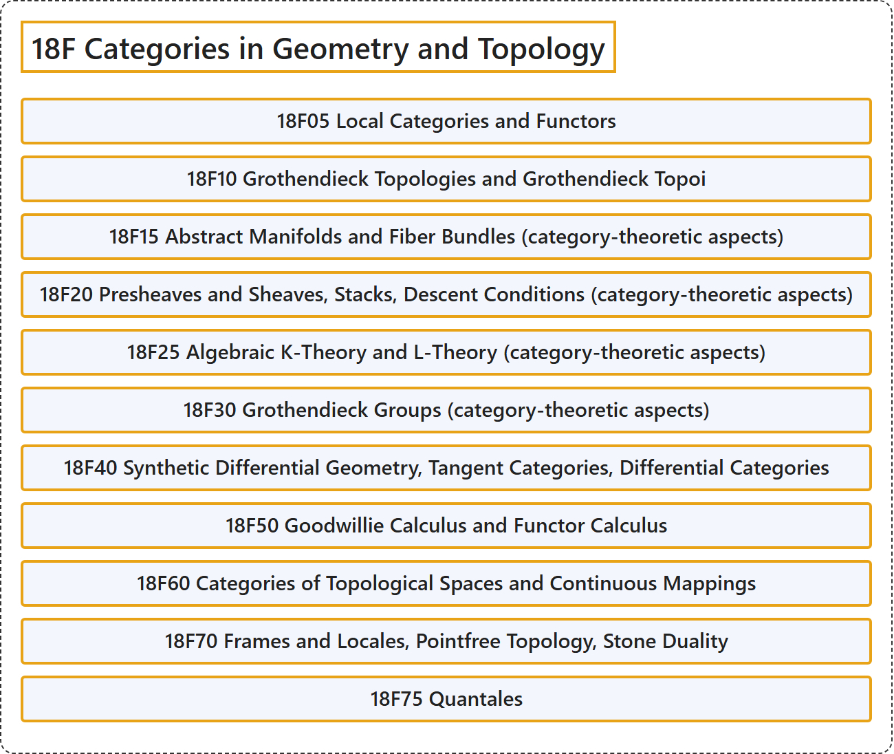

# 18F Categories in Geometry and Topology

## Classification

## Glossary

| Term | Definition | 中文翻译 | Source |
|---|---|---|---|
| **18F Categories in Geometry and Topology** 几何与拓扑中的范畴 | (No definition) | （无定义） | [Associate Editors of Mathematical Reviews and zbMATH, 2020](https://msc2020.org/) |
| **18F05 Local Categories and Functors** 局部范畴与局部函子 | (No definition) | （无定义） | [Associate Editors of Mathematical Reviews and zbMATH, 2020](https://msc2020.org/) |
| **18F10 Grothendieck Topologies and Grothendieck Topoi** 格罗滕迪克拓扑与格罗滕迪克topos | (No definition) | （无定义） | [Associate Editors of Mathematical Reviews and zbMATH, 2020](https://msc2020.org/) |
| **18F15 Abstract Manifolds and Fiber Bundles (category-theoretic aspects)** 抽象流形与纤维丛（范畴论方面） | (No definition) | （无定义） | [Associate Editors of Mathematical Reviews and zbMATH, 2020](https://msc2020.org/) |
| **18F20 Presheaves and Sheaves, Stacks, Descent Conditions (category-theoretic aspects)** 预层与层、叠、下降条件（范畴论方面） | (No definition) | （无定义） | [Associate Editors of Mathematical Reviews and zbMATH, 2020](https://msc2020.org/) |
| **18F25 Algebraic K-Theory and L-Theory (category-theoretic aspects)** 代数K理论与L理论（范畴论方面） | (No definition) | （无定义） | [Associate Editors of Mathematical Reviews and zbMATH, 2020](https://msc2020.org/) |
| **18F30 Grothendieck Groups (category-theoretic aspects)** 格罗滕迪克群（范畴论方面） | (No definition) | （无定义） | [Associate Editors of Mathematical Reviews and zbMATH, 2020](https://msc2020.org/) |
| **18F40 Synthetic Differential Geometry, Tangent Categories, Differential Categories** 合成微分几何、切范畴、微分范畴 | (No definition) | （无定义） | [Associate Editors of Mathematical Reviews and zbMATH, 2020](https://msc2020.org/) |
| **18F50 Goodwillie Calculus and Functor Calculus** 古德威利演算与函子演算 | (No definition) | （无定义） | [Associate Editors of Mathematical Reviews and zbMATH, 2020](https://msc2020.org/) |
| **18F60 Categories of Topological Spaces and Continuous Mappings** 拓扑空间与连续映射的范畴 | (No definition) | （无定义） | [Associate Editors of Mathematical Reviews and zbMATH, 2020](https://msc2020.org/) |
| **18F70 Frames and Locales, Pointfree Topology, Stone Duality** 框架与局部、无点拓扑、斯通对偶 | (No definition) | （无定义） | [Associate Editors of Mathematical Reviews and zbMATH, 2020](https://msc2020.org/) |
| **18F75 Quantales** 量子量 | (No definition) | （无定义） | [Associate Editors of Mathematical Reviews and zbMATH, 2020](https://msc2020.org/) |

## References

Associate Editors of Mathematical Reviews and zbMATH. (2020). *MSC2020: Mathematics Subject Classification system*. Retrieved October 27, 2026, from <https://msc2020.org/>
