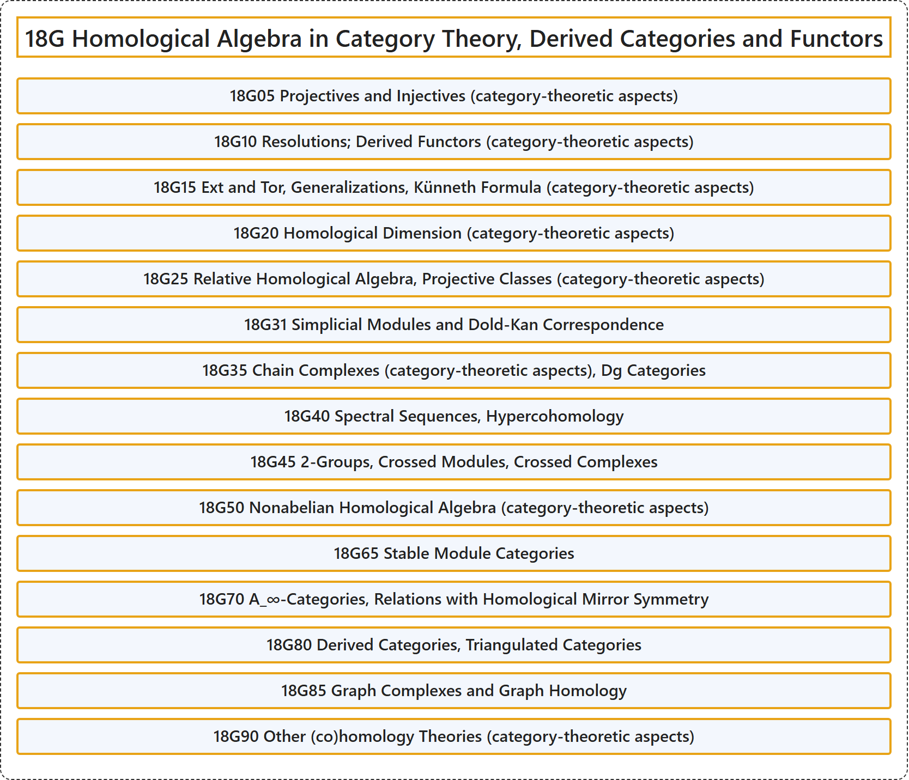

# 18G Homological Algebra in Category Theory, Derived Categories and Functors

## Classification

## Glossary

| Term | Definition | 中文翻译 | Source |
|---|---|---|---|
| **18G Homological Algebra in Category Theory, Derived Categories and Functors** 范畴论中的同调代数、导出范畴与导出函子 | (No definition) | （无定义） | [Associate Editors of Mathematical Reviews and zbMATH, 2020](https://msc2020.org/) |
| **18G05 Projectives and Injectives (category-theoretic aspects)** 射影对象与内射对象（范畴论方面） | (No definition) | （无定义） | [Associate Editors of Mathematical Reviews and zbMATH, 2020](https://msc2020.org/) |
| **18G10 Resolutions; Derived Functors (category-theoretic aspects)** 分解；导出函子（范畴论方面） | (No definition) | （无定义） | [Associate Editors of Mathematical Reviews and zbMATH, 2020](https://msc2020.org/) |
| **18G15 Ext and Tor, Generalizations, Künneth Formula (category-theoretic aspects)** Ext与Tor、推广、屈内特公式（范畴论方面） | (No definition) | （无定义） | [Associate Editors of Mathematical Reviews and zbMATH, 2020](https://msc2020.org/) |
| **18G20 Homological Dimension (category-theoretic aspects)** 同调维数（范畴论方面） | (No definition) | （无定义） | [Associate Editors of Mathematical Reviews and zbMATH, 2020](https://msc2020.org/) |
| **18G25 Relative Homological Algebra, Projective Classes (category-theoretic aspects)** 相对同调代数、射影类（范畴论方面） | (No definition) | （无定义） | [Associate Editors of Mathematical Reviews and zbMATH, 2020](https://msc2020.org/) |
| **18G31 Simplicial Modules and Dold-Kan Correspondence** 单纯模与多尔德-坎对应 | (No definition) | （无定义） | [Associate Editors of Mathematical Reviews and zbMATH, 2020](https://msc2020.org/) |
| **18G35 Chain Complexes (category-theoretic aspects), Dg Categories** 链复形（范畴论方面）、dg范畴 | (No definition) | （无定义） | [Associate Editors of Mathematical Reviews and zbMATH, 2020](https://msc2020.org/) |
| **18G40 Spectral Sequences, Hypercohomology** 谱序列、超上同调 | (No definition) | （无定义） | [Associate Editors of Mathematical Reviews and zbMATH, 2020](https://msc2020.org/) |
| **18G45 2-Groups, Crossed Modules, Crossed Complexes** 2群、交叉模、交叉复形 | (No definition) | （无定义） | [Associate Editors of Mathematical Reviews and zbMATH, 2020](https://msc2020.org/) |
| **18G50 Nonabelian Homological Algebra (category-theoretic aspects)** 非阿贝尔同调代数（范畴论方面） | (No definition) | （无定义） | [Associate Editors of Mathematical Reviews and zbMATH, 2020](https://msc2020.org/) |
| **18G65 Stable Module Categories** 稳定模范畴 | (No definition) | （无定义） | [Associate Editors of Mathematical Reviews and zbMATH, 2020](https://msc2020.org/) |
| **18G70 A_∞-Categories, Relations with Homological Mirror Symmetry** A_∞范畴、与同调镜像对称的关系 | (No definition) | （无定义） | [Associate Editors of Mathematical Reviews and zbMATH, 2020](https://msc2020.org/) |
| **18G80 Derived Categories, Triangulated Categories** 导出范畴、三角范畴 | (No definition) | （无定义） | [Associate Editors of Mathematical Reviews and zbMATH, 2020](https://msc2020.org/) |
| **18G85 Graph Complexes and Graph Homology** 图复形与图同调 | (No definition) | （无定义） | [Associate Editors of Mathematical Reviews and zbMATH, 2020](https://msc2020.org/) |
| **18G90 Other (co)homology Theories (category-theoretic aspects)** 其他（上）同调理论（范畴论方面） | (No definition) | （无定义） | [Associate Editors of Mathematical Reviews and zbMATH, 2020](https://msc2020.org/) |

## References

Associate Editors of Mathematical Reviews and zbMATH. (2020). *MSC2020: Mathematics Subject Classification system*. Retrieved October 27, 2026, from <https://msc2020.org/>
