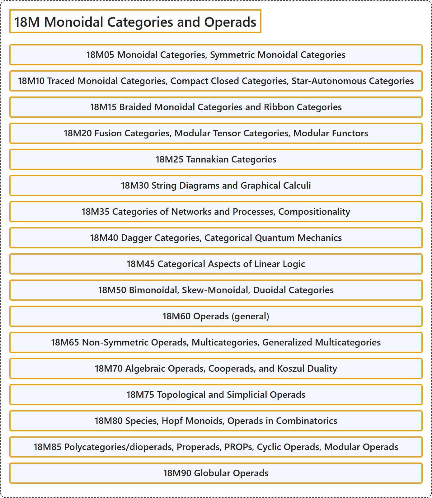

# 18M Monoidal Categories and Operads

## Classification

## Glossary

| Term | Definition | 中文翻译 | Source |
|---|---|---|---|
| **18M Monoidal Categories and Operads** 幺半范畴与操作数 | (No definition) | （无定义） | [Associate Editors of Mathematical Reviews and zbMATH, 2020](https://msc2020.org/) |
| **18M05 Monoidal Categories, Symmetric Monoidal Categories** 幺半范畴、对称幺半范畴 | (No definition) | （无定义） | [Associate Editors of Mathematical Reviews and zbMATH, 2020](https://msc2020.org/) |
| **18M10 Traced Monoidal Categories, Compact Closed Categories, Star-Autonomous Categories** 迹幺半范畴、紧闭范畴、星自伴范畴 | (No definition) | （无定义） | [Associate Editors of Mathematical Reviews and zbMATH, 2020](https://msc2020.org/) |
| **18M15 Braided Monoidal Categories and Ribbon Categories** 辫幺半范畴与带状范畴 | (No definition) | （无定义） | [Associate Editors of Mathematical Reviews and zbMATH, 2020](https://msc2020.org/) |
| **18M20 Fusion Categories, Modular Tensor Categories, Modular Functors** 融合范畴、模张量范畴、模函子 | (No definition) | （无定义） | [Associate Editors of Mathematical Reviews and zbMATH, 2020](https://msc2020.org/) |
| **18M25 Tannakian Categories** 坦纳卡范畴 | (No definition) | （无定义） | [Associate Editors of Mathematical Reviews and zbMATH, 2020](https://msc2020.org/) |
| **18M30 String Diagrams and Graphical Calculi** 弦图与图形演算 | (No definition) | （无定义） | [Associate Editors of Mathematical Reviews and zbMATH, 2020](https://msc2020.org/) |
| **18M35 Categories of Networks and Processes, Compositionality** 网络与过程的范畴、组合性 | (No definition) | （无定义） | [Associate Editors of Mathematical Reviews and zbMATH, 2020](https://msc2020.org/) |
| **18M40 Dagger Categories, Categorical Quantum Mechanics** 匕首范畴、范畴量子力学 | (No definition) | （无定义） | [Associate Editors of Mathematical Reviews and zbMATH, 2020](https://msc2020.org/) |
| **18M45 Categorical Aspects of Linear Logic** 线性逻辑的范畴方面 | (No definition) | （无定义） | [Associate Editors of Mathematical Reviews and zbMATH, 2020](https://msc2020.org/) |
| **18M50 Bimonoidal, Skew-Monoidal, Duoidal Categories** 双幺半范畴、斜幺半范畴、二元幺半范畴 | (No definition) | （无定义） | [Associate Editors of Mathematical Reviews and zbMATH, 2020](https://msc2020.org/) |
| **18M60 Operads (general)** 算子范畴（一般） | (No definition) | （无定义） | [Associate Editors of Mathematical Reviews and zbMATH, 2020](https://msc2020.org/) |
| **18M65 Non-Symmetric Operads, Multicategories, Generalized Multicategories** 非对称算子范畴、多范畴、广义多范畴 | (No definition) | （无定义） | [Associate Editors of Mathematical Reviews and zbMATH, 2020](https://msc2020.org/) |
| **18M70 Algebraic Operads, Cooperads, and Koszul Duality** 代数算子范畴、余算子范畴与科斯居尔对偶 | (No definition) | （无定义） | [Associate Editors of Mathematical Reviews and zbMATH, 2020](https://msc2020.org/) |
| **18M75 Topological and Simplicial Operads** 拓扑算子范畴与单纯算子范畴 | (No definition) | （无定义） | [Associate Editors of Mathematical Reviews and zbMATH, 2020](https://msc2020.org/) |
| **18M80 Species, Hopf Monoids, Operads in Combinatorics** 物种、霍普夫幺半群、组合学中的算子范畴 | (No definition) | （无定义） | [Associate Editors of Mathematical Reviews and zbMATH, 2020](https://msc2020.org/) |
| **18M85 Polycategories/dioperads, Properads, PROPs, Cyclic Operads, Modular Operads** 多范畴/双算子范畴、properad、PROP、循环算子范畴、模算子范畴 | (No definition) | （无定义） | [Associate Editors of Mathematical Reviews and zbMATH, 2020](https://msc2020.org/) |
| **18M90 Globular Operads** 球状算子范畴 | (No definition) | （无定义） | [Associate Editors of Mathematical Reviews and zbMATH, 2020](https://msc2020.org/) |

## References

Associate Editors of Mathematical Reviews and zbMATH. (2020). *MSC2020: Mathematics Subject Classification system*. Retrieved October 27, 2026, from <https://msc2020.org/>
