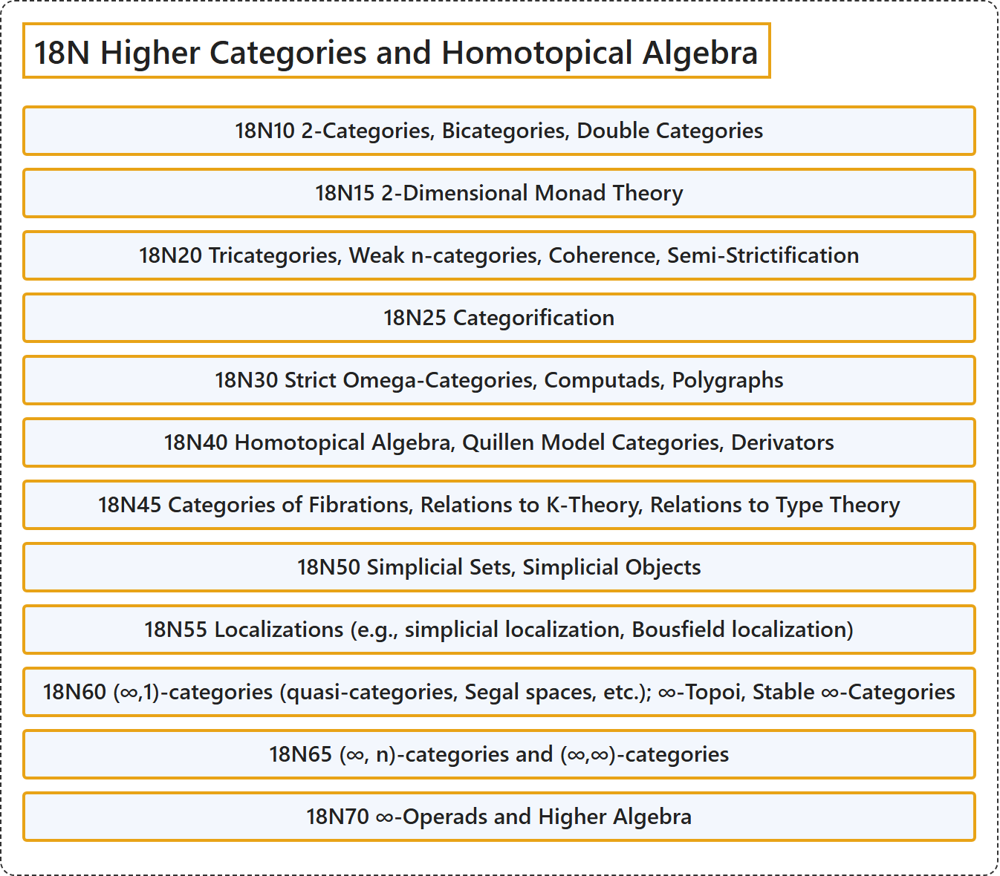

# 18N Higher Categories and Homotopical Algebra

## Classification

## Glossary

| Term | Definition | 中文翻译 | Source |
|---|---|---|---|
| **18N Higher Categories and Homotopical Algebra** 高阶范畴与同伦代数 | (No definition) | （无定义） | [Associate Editors of Mathematical Reviews and zbMATH, 2020](https://msc2020.org/) |
| **18N10 2-Categories, Bicategories, Double Categories** 2范畴、双范畴、二重范畴 | (No definition) | （无定义） | [Associate Editors of Mathematical Reviews and zbMATH, 2020](https://msc2020.org/) |
| **18N15 2-Dimensional Monad Theory** 二维单子理论 | (No definition) | （无定义） | [Associate Editors of Mathematical Reviews and zbMATH, 2020](https://msc2020.org/) |
| **18N20 Tricategories, Weak n-categories, Coherence, Semi-Strictification** 三范畴、弱n范畴、融贯性、半严格化 | (No definition) | （无定义） | [Associate Editors of Mathematical Reviews and zbMATH, 2020](https://msc2020.org/) |
| **18N25 Categorification** 范畴化 | (No definition) | （无定义） | [Associate Editors of Mathematical Reviews and zbMATH, 2020](https://msc2020.org/) |
| **18N30 Strict Omega-Categories, Computads, Polygraphs** 严格ω范畴、computad、多图 | (No definition) | （无定义） | [Associate Editors of Mathematical Reviews and zbMATH, 2020](https://msc2020.org/) |
| **18N40 Homotopical Algebra, Quillen Model Categories, Derivators** 同伦代数、奎伦模型范畴、导子 | (No definition) | （无定义） | [Associate Editors of Mathematical Reviews and zbMATH, 2020](https://msc2020.org/) |
| **18N45 Categories of Fibrations, Relations to K-Theory, Relations to Type Theory** 纤维化范畴、与K理论的关系、与类型论的关系 | (No definition) | （无定义） | [Associate Editors of Mathematical Reviews and zbMATH, 2020](https://msc2020.org/) |
| **18N50 Simplicial Sets, Simplicial Objects** 单纯集、单纯对象 | (No definition) | （无定义） | [Associate Editors of Mathematical Reviews and zbMATH, 2020](https://msc2020.org/) |
| **18N55 Localizations (e.g., simplicial localization, Bousfield localization)** 局部化（例如单纯局部化、布斯菲尔德局部化） | (No definition) | （无定义） | [Associate Editors of Mathematical Reviews and zbMATH, 2020](https://msc2020.org/) |
| **18N60 (∞,1)-categories (quasi-categories, Segal spaces, etc.); ∞-Topoi, Stable ∞-Categories** （∞,1）范畴（拟范畴、塞格尔空间等）；∞topos、稳定∞范畴 | (No definition) | （无定义） | [Associate Editors of Mathematical Reviews and zbMATH, 2020](https://msc2020.org/) |
| **18N65 (∞, n)-categories and (∞,∞)-categories** （∞, n）范畴与（∞,∞）范畴 | (No definition) | （无定义） | [Associate Editors of Mathematical Reviews and zbMATH, 2020](https://msc2020.org/) |
| **18N70 ∞-Operads and Higher Algebra** ∞算子范畴与高阶代数 | (No definition) | （无定义） | [Associate Editors of Mathematical Reviews and zbMATH, 2020](https://msc2020.org/) |

## References

Associate Editors of Mathematical Reviews and zbMATH. (2020). *MSC2020: Mathematics Subject Classification system*. Retrieved October 27, 2026, from <https://msc2020.org/>
