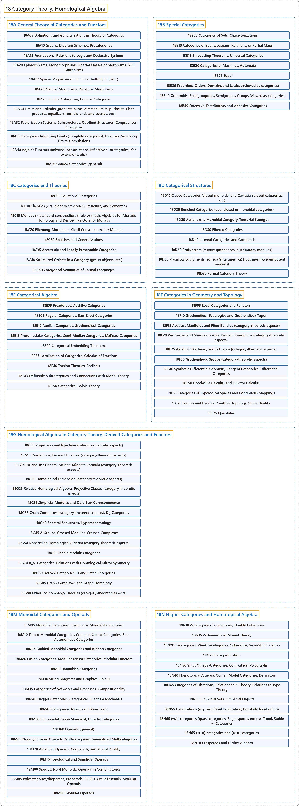

# 18 Category Theory; Homological Algebra

## Classification

## Glossary

| Term | Definition | 中文翻译 | Source |
|---|---|---|---|
| **18 Category Theory; Homological Algebra** 范畴论；同调代数 | "The branch of mathematics which formalizes a number of **algebraic properties of collections of transformations between mathematical objects** (such as binary relations, groups, sets, topological spaces, etc.) of the same type ..." | 这个数学分支把同一类型的数学对象（如二元关系、群、集合、拓扑空间等）之间**变换的汇集所具有的若干代数性质**加以形式化…… | [Weisstein, n.d., "Category theory" entry, para. 1](https://mathworld.wolfram.com/CategoryTheory.html#:~:text=The%20branch%20of%20mathematics%20which%20formalizes%20a%20number%20of%20algebraic%20properties) |
| **[18A General Theory of Categories and Functors](18a-general-theory-of-categories-and-functors.md)** 范畴与函子的一般理论 | (No definition) | （无定义） | [Associate Editors of Mathematical Reviews and zbMATH, 2020](https://msc2020.org/) |
| **[18B Special Categories](18b-special-categories.md)** 特殊范畴 | (No definition) | （无定义） | [Associate Editors of Mathematical Reviews and zbMATH, 2020](https://msc2020.org/) |
| **[18C Categories and Theories](18c-categories-and-theories.md)** 范畴与理论 | (No definition) | （无定义） | [Associate Editors of Mathematical Reviews and zbMATH, 2020](https://msc2020.org/) |
| **[18D Categorical Structures](18d-categorical-structures.md)** 范畴结构 | (No definition) | （无定义） | [Associate Editors of Mathematical Reviews and zbMATH, 2020](https://msc2020.org/) |
| **[18E Categorical Algebra](18e-categorical-algebra.md)** 范畴代数 | (No definition) | （无定义） | [Associate Editors of Mathematical Reviews and zbMATH, 2020](https://msc2020.org/) |
| **[18F Categories in Geometry and Topology](18f-categories-in-geometry-and-topology.md)** 几何与拓扑中的范畴 | (No definition) | （无定义） | [Associate Editors of Mathematical Reviews and zbMATH, 2020](https://msc2020.org/) |
| **[18G Homological Algebra in Category Theory, Derived Categories and Functors](18g-homological-algebra-in-category-theory-derived-categories-an.md)** 范畴论中的同调代数、导出范畴与导出函子 | (No definition) | （无定义） | [Associate Editors of Mathematical Reviews and zbMATH, 2020](https://msc2020.org/) |
| **[18M Monoidal Categories and Operads](18m-monoidal-categories-and-operads.md)** 幺半范畴与操作数 | (No definition) | （无定义） | [Associate Editors of Mathematical Reviews and zbMATH, 2020](https://msc2020.org/) |
| **[18N Higher Categories and Homotopical Algebra](18n-higher-categories-and-homotopical-algebra.md)** 高阶范畴与同伦代数 | (No definition) | （无定义） | [Associate Editors of Mathematical Reviews and zbMATH, 2020](https://msc2020.org/) |

## References

Associate Editors of Mathematical Reviews and zbMATH. (2020). *MSC2020: Mathematics Subject Classification system*. Retrieved October 27, 2026, from <https://msc2020.org/>

Weisstein, E. W. (n.d.). *Category theory*. MathWorld: A Wolfram Resource. Retrieved October 27, 2026, from <https://mathworld.wolfram.com/CategoryTheory.html>
