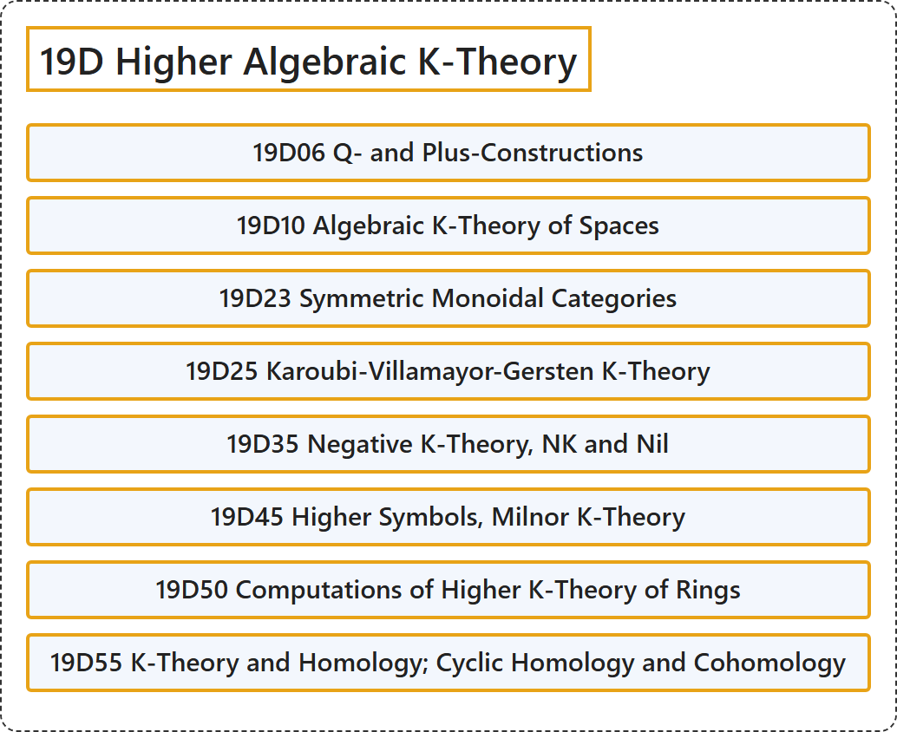

# 19D Higher Algebraic K-Theory

## Classification

## Glossary

| Term | Definition | 中文翻译 | Source |
|---|---|---|---|
| **19D Higher Algebraic K-Theory** 高阶代数 K 理论 | (No definition) | （无定义） | [Associate Editors of Mathematical Reviews and zbMATH, 2020](https://msc2020.org/) |
| **19D06 Q- and Plus-Constructions** Q构造与加构造 | (No definition) | （无定义） | [Associate Editors of Mathematical Reviews and zbMATH, 2020](https://msc2020.org/) |
| **19D10 Algebraic K-Theory of Spaces** 空间的代数K理论 | (No definition) | （无定义） | [Associate Editors of Mathematical Reviews and zbMATH, 2020](https://msc2020.org/) |
| **19D23 Symmetric Monoidal Categories** 对称幺半范畴 | (No definition) | （无定义） | [Associate Editors of Mathematical Reviews and zbMATH, 2020](https://msc2020.org/) |
| **19D25 Karoubi-Villamayor-Gersten K-Theory** 卡鲁比-维拉马约尔-格斯滕K理论 | (No definition) | （无定义） | [Associate Editors of Mathematical Reviews and zbMATH, 2020](https://msc2020.org/) |
| **19D35 Negative K-Theory, NK and Nil** 负K理论、NK与Nil | (No definition) | （无定义） | [Associate Editors of Mathematical Reviews and zbMATH, 2020](https://msc2020.org/) |
| **19D45 Higher Symbols, Milnor K-Theory** 高阶符号、米尔诺K理论 | (No definition) | （无定义） | [Associate Editors of Mathematical Reviews and zbMATH, 2020](https://msc2020.org/) |
| **19D50 Computations of Higher K-Theory of Rings** 环的高阶K理论的计算 | (No definition) | （无定义） | [Associate Editors of Mathematical Reviews and zbMATH, 2020](https://msc2020.org/) |
| **19D55 K-Theory and Homology; Cyclic Homology and Cohomology** K理论与同调；循环同调与上同调 | (No definition) | （无定义） | [Associate Editors of Mathematical Reviews and zbMATH, 2020](https://msc2020.org/) |

## References

Associate Editors of Mathematical Reviews and zbMATH. (2020). *MSC2020: Mathematics Subject Classification system*. Retrieved October 27, 2026, from <https://msc2020.org/>
