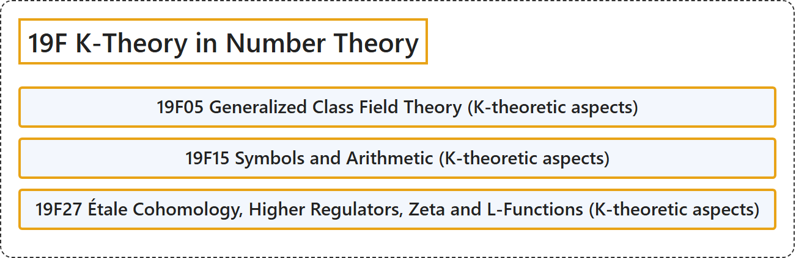

# 19F K-Theory in Number Theory

## Classification

## Glossary

| Term | Definition | 中文翻译 | Source |
|---|---|---|---|
| **19F K-Theory in Number Theory** 数论中的 K 理论 | (No definition) | （无定义） | [Associate Editors of Mathematical Reviews and zbMATH, 2020](https://msc2020.org/) |
| **19F05 Generalized Class Field Theory (K-theoretic aspects)** 广义类域论（K理论方面） | (No definition) | （无定义） | [Associate Editors of Mathematical Reviews and zbMATH, 2020](https://msc2020.org/) |
| **19F15 Symbols and Arithmetic (K-theoretic aspects)** 符号与算术（K理论方面） | (No definition) | （无定义） | [Associate Editors of Mathematical Reviews and zbMATH, 2020](https://msc2020.org/) |
| **19F27 Étale Cohomology, Higher Regulators, Zeta and L-Functions (K-theoretic aspects)** 平展上同调、高阶调节子、ζ函数与L函数（K理论方面） | (No definition) | （无定义） | [Associate Editors of Mathematical Reviews and zbMATH, 2020](https://msc2020.org/) |

## References

Associate Editors of Mathematical Reviews and zbMATH. (2020). *MSC2020: Mathematics Subject Classification system*. Retrieved October 27, 2026, from <https://msc2020.org/>
