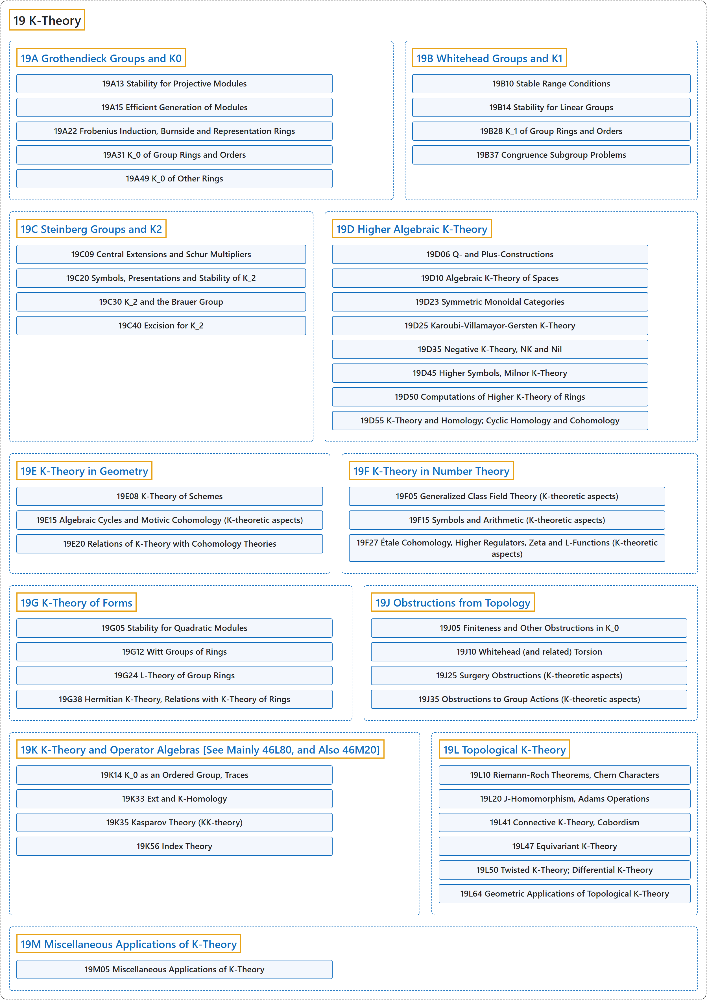

# 19 K-Theory

## Classification

## Glossary

| Term | Definition | 中文翻译 | Source |
|---|---|---|---|
| **19 K-Theory** K-理论 | "K-theory is a branch of mathematics which **brings together ideas from algebraic geometry, linear algebra, and number theory**." | K-理论是一个数学分支，它**把代数几何、线性代数和数论的思想结合在一起**。 | [Weisstein, n.d., "K-theory" entry, para. 1](https://mathworld.wolfram.com/K-Theory.html#:~:text=K%2Dtheory%20is%20a%20branch%20of%20mathematics%20which%20brings%20together%20ideas) |
| **[19A Grothendieck Groups and K0](19a-grothendieck-groups-and-k0.md)** 格罗滕迪克群与 K0 | (No definition) | （无定义） | [Associate Editors of Mathematical Reviews and zbMATH, 2020](https://msc2020.org/) |
| **[19B Whitehead Groups and K1](19b-whitehead-groups-and-k1.md)** 怀特黑德群与 K1 | (No definition) | （无定义） | [Associate Editors of Mathematical Reviews and zbMATH, 2020](https://msc2020.org/) |
| **[19C Steinberg Groups and K2](19c-steinberg-groups-and-k2.md)** 斯坦伯格群与 K2 | (No definition) | （无定义） | [Associate Editors of Mathematical Reviews and zbMATH, 2020](https://msc2020.org/) |
| **[19D Higher Algebraic K-Theory](19d-higher-algebraic-k-theory.md)** 高阶代数 K 理论 | (No definition) | （无定义） | [Associate Editors of Mathematical Reviews and zbMATH, 2020](https://msc2020.org/) |
| **[19E K-Theory in Geometry](19e-k-theory-in-geometry.md)** 几何中的 K 理论 | (No definition) | （无定义） | [Associate Editors of Mathematical Reviews and zbMATH, 2020](https://msc2020.org/) |
| **[19F K-Theory in Number Theory](19f-k-theory-in-number-theory.md)** 数论中的 K 理论 | (No definition) | （无定义） | [Associate Editors of Mathematical Reviews and zbMATH, 2020](https://msc2020.org/) |
| **[19G K-Theory of Forms](19g-k-theory-of-forms.md)** 型的 K 理论 | (No definition) | （无定义） | [Associate Editors of Mathematical Reviews and zbMATH, 2020](https://msc2020.org/) |
| **[19J Obstructions from Topology](19j-obstructions-from-topology.md)** 来自拓扑的障碍 | (No definition) | （无定义） | [Associate Editors of Mathematical Reviews and zbMATH, 2020](https://msc2020.org/) |
| **[19K K-Theory and Operator Algebras [See Mainly 46L80, and Also 46M20]](19k-k-theory-and-operator-algebras-see-mainly-46l80-and-also-46m.md)** K 理论与算子代数［主要见 46L80，另见 46M20］ | (No definition) | （无定义） | [Associate Editors of Mathematical Reviews and zbMATH, 2020](https://msc2020.org/) |
| **[19L Topological K-Theory](19l-topological-k-theory.md)** 拓扑 K 理论 | (No definition) | （无定义） | [Associate Editors of Mathematical Reviews and zbMATH, 2020](https://msc2020.org/) |
| **[19M Miscellaneous Applications of K-Theory](19m-miscellaneous-applications-of-k-theory.md)** K 理论的杂项应用 | (No definition) | （无定义） | [Associate Editors of Mathematical Reviews and zbMATH, 2020](https://msc2020.org/) |

## References

Associate Editors of Mathematical Reviews and zbMATH. (2020). *MSC2020: Mathematics Subject Classification system*. Retrieved October 27, 2026, from <https://msc2020.org/>

Weisstein, E. W. (n.d.). *K-theory*. MathWorld: A Wolfram Resource. Retrieved October 27, 2026, from <https://mathworld.wolfram.com/K-Theory.html>
