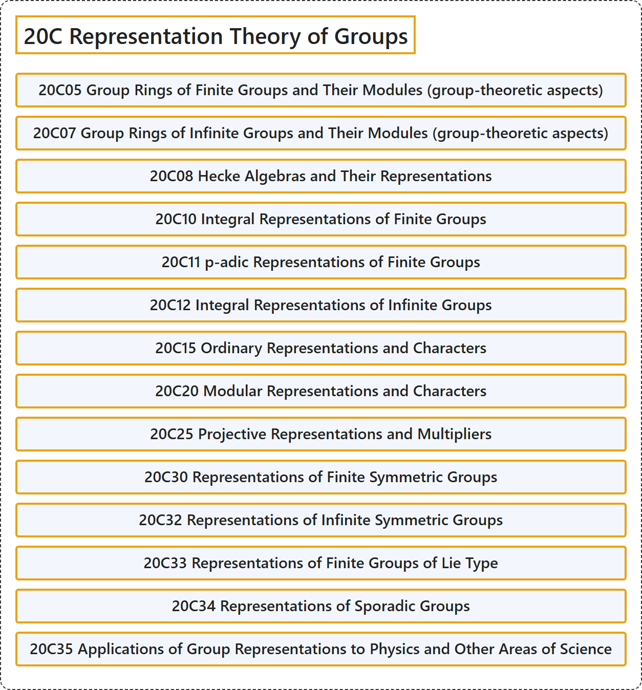

# 20C Representation Theory of Groups

## Classification

## Glossary

| Term | Definition | 中文翻译 | Source |
|---|---|---|---|
| **20C Representation Theory of Groups** 群的表示论 | (No definition) | （无定义） | [Associate Editors of Mathematical Reviews and zbMATH, 2020](https://msc2020.org/) |
| **20C05 Group Rings of Finite Groups and Their Modules (group-theoretic aspects)** 有限群的群环及其模（群论方面） | (No definition) | （无定义） | [Associate Editors of Mathematical Reviews and zbMATH, 2020](https://msc2020.org/) |
| **20C07 Group Rings of Infinite Groups and Their Modules (group-theoretic aspects)** 无限群的群环及其模（群论方面） | (No definition) | （无定义） | [Associate Editors of Mathematical Reviews and zbMATH, 2020](https://msc2020.org/) |
| **20C08 Hecke Algebras and Their Representations** 赫克代数及其表示 | (No definition) | （无定义） | [Associate Editors of Mathematical Reviews and zbMATH, 2020](https://msc2020.org/) |
| **20C10 Integral Representations of Finite Groups** 有限群的整表示 | (No definition) | （无定义） | [Associate Editors of Mathematical Reviews and zbMATH, 2020](https://msc2020.org/) |
| **20C11 p-adic Representations of Finite Groups** 有限群的p进表示 | (No definition) | （无定义） | [Associate Editors of Mathematical Reviews and zbMATH, 2020](https://msc2020.org/) |
| **20C12 Integral Representations of Infinite Groups** 无限群的整表示 | (No definition) | （无定义） | [Associate Editors of Mathematical Reviews and zbMATH, 2020](https://msc2020.org/) |
| **20C15 Ordinary Representations and Characters** 普通表示与特征标 | (No definition) | （无定义） | [Associate Editors of Mathematical Reviews and zbMATH, 2020](https://msc2020.org/) |
| **20C20 Modular Representations and Characters** 模表示与特征标 | (No definition) | （无定义） | [Associate Editors of Mathematical Reviews and zbMATH, 2020](https://msc2020.org/) |
| **20C25 Projective Representations and Multipliers** 射影表示与乘子 | (No definition) | （无定义） | [Associate Editors of Mathematical Reviews and zbMATH, 2020](https://msc2020.org/) |
| **20C30 Representations of Finite Symmetric Groups** 有限对称群的表示 | (No definition) | （无定义） | [Associate Editors of Mathematical Reviews and zbMATH, 2020](https://msc2020.org/) |
| **20C32 Representations of Infinite Symmetric Groups** 无限对称群的表示 | (No definition) | （无定义） | [Associate Editors of Mathematical Reviews and zbMATH, 2020](https://msc2020.org/) |
| **20C33 Representations of Finite Groups of Lie Type** 李型有限群的表示 | (No definition) | （无定义） | [Associate Editors of Mathematical Reviews and zbMATH, 2020](https://msc2020.org/) |
| **20C34 Representations of Sporadic Groups** 散在群的表示 | (No definition) | （无定义） | [Associate Editors of Mathematical Reviews and zbMATH, 2020](https://msc2020.org/) |
| **20C35 Applications of Group Representations to Physics and Other Areas of Science** 群表示在物理学及其他科学领域中的应用 | (No definition) | （无定义） | [Associate Editors of Mathematical Reviews and zbMATH, 2020](https://msc2020.org/) |

## References

Associate Editors of Mathematical Reviews and zbMATH. (2020). *MSC2020: Mathematics Subject Classification system*. Retrieved October 27, 2026, from <https://msc2020.org/>
