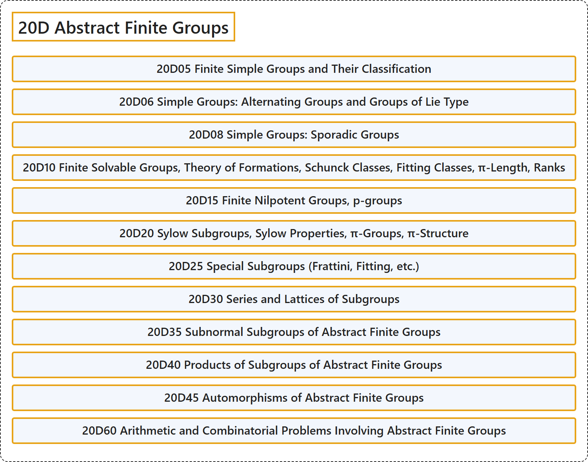

# 20D Abstract Finite Groups

## Classification

## Glossary

| Term | Definition | 中文翻译 | Source |
|---|---|---|---|
| **20D Abstract Finite Groups** 抽象有限群 | (No definition) | （无定义） | [Associate Editors of Mathematical Reviews and zbMATH, 2020](https://msc2020.org/) |
| **20D05 Finite Simple Groups and Their Classification** 有限单群及其分类 | (No definition) | （无定义） | [Associate Editors of Mathematical Reviews and zbMATH, 2020](https://msc2020.org/) |
| **20D06 Simple Groups: Alternating Groups and Groups of Lie Type** 单群：交错群与李型群 | (No definition) | （无定义） | [Associate Editors of Mathematical Reviews and zbMATH, 2020](https://msc2020.org/) |
| **20D08 Simple Groups: Sporadic Groups** 单群：散在群 | (No definition) | （无定义） | [Associate Editors of Mathematical Reviews and zbMATH, 2020](https://msc2020.org/) |
| **20D10 Finite Solvable Groups, Theory of Formations, Schunck Classes, Fitting Classes, π-Length, Ranks** 有限可解群、形成理论、舒克类、菲廷类、π长度、秩 | (No definition) | （无定义） | [Associate Editors of Mathematical Reviews and zbMATH, 2020](https://msc2020.org/) |
| **20D15 Finite Nilpotent Groups, p-groups** 有限幂零群、p群 | (No definition) | （无定义） | [Associate Editors of Mathematical Reviews and zbMATH, 2020](https://msc2020.org/) |
| **20D20 Sylow Subgroups, Sylow Properties, π-Groups, π-Structure** 西罗子群、西罗性质、π群、π结构 | (No definition) | （无定义） | [Associate Editors of Mathematical Reviews and zbMATH, 2020](https://msc2020.org/) |
| **20D25 Special Subgroups (Frattini, Fitting, etc.)** 特殊子群（弗拉蒂尼、菲廷等） | (No definition) | （无定义） | [Associate Editors of Mathematical Reviews and zbMATH, 2020](https://msc2020.org/) |
| **20D30 Series and Lattices of Subgroups** 子群的列与格 | (No definition) | （无定义） | [Associate Editors of Mathematical Reviews and zbMATH, 2020](https://msc2020.org/) |
| **20D35 Subnormal Subgroups of Abstract Finite Groups** 抽象有限群的次正规子群 | (No definition) | （无定义） | [Associate Editors of Mathematical Reviews and zbMATH, 2020](https://msc2020.org/) |
| **20D40 Products of Subgroups of Abstract Finite Groups** 抽象有限群的子群之积 | (No definition) | （无定义） | [Associate Editors of Mathematical Reviews and zbMATH, 2020](https://msc2020.org/) |
| **20D45 Automorphisms of Abstract Finite Groups** 抽象有限群的自同构 | (No definition) | （无定义） | [Associate Editors of Mathematical Reviews and zbMATH, 2020](https://msc2020.org/) |
| **20D60 Arithmetic and Combinatorial Problems Involving Abstract Finite Groups** 涉及抽象有限群的算术与组合问题 | (No definition) | （无定义） | [Associate Editors of Mathematical Reviews and zbMATH, 2020](https://msc2020.org/) |

## References

Associate Editors of Mathematical Reviews and zbMATH. (2020). *MSC2020: Mathematics Subject Classification system*. Retrieved October 27, 2026, from <https://msc2020.org/>
