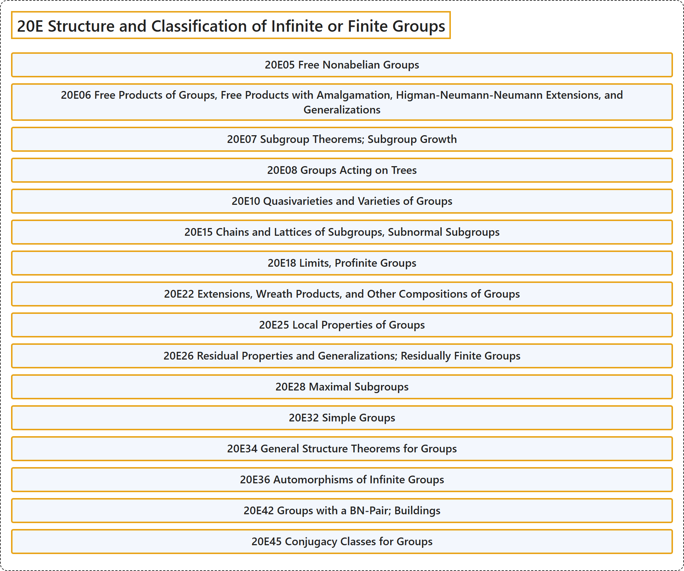

# 20E Structure and Classification of Infinite or Finite Groups

## Classification

## Glossary

| Term | Definition | 中文翻译 | Source |
|---|---|---|---|
| **20E Structure and Classification of Infinite or Finite Groups** 无限群或有限群的结构与分类 | (No definition) | （无定义） | [Associate Editors of Mathematical Reviews and zbMATH, 2020](https://msc2020.org/) |
| **20E05 Free Nonabelian Groups** 自由非阿贝尔群 | (No definition) | （无定义） | [Associate Editors of Mathematical Reviews and zbMATH, 2020](https://msc2020.org/) |
| **20E06 Free Products of Groups, Free Products with Amalgamation, Higman-Neumann-Neumann Extensions, and Generalizations** 群的自由积、带并合的自由积、希格曼-诺伊曼-诺伊曼扩张及其推广 | (No definition) | （无定义） | [Associate Editors of Mathematical Reviews and zbMATH, 2020](https://msc2020.org/) |
| **20E07 Subgroup Theorems; Subgroup Growth** 子群定理；子群增长 | (No definition) | （无定义） | [Associate Editors of Mathematical Reviews and zbMATH, 2020](https://msc2020.org/) |
| **20E08 Groups Acting on Trees** 作用在树上的群 | (No definition) | （无定义） | [Associate Editors of Mathematical Reviews and zbMATH, 2020](https://msc2020.org/) |
| **20E10 Quasivarieties and Varieties of Groups** 群的拟簇与簇 | (No definition) | （无定义） | [Associate Editors of Mathematical Reviews and zbMATH, 2020](https://msc2020.org/) |
| **20E15 Chains and Lattices of Subgroups, Subnormal Subgroups** 子群的链与格、次正规子群 | (No definition) | （无定义） | [Associate Editors of Mathematical Reviews and zbMATH, 2020](https://msc2020.org/) |
| **20E18 Limits, Profinite Groups** 极限、射有限群 | (No definition) | （无定义） | [Associate Editors of Mathematical Reviews and zbMATH, 2020](https://msc2020.org/) |
| **20E22 Extensions, Wreath Products, and Other Compositions of Groups** 扩张、圈积及群的其他合成 | (No definition) | （无定义） | [Associate Editors of Mathematical Reviews and zbMATH, 2020](https://msc2020.org/) |
| **20E25 Local Properties of Groups** 群的局部性质 | (No definition) | （无定义） | [Associate Editors of Mathematical Reviews and zbMATH, 2020](https://msc2020.org/) |
| **20E26 Residual Properties and Generalizations; Residually Finite Groups** 剩余性质及其推广；剩余有限群 | (No definition) | （无定义） | [Associate Editors of Mathematical Reviews and zbMATH, 2020](https://msc2020.org/) |
| **20E28 Maximal Subgroups** 极大子群 | (No definition) | （无定义） | [Associate Editors of Mathematical Reviews and zbMATH, 2020](https://msc2020.org/) |
| **20E32 Simple Groups** 单群 | (No definition) | （无定义） | [Associate Editors of Mathematical Reviews and zbMATH, 2020](https://msc2020.org/) |
| **20E34 General Structure Theorems for Groups** 群的一般结构定理 | (No definition) | （无定义） | [Associate Editors of Mathematical Reviews and zbMATH, 2020](https://msc2020.org/) |
| **20E36 Automorphisms of Infinite Groups** 无限群的自同构 | (No definition) | （无定义） | [Associate Editors of Mathematical Reviews and zbMATH, 2020](https://msc2020.org/) |
| **20E42 Groups with a BN-Pair; Buildings** 带BN对的群；建筑 | (No definition) | （无定义） | [Associate Editors of Mathematical Reviews and zbMATH, 2020](https://msc2020.org/) |
| **20E45 Conjugacy Classes for Groups** 群的共轭类 | (No definition) | （无定义） | [Associate Editors of Mathematical Reviews and zbMATH, 2020](https://msc2020.org/) |

## References

Associate Editors of Mathematical Reviews and zbMATH. (2020). *MSC2020: Mathematics Subject Classification system*. Retrieved October 27, 2026, from <https://msc2020.org/>
