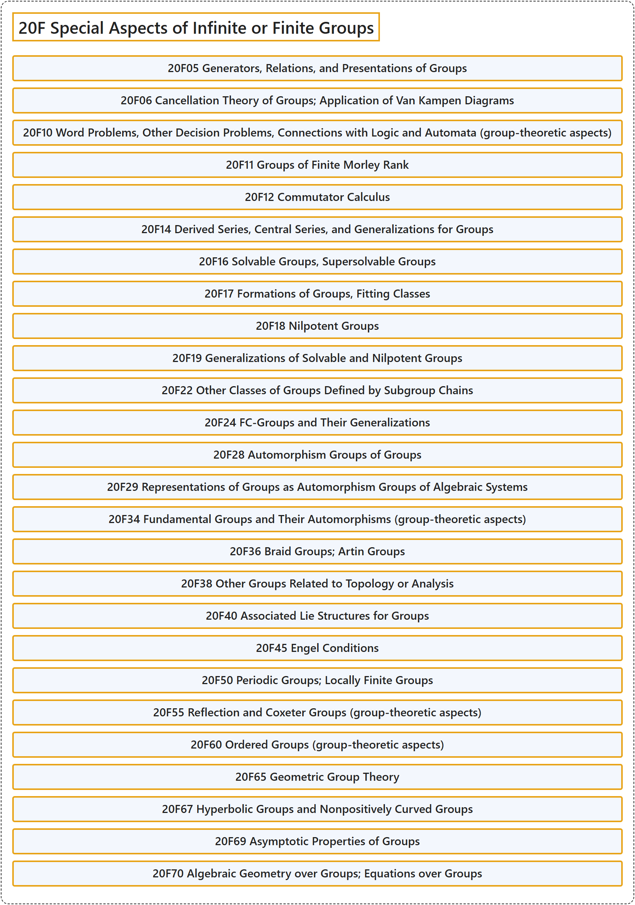

# 20F Special Aspects of Infinite or Finite Groups

## Classification

## Glossary

| Term | Definition | 中文翻译 | Source |
|---|---|---|---|
| **20F Special Aspects of Infinite or Finite Groups** 无限群或有限群的特殊方面 | (No definition) | （无定义） | [Associate Editors of Mathematical Reviews and zbMATH, 2020](https://msc2020.org/) |
| **20F05 Generators, Relations, and Presentations of Groups** 群的生成元、关系与表现 | (No definition) | （无定义） | [Associate Editors of Mathematical Reviews and zbMATH, 2020](https://msc2020.org/) |
| **20F06 Cancellation Theory of Groups; Application of Van Kampen Diagrams** 群的消去理论；范坎彭图的应用 | (No definition) | （无定义） | [Associate Editors of Mathematical Reviews and zbMATH, 2020](https://msc2020.org/) |
| **20F10 Word Problems, Other Decision Problems, Connections with Logic and Automata (group-theoretic aspects)** 字问题、其他判定问题、与逻辑和自动机的联系（群论方面） | (No definition) | （无定义） | [Associate Editors of Mathematical Reviews and zbMATH, 2020](https://msc2020.org/) |
| **20F11 Groups of Finite Morley Rank** 有限莫利秩群 | (No definition) | （无定义） | [Associate Editors of Mathematical Reviews and zbMATH, 2020](https://msc2020.org/) |
| **20F12 Commutator Calculus** 换位子演算 | (No definition) | （无定义） | [Associate Editors of Mathematical Reviews and zbMATH, 2020](https://msc2020.org/) |
| **20F14 Derived Series, Central Series, and Generalizations for Groups** 群的导出列、中心列及其推广 | (No definition) | （无定义） | [Associate Editors of Mathematical Reviews and zbMATH, 2020](https://msc2020.org/) |
| **20F16 Solvable Groups, Supersolvable Groups** 可解群、超可解群 | (No definition) | （无定义） | [Associate Editors of Mathematical Reviews and zbMATH, 2020](https://msc2020.org/) |
| **20F17 Formations of Groups, Fitting Classes** 群的形成、菲廷类 | (No definition) | （无定义） | [Associate Editors of Mathematical Reviews and zbMATH, 2020](https://msc2020.org/) |
| **20F18 Nilpotent Groups** 幂零群 | (No definition) | （无定义） | [Associate Editors of Mathematical Reviews and zbMATH, 2020](https://msc2020.org/) |
| **20F19 Generalizations of Solvable and Nilpotent Groups** 可解群与幂零群的推广 | (No definition) | （无定义） | [Associate Editors of Mathematical Reviews and zbMATH, 2020](https://msc2020.org/) |
| **20F22 Other Classes of Groups Defined by Subgroup Chains** 由子群链定义的其他群类 | (No definition) | （无定义） | [Associate Editors of Mathematical Reviews and zbMATH, 2020](https://msc2020.org/) |
| **20F24 FC-Groups and Their Generalizations** FC群及其推广 | (No definition) | （无定义） | [Associate Editors of Mathematical Reviews and zbMATH, 2020](https://msc2020.org/) |
| **20F28 Automorphism Groups of Groups** 群的自同构群 | (No definition) | （无定义） | [Associate Editors of Mathematical Reviews and zbMATH, 2020](https://msc2020.org/) |
| **20F29 Representations of Groups as Automorphism Groups of Algebraic Systems** 群作为代数系统自同构群的表示 | (No definition) | （无定义） | [Associate Editors of Mathematical Reviews and zbMATH, 2020](https://msc2020.org/) |
| **20F34 Fundamental Groups and Their Automorphisms (group-theoretic aspects)** 基本群及其自同构（群论方面） | (No definition) | （无定义） | [Associate Editors of Mathematical Reviews and zbMATH, 2020](https://msc2020.org/) |
| **20F36 Braid Groups; Artin Groups** 辫群；阿廷群 | (No definition) | （无定义） | [Associate Editors of Mathematical Reviews and zbMATH, 2020](https://msc2020.org/) |
| **20F38 Other Groups Related to Topology or Analysis** 与拓扑或分析有关的其他群 | (No definition) | （无定义） | [Associate Editors of Mathematical Reviews and zbMATH, 2020](https://msc2020.org/) |
| **20F40 Associated Lie Structures for Groups** 群的相伴李结构 | (No definition) | （无定义） | [Associate Editors of Mathematical Reviews and zbMATH, 2020](https://msc2020.org/) |
| **20F45 Engel Conditions** 恩格尔条件 | (No definition) | （无定义） | [Associate Editors of Mathematical Reviews and zbMATH, 2020](https://msc2020.org/) |
| **20F50 Periodic Groups; Locally Finite Groups** 周期群；局部有限群 | (No definition) | （无定义） | [Associate Editors of Mathematical Reviews and zbMATH, 2020](https://msc2020.org/) |
| **20F55 Reflection and Coxeter Groups (group-theoretic aspects)** 反射群与考克斯特群（群论方面） | (No definition) | （无定义） | [Associate Editors of Mathematical Reviews and zbMATH, 2020](https://msc2020.org/) |
| **20F60 Ordered Groups (group-theoretic aspects)** 有序群（群论方面） | (No definition) | （无定义） | [Associate Editors of Mathematical Reviews and zbMATH, 2020](https://msc2020.org/) |
| **20F65 Geometric Group Theory** 几何群论 | (No definition) | （无定义） | [Associate Editors of Mathematical Reviews and zbMATH, 2020](https://msc2020.org/) |
| **20F67 Hyperbolic Groups and Nonpositively Curved Groups** 双曲群与非正曲率群 | (No definition) | （无定义） | [Associate Editors of Mathematical Reviews and zbMATH, 2020](https://msc2020.org/) |
| **20F69 Asymptotic Properties of Groups** 群的渐近性质 | (No definition) | （无定义） | [Associate Editors of Mathematical Reviews and zbMATH, 2020](https://msc2020.org/) |
| **20F70 Algebraic Geometry over Groups; Equations over Groups** 群上的代数几何；群上的方程 | (No definition) | （无定义） | [Associate Editors of Mathematical Reviews and zbMATH, 2020](https://msc2020.org/) |

## References

Associate Editors of Mathematical Reviews and zbMATH. (2020). *MSC2020: Mathematics Subject Classification system*. Retrieved October 27, 2026, from <https://msc2020.org/>
