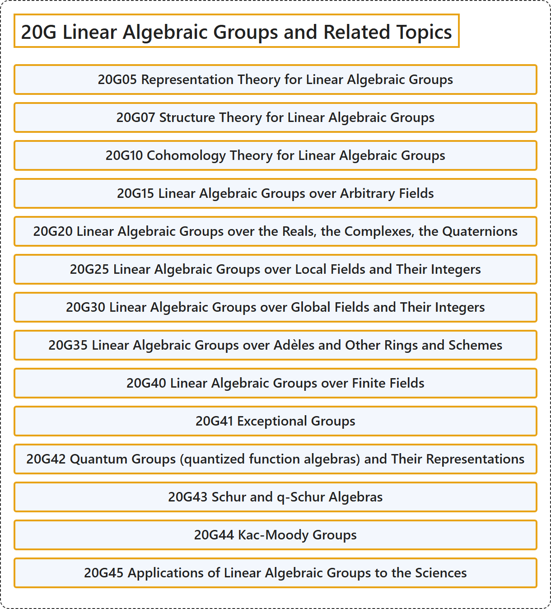

# 20G Linear Algebraic Groups and Related Topics

## Classification

## Glossary

| Term | Definition | 中文翻译 | Source |
|---|---|---|---|
| **20G Linear Algebraic Groups and Related Topics** 线性代数群及相关专题 | (No definition) | （无定义） | [Associate Editors of Mathematical Reviews and zbMATH, 2020](https://msc2020.org/) |
| **20G05 Representation Theory for Linear Algebraic Groups** 线性代数群的表示论 | (No definition) | （无定义） | [Associate Editors of Mathematical Reviews and zbMATH, 2020](https://msc2020.org/) |
| **20G07 Structure Theory for Linear Algebraic Groups** 线性代数群的结构理论 | (No definition) | （无定义） | [Associate Editors of Mathematical Reviews and zbMATH, 2020](https://msc2020.org/) |
| **20G10 Cohomology Theory for Linear Algebraic Groups** 线性代数群的上同调理论 | (No definition) | （无定义） | [Associate Editors of Mathematical Reviews and zbMATH, 2020](https://msc2020.org/) |
| **20G15 Linear Algebraic Groups over Arbitrary Fields** 任意域上的线性代数群 | (No definition) | （无定义） | [Associate Editors of Mathematical Reviews and zbMATH, 2020](https://msc2020.org/) |
| **20G20 Linear Algebraic Groups over the Reals, the Complexes, the Quaternions** 实数域、复数域、四元数上的线性代数群 | (No definition) | （无定义） | [Associate Editors of Mathematical Reviews and zbMATH, 2020](https://msc2020.org/) |
| **20G25 Linear Algebraic Groups over Local Fields and Their Integers** 局部域及其整数环上的线性代数群 | (No definition) | （无定义） | [Associate Editors of Mathematical Reviews and zbMATH, 2020](https://msc2020.org/) |
| **20G30 Linear Algebraic Groups over Global Fields and Their Integers** 整体域及其整数环上的线性代数群 | (No definition) | （无定义） | [Associate Editors of Mathematical Reviews and zbMATH, 2020](https://msc2020.org/) |
| **20G35 Linear Algebraic Groups over Adèles and Other Rings and Schemes** 阿代尔及其他环与概形上的线性代数群 | (No definition) | （无定义） | [Associate Editors of Mathematical Reviews and zbMATH, 2020](https://msc2020.org/) |
| **20G40 Linear Algebraic Groups over Finite Fields** 有限域上的线性代数群 | (No definition) | （无定义） | [Associate Editors of Mathematical Reviews and zbMATH, 2020](https://msc2020.org/) |
| **20G41 Exceptional Groups** 例外群 | (No definition) | （无定义） | [Associate Editors of Mathematical Reviews and zbMATH, 2020](https://msc2020.org/) |
| **20G42 Quantum Groups (quantized function algebras) and Their Representations** 量子群（量子化函数代数）及其表示 | (No definition) | （无定义） | [Associate Editors of Mathematical Reviews and zbMATH, 2020](https://msc2020.org/) |
| **20G43 Schur and q-Schur Algebras** 舒尔代数与q舒尔代数 | (No definition) | （无定义） | [Associate Editors of Mathematical Reviews and zbMATH, 2020](https://msc2020.org/) |
| **20G44 Kac-Moody Groups** 卡茨-穆迪群 | (No definition) | （无定义） | [Associate Editors of Mathematical Reviews and zbMATH, 2020](https://msc2020.org/) |
| **20G45 Applications of Linear Algebraic Groups to the Sciences** 线性代数群在科学中的应用 | (No definition) | （无定义） | [Associate Editors of Mathematical Reviews and zbMATH, 2020](https://msc2020.org/) |

## References

Associate Editors of Mathematical Reviews and zbMATH. (2020). *MSC2020: Mathematics Subject Classification system*. Retrieved October 27, 2026, from <https://msc2020.org/>
