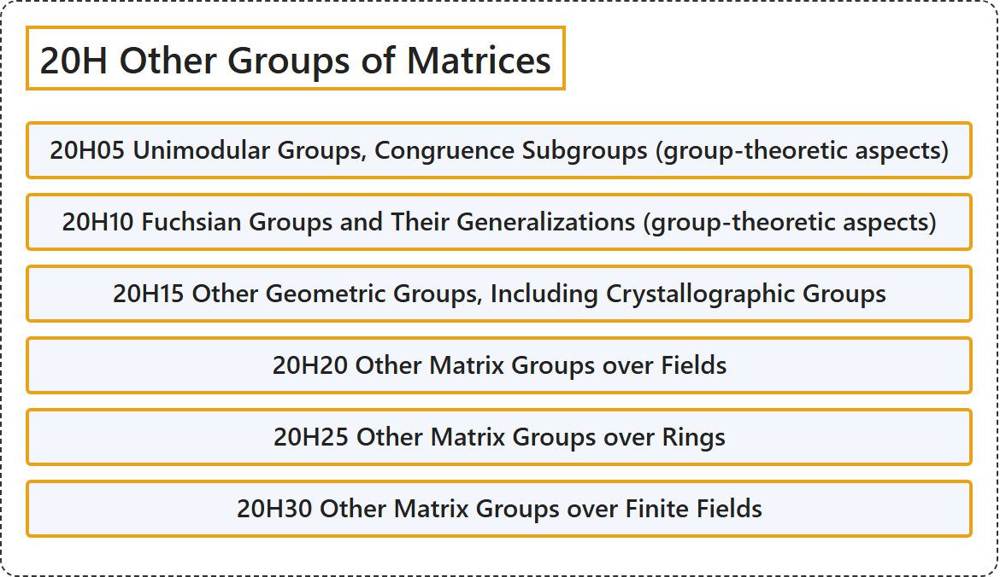

# 20H Other Groups of Matrices

## Classification

## Glossary

| Term | Definition | 中文翻译 | Source |
|---|---|---|---|
| **20H Other Groups of Matrices** 其他矩阵群 | (No definition) | （无定义） | [Associate Editors of Mathematical Reviews and zbMATH, 2020](https://msc2020.org/) |
| **20H05 Unimodular Groups, Congruence Subgroups (group-theoretic aspects)** 幺模群、同余子群（群论方面） | (No definition) | （无定义） | [Associate Editors of Mathematical Reviews and zbMATH, 2020](https://msc2020.org/) |
| **20H10 Fuchsian Groups and Their Generalizations (group-theoretic aspects)** 富克斯群及其推广（群论方面） | (No definition) | （无定义） | [Associate Editors of Mathematical Reviews and zbMATH, 2020](https://msc2020.org/) |
| **20H15 Other Geometric Groups, Including Crystallographic Groups** 其他几何群，包括晶体群 | (No definition) | （无定义） | [Associate Editors of Mathematical Reviews and zbMATH, 2020](https://msc2020.org/) |
| **20H20 Other Matrix Groups over Fields** 域上的其他矩阵群 | (No definition) | （无定义） | [Associate Editors of Mathematical Reviews and zbMATH, 2020](https://msc2020.org/) |
| **20H25 Other Matrix Groups over Rings** 环上的其他矩阵群 | (No definition) | （无定义） | [Associate Editors of Mathematical Reviews and zbMATH, 2020](https://msc2020.org/) |
| **20H30 Other Matrix Groups over Finite Fields** 有限域上的其他矩阵群 | (No definition) | （无定义） | [Associate Editors of Mathematical Reviews and zbMATH, 2020](https://msc2020.org/) |

## References

Associate Editors of Mathematical Reviews and zbMATH. (2020). *MSC2020: Mathematics Subject Classification system*. Retrieved October 27, 2026, from <https://msc2020.org/>
